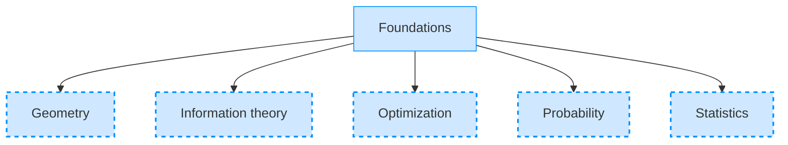
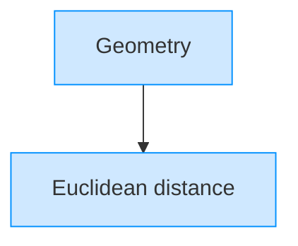
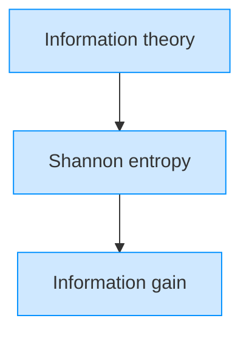
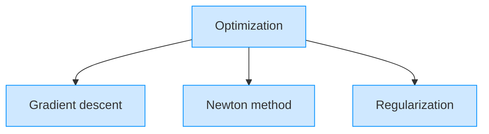
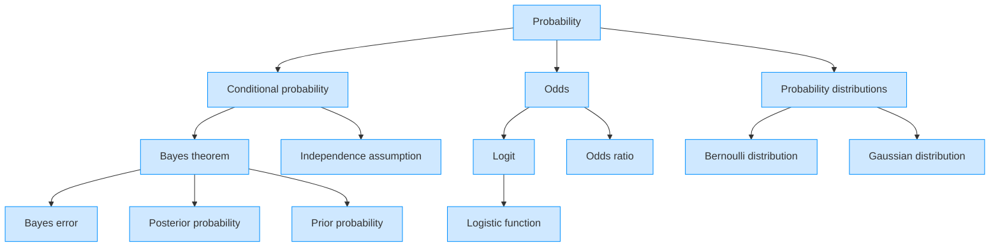
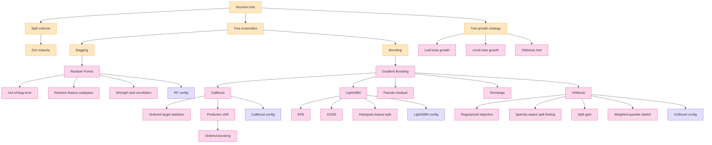

# Cây kiến thức — từ nền tảng đến triển khai

*Sinh tự động bởi `scripts/build_knowledge_tree.py` — đừng sửa tay. 127 khái niệm.*

Tầng: `L0` Nền tảng → `L1` Khái niệm ML → `L2` Họ mô hình → `L3` Thuật toán → `L4` Triển khai. Đây là cây **phân loại** (`up:`). Lộ trình học theo mô hình (`requires:`) nằm ở [[03 Model Paths]].

## 1. Cây đầy đủ

- [[Foundations]] `L0` — Nền tảng
    - [[Geometry]] `L0` — Hình học
        - [[Euclidean distance]] `L0` — Khoảng cách Euclid <small>(Cover Hart 1967)</small>
    - [[Information theory]] `L0` — Lý thuyết thông tin
        - [[Shannon entropy]] `L0` <small>(Maron 1961)</small>
            - [[Information gain]] `L0` — Độ lợi thông tin <small>(Maron 1961, Breiman 2001)</small>
    - [[Optimization]] `L0` — Tối ưu
        - [[Gradient descent]] `L0` — Hạ gradient <small>(Friedman 2001)</small>
        - [[Newton method]] `L0` — Phương pháp Newton <small>(Chen Guestrin 2016)</small>
        - [[Regularization]] `L0` — Điều chuẩn <small>(Chen Guestrin 2016)</small>
    - [[Probability]] `L0` — Xác suất
        - [[Conditional probability]] `L0` — Xác suất có điều kiện <small>(Cox 1958, Maron 1961)</small>
            - [[Bayes theorem]] `L0` — Định lý Bayes <small>(Maron 1961, Cover Hart 1967)</small>
                - [[Bayes error]] `L0` — Sai số Bayes <small>(Cover Hart 1967)</small>
                - [[Posterior probability]] `L0` — Xác suất hậu nghiệm <small>(Maron 1961)</small>
                - [[Prior probability]] `L0` — Xác suất tiên nghiệm <small>(Maron 1961)</small>
            - [[Independence assumption]] `L0` — Giả định độc lập <small>(Cox 1958, Maron 1961)</small>
        - [[Odds]] `L0` — Tỷ lệ cược <small>(Cox 1958)</small>
            - [[Logit]] `L0` <small>(Cox 1958)</small>
                - [[Logistic function]] `L0` — Hàm logistic <small>(Cox 1958)</small>
            - [[Odds ratio]] `L0` — Tỷ số odds <small>(Cox 1958)</small>
        - [[Probability distributions]] `L0` — Phân phối xác suất
            - [[Bernoulli distribution]] `L0` — Phân phối Bernoulli <small>(Cox 1958)</small>
            - [[Gaussian distribution]] `L0` — Phân phối chuẩn
    - [[Statistics]] `L0` — Thống kê
        - [[Contingency table]] `L0` — Bảng tiếp liên <small>(Cox 1958, Maron 1961)</small>
            - [[Empty cells and small counts]] `L0` — Ô rỗng và tần số nhỏ <small>(Cox 1958, Maron 1961)</small>
                - [[Smoothing]] `L1` — Làm trơn <small>(Maron 1961)</small>
        - [[Hypothesis testing]] `L0` — Kiểm định giả thuyết <small>(Cox 1958)</small>
            - [[Friedman test]] `L0` — Kiểm định Friedman
                - [[Nemenyi test]] `L0` — Kiểm định Nemenyi
                - [[Model comparison tests]] `L4` — Kiểm định so sánh mô hình
            - [[Holm correction]] `L0` — Hiệu chỉnh Holm
            - [[Statistical significance]] `L0` — Ý nghĩa thống kê <small>(Cox 1958, Maron 1961)</small>
            - [[Wilcoxon rank-sum test]] `L0` — Kiểm định tổng hạng Wilcoxon <small>(Cox 1958)</small>
            - [[Wilcoxon signed-rank test]] `L0` — Kiểm định Wilcoxon hạng có dấu
        - [[Likelihood]] `L0` — Hàm hợp lý <small>(Cox 1958, Maron 1961, Friedman 2001)</small>
            - [[Maximum likelihood]] `L0` — Ước lượng hợp lý cực đại <small>(Cox 1958)</small>
            - [[Sufficient statistic]] `L0` — Thống kê đủ <small>(Cox 1958)</small>
            - [[Log-loss]] `L1` — Hàm mất mát logistic <small>(Cox 1958, Friedman 2001, Chen Guestrin 2016)</small>
                - [[Log-loss gradient and Hessian]] `L1` — Gradient và Hessian của log-loss <small>(Friedman 2001, Chen Guestrin 2016)</small>
        - [[Parameter estimation]] `L0` — Ước lượng tham số <small>(Cox 1958, Maron 1961)</small>
            - [[Nuisance parameter]] `L0` — Tham số phiền nhiễu <small>(Cox 1958)</small>
        - [[Sample size]] `L0` — Cỡ mẫu <small>(Cox 1958, Maron 1961)</small>
        - [[Sampling]] `L0` — Lấy mẫu <small>(Breiman 2001, Ke 2017)</small>
            - [[Bootstrap]] `L0` — Lấy mẫu bootstrap <small>(Breiman 2001)</small>
        - [[Supervised learning]] `L1` — Học có giám sát
            - [[Binary outcome]] `L1` — Kết quả nhị phân <small>(Cox 1958, Maron 1961)</small>
                - [[Predicted probability]] `L1` — Xác suất dự đoán <small>(Cox 1958, Maron 1961)</small>
                    - [[Probability calibration]] `L1` — Hiệu chỉnh xác suất
                        - [[Calibration curve]] `L1` — Đường calibration
                    - [[Threshold selection]] `L4` — Chọn ngưỡng
            - [[Feature]] `L1` — Đặc trưng <small>(Cox 1958, Maron 1961, Breiman 2001)</small>
                - [[Categorical encoding]] `L1` — Mã hóa biến phân loại <small>(Prokhorenkova 2018, Dorogush 2018)</small>
                - [[Feature scaling]] `L1` — Chuẩn hóa thang đo
                - [[Feature selection]] `L1` — Chọn đặc trưng <small>(Maron 1961)</small>
                - [[Preprocessing B0-B1]] `L4` — Tiền xử lý
            - [[Generalization]] `L1` — Tổng quát hóa <small>(Breiman 2001)</small>
                - [[Bias-variance tradeoff]] `L1` — Đánh đổi bias – variance <small>(Breiman 2001, Friedman 2001)</small>
                - [[Learning curve]] `L1` — Đường học
                - [[Overfitting]] `L1` — Quá khớp <small>(Maron 1961, Breiman 2001, Ke 2017, Prokhorenkova 2018)</small>
                - [[Train-test split]] `L1` — Chia tập huấn luyện – kiểm tra <small>(Maron 1961)</small>
                    - [[Cross-validation]] `L1` — Kiểm định chéo
                        - [[CV scheme]] `L4` — Sơ đồ chia dữ liệu
                    - [[Data leakage]] `L1` — Rò rỉ dữ liệu <small>(Prokhorenkova 2018)</small>
            - [[Loss function]] `L1` — Hàm mất mát <small>(Friedman 2001)</small>
            - [[Model evaluation]] `L1` — Đánh giá mô hình
                - [[Brier score]] `L1` — Điểm Brier
                - [[Confusion matrix]] `L1` — Ma trận nhầm lẫn
                    - [[Accuracy]] `L1` — Độ chính xác tổng thể
                    - [[F1 score]] `L1` — Điểm F1
                    - [[Precision]] `L1` — Độ chính xác dương
                    - [[Recall]] `L1` — Độ nhạy
                    - [[Specificity]] `L1` — Độ đặc hiệu
                - [[PR curve]] `L1` — Đường precision–recall
                    - [[Average Precision]] `L1` — Độ chính xác trung bình
                - [[ROC curve]] `L1` — Đường ROC
                    - [[AUC]] `L1` — Diện tích dưới đường ROC
                        - [[Gini coefficient]] `L1` — Hệ số Gini
                    - [[KS statistic]] `L1` — Thống kê KS
                - [[Project metrics]] `L4` — Thước đo trong đồ án
            - [[Simplifying assumption]] `L1` — Giả định đơn giản hóa <small>(Cox 1958, Maron 1961)</small>
            - [[Decision tree]] `L2` — Cây quyết định <small>(Breiman 2001, Friedman 2001)</small>
                - [[Split criterion]] `L2` — Tiêu chí chia nút <small>(Breiman 2001, Chen Guestrin 2016)</small>
                    - [[Gini impurity]] `L2` — Độ vẩn đục Gini <small>(Breiman 2001)</small>
                - [[Tree ensembles]] `L2` — Tập hợp cây <small>(Breiman 2001, Friedman 2001)</small>
                    - [[Bagging]] `L2` <small>(Breiman 2001)</small>
                        - [[Random Forest]] `L3` — Rừng ngẫu nhiên <small>(Breiman 2001)</small>
                            - [[Out-of-bag error]] `L3` — Sai số ngoài túi <small>(Breiman 2001)</small>
                            - [[Random feature subspace]] `L3` — Chọn ngẫu nhiên đặc trưng <small>(Breiman 2001)</small>
                            - [[Strength and correlation]] `L3` — Độ mạnh và tương quan <small>(Breiman 2001)</small>
                            - [[RF config]] `L4` — Cấu hình RF
                    - [[Boosting]] `L2` — Tăng cường <small>(Friedman 2001)</small>
                        - [[Gradient Boosting]] `L3` <small>(Friedman 2001)</small>
                            - [[CatBoost]] `L3` <small>(Prokhorenkova 2018, Dorogush 2018)</small>
                                - [[Ordered target statistics]] `L3` <small>(Prokhorenkova 2018, Dorogush 2018)</small>
                                - [[Prediction shift]] `L3` — Dịch chuyển dự đoán <small>(Prokhorenkova 2018)</small>
                                    - [[Ordered boosting]] `L3` <small>(Prokhorenkova 2018)</small>
                                - [[CatBoost config]] `L4` — Cấu hình CatBoost
                            - [[LightGBM]] `L3` <small>(Ke 2017)</small>
                                - [[EFB]] `L3` <small>(Ke 2017)</small>
                                - [[GOSS]] `L3` <small>(Ke 2017)</small>
                                - [[Histogram-based split]] `L3` <small>(Ke 2017, Chen Guestrin 2016)</small>
                                - [[LightGBM config]] `L4` — Cấu hình LightGBM
                            - [[Pseudo-residual]] `L3` — Phần dư giả <small>(Friedman 2001)</small>
                            - [[Shrinkage]] `L3` — η <small>(Friedman 2001)</small>
                            - [[XGBoost]] `L3` <small>(Chen Guestrin 2016)</small>
                                - [[Regularized objective]] `L3` — Mục tiêu có điều chuẩn <small>(Chen Guestrin 2016)</small>
                                - [[Sparsity-aware split finding]] `L3` — Xử lý giá trị thiếu <small>(Chen Guestrin 2016)</small>
                                - [[Split gain]] `L3` <small>(Chen Guestrin 2016)</small>
                                - [[Weighted quantile sketch]] `L3` <small>(Chen Guestrin 2016)</small>
                                - [[XGBoost config]] `L4` — Cấu hình XGBoost
                - [[Tree growth strategy]] `L2` — Chiến lược phát triển cây <small>(Chen Guestrin 2016, Ke 2017, Prokhorenkova 2018)</small>
                    - [[Leaf-wise growth]] `L3` — Phát triển theo lá <small>(Ke 2017)</small>
                    - [[Level-wise growth]] `L3` — Phát triển theo tầng <small>(Chen Guestrin 2016)</small>
                    - [[Oblivious tree]] `L3` — Cây đối xứng <small>(Prokhorenkova 2018, Dorogush 2018)</small>
            - [[Distance-based models]] `L2` — Mô hình dựa trên khoảng cách <small>(Cover Hart 1967)</small>
                - [[KNN]] `L3` — k láng giềng gần nhất <small>(Cover Hart 1967)</small>
                    - [[Nearest neighbor error bound]] `L3` — Giới hạn sai số NN <small>(Cover Hart 1967)</small>
                    - [[KNN config]] `L4` — Cấu hình KNN
            - [[Generative models]] `L2` — Mô hình sinh <small>(Maron 1961)</small>
                - [[Naive Bayes]] `L3` — Bayes ngây thơ <small>(Maron 1961)</small>
                    - [[Naive Bayes formula]] `L3` — Công thức Naive Bayes <small>(Maron 1961)</small>
                    - [[NB config]] `L4` — Cấu hình NB
            - [[Linear probabilistic models]] `L2` — Mô hình tuyến tính xác suất <small>(Cox 1958)</small>
                - [[Logistic Regression]] `L3` — Hồi quy logistic <small>(Cox 1958)</small>
                    - [[LR config]] `L4` — Cấu hình LR

## 2. Sơ đồ theo nhánh

Khung nét đứt là nhánh được vẽ riêng ở sơ đồ khác.

### Foundations

### Geometry

### Information theory

### Optimization

### Probability

### Statistics

```mermaid
flowchart TD
    n0["Statistics"]
    n1["Contingency table"]
    n2["Empty cells and small counts"]
    n3["Smoothing"]
    n4["Hypothesis testing"]
    n5["Friedman test"]
    n6["Nemenyi test"]
    n7["Model comparison tests"]
    n8["Holm correction"]
    n9["Statistical significance"]
    n10["Wilcoxon rank-sum test"]
    n11["Wilcoxon signed-rank test"]
    n12["Likelihood"]
    n13["Maximum likelihood"]
    n14["Sufficient statistic"]
    n15["Log-loss"]
    n16["Log-loss gradient and Hessian"]
    n17["Parameter estimation"]
    n18["Nuisance parameter"]
    n19["Sample size"]
    n20["Sampling"]
    n21["Bootstrap"]
    n22["Supervised learning"]
    n0 --> n1
    n1 --> n2
    n2 --> n3
    n0 --> n4
    n4 --> n5
    n5 --> n6
    n5 --> n7
    n4 --> n8
    n4 --> n9
    n4 --> n10
    n4 --> n11
    n0 --> n12
    n12 --> n13
    n12 --> n14
    n12 --> n15
    n15 --> n16
    n0 --> n17
    n17 --> n18
    n0 --> n19
    n0 --> n20
    n20 --> n21
    n0 --> n22
    class n0,n1,n2,n4,n5,n6,n8,n9,n10,n11,n12,n13,n14,n17,n18,n19,n20,n21 L0
    class n3,n15,n16,n22 L1
    class n7 L4
    class n22 branch
    class n0,n1,n2,n3,n4,n5,n6,n7,n8,n9,n10,n11,n12,n13,n14,n15,n16,n17,n18,n19,n20,n21,n22 internal-link
    classDef L0 fill:#cfe8ff,stroke:#0090ff
    classDef L1 fill:#d3f4e0,stroke:#30a46c
    classDef L2 fill:#ffe7c2,stroke:#f5a623
    classDef L3 fill:#fcd6eb,stroke:#d6409f
    classDef L4 fill:#e4defc,stroke:#6e56cf
    classDef branch stroke-dasharray:5 5,stroke-width:2px
```

### Supervised learning

```mermaid
flowchart TD
    n0["Supervised learning"]
    n1["Binary outcome"]
    n2["Predicted probability"]
    n3["Probability calibration"]
    n4["Calibration curve"]
    n5["Threshold selection"]
    n6["Feature"]
    n7["Categorical encoding"]
    n8["Feature scaling"]
    n9["Feature selection"]
    n10["Preprocessing B0-B1"]
    n11["Generalization"]
    n12["Bias-variance tradeoff"]
    n13["Learning curve"]
    n14["Overfitting"]
    n15["Train-test split"]
    n16["Cross-validation"]
    n17["CV scheme"]
    n18["Data leakage"]
    n19["Loss function"]
    n20["Model evaluation"]
    n21["Brier score"]
    n22["Confusion matrix"]
    n23["Accuracy"]
    n24["F1 score"]
    n25["Precision"]
    n26["Recall"]
    n27["Specificity"]
    n28["PR curve"]
    n29["Average Precision"]
    n30["ROC curve"]
    n31["AUC"]
    n32["Gini coefficient"]
    n33["KS statistic"]
    n34["Project metrics"]
    n35["Simplifying assumption"]
    n36["Decision tree"]
    n37["Distance-based models"]
    n38["KNN"]
    n39["Nearest neighbor error bound"]
    n40["KNN config"]
    n41["Generative models"]
    n42["Naive Bayes"]
    n43["Naive Bayes formula"]
    n44["NB config"]
    n45["Linear probabilistic models"]
    n46["Logistic Regression"]
    n47["LR config"]
    n0 --> n1
    n1 --> n2
    n2 --> n3
    n3 --> n4
    n2 --> n5
    n0 --> n6
    n6 --> n7
    n6 --> n8
    n6 --> n9
    n6 --> n10
    n0 --> n11
    n11 --> n12
    n11 --> n13
    n11 --> n14
    n11 --> n15
    n15 --> n16
    n16 --> n17
    n15 --> n18
    n0 --> n19
    n0 --> n20
    n20 --> n21
    n20 --> n22
    n22 --> n23
    n22 --> n24
    n22 --> n25
    n22 --> n26
    n22 --> n27
    n20 --> n28
    n28 --> n29
    n20 --> n30
    n30 --> n31
    n31 --> n32
    n30 --> n33
    n20 --> n34
    n0 --> n35
    n0 --> n36
    n0 --> n37
    n37 --> n38
    n38 --> n39
    n38 --> n40
    n0 --> n41
    n41 --> n42
    n42 --> n43
    n42 --> n44
    n0 --> n45
    n45 --> n46
    n46 --> n47
    class n0,n1,n2,n3,n4,n6,n7,n8,n9,n11,n12,n13,n14,n15,n16,n18,n19,n20,n21,n22,n23,n24,n25,n26,n27,n28,n29,n30,n31,n32,n33,n35 L1
    class n36,n37,n41,n45 L2
    class n38,n39,n42,n43,n46 L3
    class n5,n10,n17,n34,n40,n44,n47 L4
    class n36 branch
    class n0,n1,n2,n3,n4,n5,n6,n7,n8,n9,n10,n11,n12,n13,n14,n15,n16,n17,n18,n19,n20,n21,n22,n23,n24,n25,n26,n27,n28,n29,n30,n31,n32,n33,n34,n35,n36,n37,n38,n39,n40,n41,n42,n43,n44,n45,n46,n47 internal-link
    classDef L0 fill:#cfe8ff,stroke:#0090ff
    classDef L1 fill:#d3f4e0,stroke:#30a46c
    classDef L2 fill:#ffe7c2,stroke:#f5a623
    classDef L3 fill:#fcd6eb,stroke:#d6409f
    classDef L4 fill:#e4defc,stroke:#6e56cf
    classDef branch stroke-dasharray:5 5,stroke-width:2px
```

### Decision tree

## 3. Đường đi từ gốc đến triển khai

- [[Foundations]] › [[Statistics]] › [[Hypothesis testing]] › [[Friedman test]] › [[Model comparison tests]]
- [[Foundations]] › [[Statistics]] › [[Supervised learning]] › [[Binary outcome]] › [[Predicted probability]] › [[Threshold selection]]
- [[Foundations]] › [[Statistics]] › [[Supervised learning]] › [[Decision tree]] › [[Tree ensembles]] › [[Bagging]] › [[Random Forest]] › [[RF config]]
- [[Foundations]] › [[Statistics]] › [[Supervised learning]] › [[Decision tree]] › [[Tree ensembles]] › [[Boosting]] › [[Gradient Boosting]] › [[CatBoost]] › [[CatBoost config]]
- [[Foundations]] › [[Statistics]] › [[Supervised learning]] › [[Decision tree]] › [[Tree ensembles]] › [[Boosting]] › [[Gradient Boosting]] › [[LightGBM]] › [[LightGBM config]]
- [[Foundations]] › [[Statistics]] › [[Supervised learning]] › [[Decision tree]] › [[Tree ensembles]] › [[Boosting]] › [[Gradient Boosting]] › [[XGBoost]] › [[XGBoost config]]
- [[Foundations]] › [[Statistics]] › [[Supervised learning]] › [[Distance-based models]] › [[KNN]] › [[KNN config]]
- [[Foundations]] › [[Statistics]] › [[Supervised learning]] › [[Feature]] › [[Preprocessing B0-B1]]
- [[Foundations]] › [[Statistics]] › [[Supervised learning]] › [[Generalization]] › [[Train-test split]] › [[Cross-validation]] › [[CV scheme]]
- [[Foundations]] › [[Statistics]] › [[Supervised learning]] › [[Generative models]] › [[Naive Bayes]] › [[NB config]]
- [[Foundations]] › [[Statistics]] › [[Supervised learning]] › [[Linear probabilistic models]] › [[Logistic Regression]] › [[LR config]]
- [[Foundations]] › [[Statistics]] › [[Supervised learning]] › [[Model evaluation]] › [[Project metrics]]

## 4. Theo bài báo

- **[[Cox 1958]]** (25): [[Bernoulli distribution]] · [[Conditional probability]] · [[Contingency table]] · [[Empty cells and small counts]] · [[Hypothesis testing]] · [[Independence assumption]] · [[Likelihood]] · [[Logistic function]] · [[Logit]] · [[Maximum likelihood]] · [[Nuisance parameter]] · [[Odds]] · [[Odds ratio]] · [[Parameter estimation]] · [[Sample size]] · [[Statistical significance]] · [[Sufficient statistic]] · [[Wilcoxon rank-sum test]] · [[Binary outcome]] · [[Feature]] · [[Log-loss]] · [[Predicted probability]] · [[Simplifying assumption]] · [[Linear probabilistic models]] · [[Logistic Regression]]
- **[[Maron 1961]]** (24): [[Bayes theorem]] · [[Conditional probability]] · [[Contingency table]] · [[Empty cells and small counts]] · [[Independence assumption]] · [[Information gain]] · [[Likelihood]] · [[Parameter estimation]] · [[Posterior probability]] · [[Prior probability]] · [[Sample size]] · [[Shannon entropy]] · [[Statistical significance]] · [[Binary outcome]] · [[Feature]] · [[Feature selection]] · [[Overfitting]] · [[Predicted probability]] · [[Simplifying assumption]] · [[Smoothing]] · [[Train-test split]] · [[Generative models]] · [[Naive Bayes]] · [[Naive Bayes formula]]
- **[[Cover Hart 1967]]** (6): [[Bayes error]] · [[Bayes theorem]] · [[Euclidean distance]] · [[Distance-based models]] · [[KNN]] · [[Nearest neighbor error bound]]
- **[[Breiman 2001]]** (16): [[Bootstrap]] · [[Information gain]] · [[Sampling]] · [[Bias-variance tradeoff]] · [[Feature]] · [[Generalization]] · [[Overfitting]] · [[Bagging]] · [[Decision tree]] · [[Gini impurity]] · [[Split criterion]] · [[Tree ensembles]] · [[Out-of-bag error]] · [[Random feature subspace]] · [[Random Forest]] · [[Strength and correlation]]
- **[[Friedman 2001]]** (12): [[Gradient descent]] · [[Likelihood]] · [[Bias-variance tradeoff]] · [[Log-loss]] · [[Log-loss gradient and Hessian]] · [[Loss function]] · [[Boosting]] · [[Decision tree]] · [[Tree ensembles]] · [[Gradient Boosting]] · [[Pseudo-residual]] · [[Shrinkage]]
- **[[Chen Guestrin 2016]]** (13): [[Newton method]] · [[Regularization]] · [[Log-loss]] · [[Log-loss gradient and Hessian]] · [[Split criterion]] · [[Tree growth strategy]] · [[Histogram-based split]] · [[Level-wise growth]] · [[Regularized objective]] · [[Sparsity-aware split finding]] · [[Split gain]] · [[Weighted quantile sketch]] · [[XGBoost]]
- **[[Ke 2017]]** (8): [[Sampling]] · [[Overfitting]] · [[Tree growth strategy]] · [[EFB]] · [[GOSS]] · [[Histogram-based split]] · [[Leaf-wise growth]] · [[LightGBM]]
- **[[Dorogush 2018]]** (4): [[Categorical encoding]] · [[CatBoost]] · [[Oblivious tree]] · [[Ordered target statistics]]
- **[[Prokhorenkova 2018]]** (9): [[Categorical encoding]] · [[Data leakage]] · [[Overfitting]] · [[Tree growth strategy]] · [[CatBoost]] · [[Oblivious tree]] · [[Ordered boosting]] · [[Ordered target statistics]] · [[Prediction shift]]
