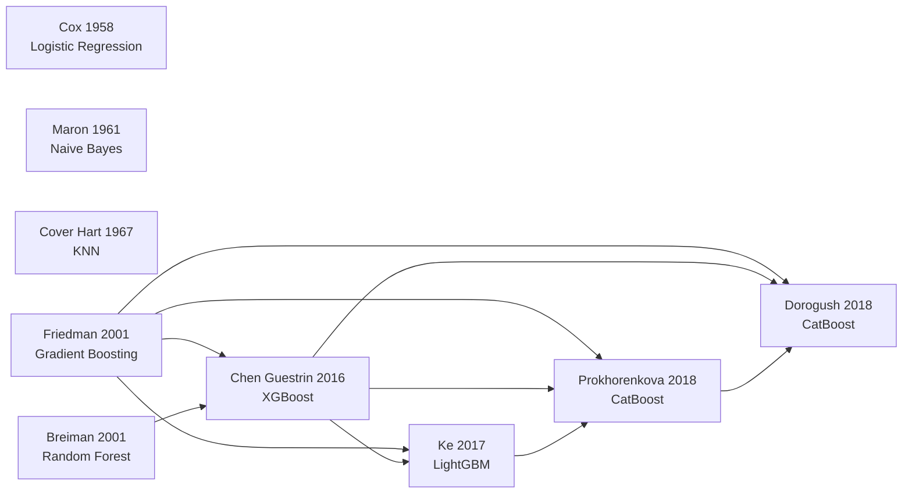
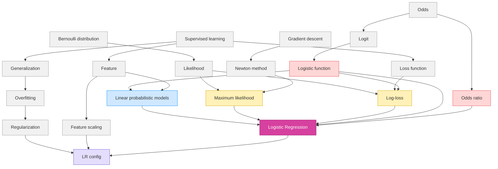
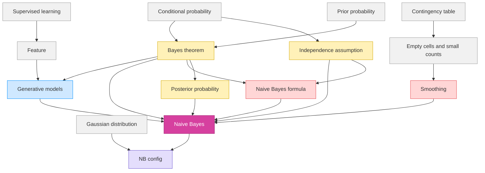
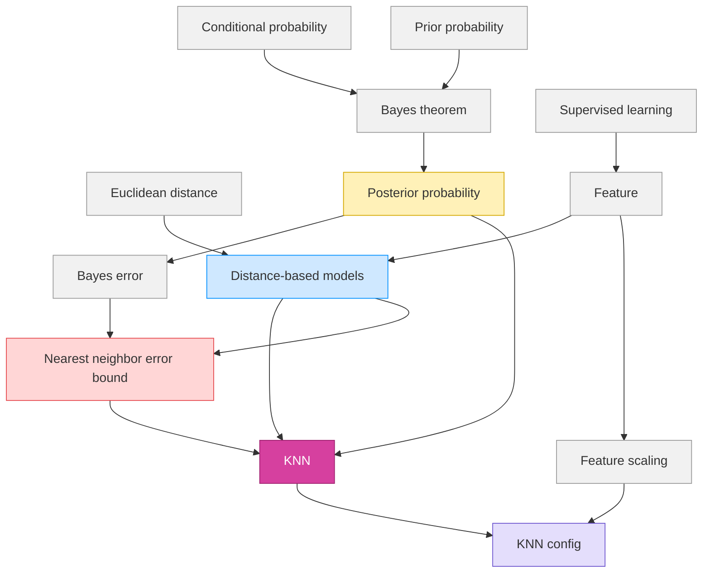
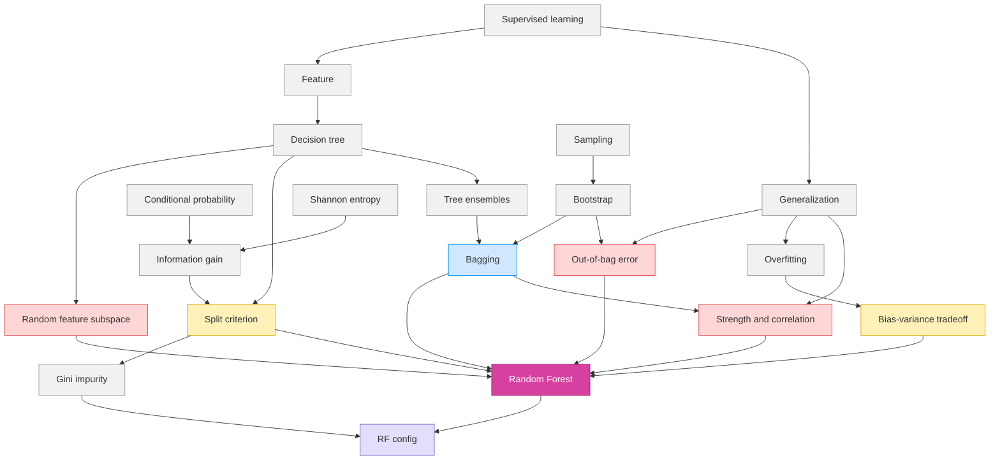
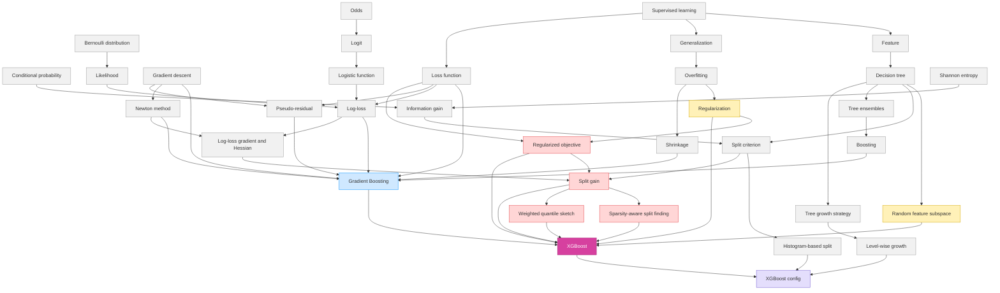
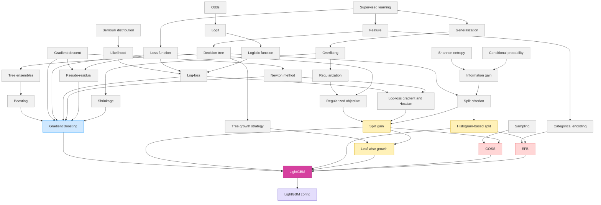
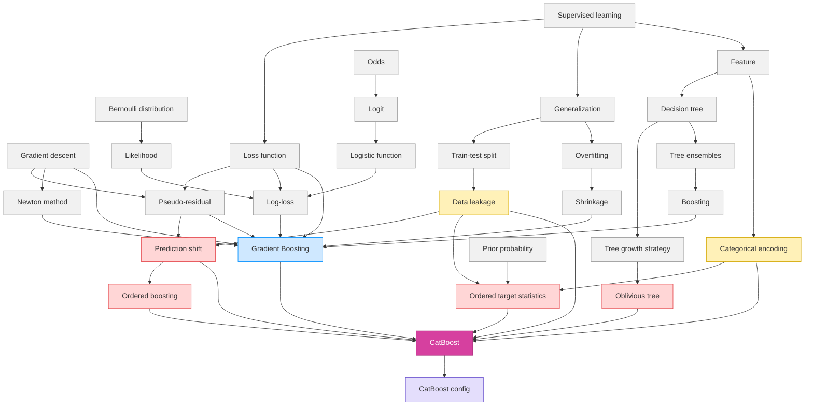

# Lộ trình theo mô hình — học xuôi và ngược

*Sinh tự động bởi `scripts/build_knowledge_tree.py` — đừng sửa tay.*

- **Ngược** (mô hình → nền tảng): mở ghi chú mô hình, xem *Lộ trình ngược*, hoặc đọc mục 3 dưới đây.
- **Xuôi** (nền tảng → mô hình): mở một khái niệm, xem *➡ Mở ra* và *🎯 Dùng trong mô hình*.
- Vai trò: ▫️ kiến thức trước · 🟦 nền · 🟨 kế thừa · 🟥 mới · 🎯 mô hình · ⚙️ đồ án.
- Mũi tên trong sơ đồ: A → B nghĩa là cần hiểu A trước B.

## 1. Bài báo kế thừa nhau thế nào

Mũi tên A → B: B trích dẫn A (lấy từ danh sách tài liệu tham khảo của B).

| Năm | Bài báo | Mô hình | Trích dẫn | Được trích bởi |
|---|---|---|---|---|
| 1958 | [[Cox 1958]] | [[Logistic Regression]] | — | — |
| 1961 | [[Maron 1961]] | [[Naive Bayes]] | — | — |
| 1967 | [[Cover Hart 1967]] | [[KNN]] | — | — |
| 2001 | [[Breiman 2001]] | [[Random Forest]] | — | [[Chen Guestrin 2016]] |
| 2001 | [[Friedman 2001]] | [[Gradient Boosting]] | — | [[Chen Guestrin 2016]] · [[Ke 2017]] · [[Dorogush 2018]] · [[Prokhorenkova 2018]] |
| 2016 | [[Chen Guestrin 2016]] | [[XGBoost]] | [[Friedman 2001]] · [[Breiman 2001]] | [[Ke 2017]] · [[Dorogush 2018]] · [[Prokhorenkova 2018]] |
| 2017 | [[Ke 2017]] | [[LightGBM]] | [[Friedman 2001]] · [[Chen Guestrin 2016]] | [[Prokhorenkova 2018]] |
| 2018 | [[Dorogush 2018]] | [[CatBoost]] | [[Friedman 2001]] · [[Chen Guestrin 2016]] · [[Prokhorenkova 2018]] | — |
| 2018 | [[Prokhorenkova 2018]] | [[CatBoost]] | [[Friedman 2001]] · [[Chen Guestrin 2016]] · [[Ke 2017]] | [[Dorogush 2018]] |

## 2. Kiến thức dùng chung giữa các mô hình

| Khái niệm                         | Tầng | Logistic Regression | Naive Bayes | KNN | Random Forest | XGBoost | LightGBM | CatBoost | Số mô hình |
| --------------------------------- | ---- | ------------------- | ----------- | --- | ------------- | ------- | -------- | -------- | ---------- |
| [[Feature]]                       | `L1` | ✓                   | ✓           | ✓   | ✓             | ✓       | ✓        | ✓        | 7          |
| [[Supervised learning]]           | `L1` | ✓                   | ✓           | ✓   | ✓             | ✓       | ✓        | ✓        | 7          |
| [[Conditional probability]]       | `L0` |                     | ✓           | ✓   | ✓             | ✓       | ✓        |          | 5          |
| [[Generalization]]                | `L1` | ✓                   |             |     | ✓             | ✓       | ✓        | ✓        | 5          |
| [[Overfitting]]                   | `L1` | ✓                   |             |     | ✓             | ✓       | ✓        | ✓        | 5          |
| [[Bernoulli distribution]]        | `L0` | ✓                   |             |     |               | ✓       | ✓        | ✓        | 4          |
| [[Gradient descent]]              | `L0` | ✓                   |             |     |               | ✓       | ✓        | ✓        | 4          |
| [[Likelihood]]                    | `L0` | ✓                   |             |     |               | ✓       | ✓        | ✓        | 4          |
| [[Logistic function]]             | `L0` | ✓                   |             |     |               | ✓       | ✓        | ✓        | 4          |
| [[Logit]]                         | `L0` | ✓                   |             |     |               | ✓       | ✓        | ✓        | 4          |
| [[Newton method]]                 | `L0` | ✓                   |             |     |               | ✓       | ✓        | ✓        | 4          |
| [[Odds]]                          | `L0` | ✓                   |             |     |               | ✓       | ✓        | ✓        | 4          |
| [[Log-loss]]                      | `L1` | ✓                   |             |     |               | ✓       | ✓        | ✓        | 4          |
| [[Loss function]]                 | `L1` | ✓                   |             |     |               | ✓       | ✓        | ✓        | 4          |
| [[Decision tree]]                 | `L2` |                     |             |     | ✓             | ✓       | ✓        | ✓        | 4          |
| [[Tree ensembles]]                | `L2` |                     |             |     | ✓             | ✓       | ✓        | ✓        | 4          |
| [[Information gain]]              | `L0` |                     |             |     | ✓             | ✓       | ✓        |          | 3          |
| [[Prior probability]]             | `L0` |                     | ✓           | ✓   |               |         |          | ✓        | 3          |
| [[Regularization]]                | `L0` | ✓                   |             |     |               | ✓       | ✓        |          | 3          |
| [[Shannon entropy]]               | `L0` |                     |             |     | ✓             | ✓       | ✓        |          | 3          |
| [[Boosting]]                      | `L2` |                     |             |     |               | ✓       | ✓        | ✓        | 3          |
| [[Split criterion]]               | `L2` |                     |             |     | ✓             | ✓       | ✓        |          | 3          |
| [[Tree growth strategy]]          | `L2` |                     |             |     |               | ✓       | ✓        | ✓        | 3          |
| [[Gradient Boosting]]             | `L3` |                     |             |     |               | ✓       | ✓        | ✓        | 3          |
| [[Pseudo-residual]]               | `L3` |                     |             |     |               | ✓       | ✓        | ✓        | 3          |
| [[Shrinkage]]                     | `L3` |                     |             |     |               | ✓       | ✓        | ✓        | 3          |
| [[Bayes theorem]]                 | `L0` |                     | ✓           | ✓   |               |         |          |          | 2          |
| [[Posterior probability]]         | `L0` |                     | ✓           | ✓   |               |         |          |          | 2          |
| [[Sampling]]                      | `L0` |                     |             |     | ✓             |         | ✓        |          | 2          |
| [[Categorical encoding]]          | `L1` |                     |             |     |               |         | ✓        | ✓        | 2          |
| [[Feature scaling]]               | `L1` | ✓                   |             | ✓   |               |         |          |          | 2          |
| [[Log-loss gradient and Hessian]] | `L1` |                     |             |     |               | ✓       | ✓        |          | 2          |
| [[Histogram-based split]]         | `L3` |                     |             |     |               | ✓       | ✓        |          | 2          |
| [[Random feature subspace]]       | `L3` |                     |             |     | ✓             | ✓       |          |          | 2          |
| [[Regularized objective]]         | `L3` |                     |             |     |               | ✓       | ✓        |          | 2          |
| [[Split gain]]                    | `L3` |                     |             |     |               | ✓       | ✓        |          | 2          |

## 3. Lộ trình ngược của từng mô hình

### [[Logistic Regression]]

*Hồi quy logistic dự đoán xác suất vỡ nợ thế nào?* — 20 bước. Nền: [[Linear probabilistic models]] · Kế thừa: [[Maximum likelihood]] · [[Log-loss]] · Mới: [[Logistic function]] · [[Odds ratio]]

[[Bernoulli distribution]] → [[Gradient descent]] → [[Likelihood]] → [[Newton method]] → [[Odds]] → [[Logit]] → [[Supervised learning]] → [[Feature]] → [[Feature scaling]] → [[Generalization]] → [[Loss function]] → [[Overfitting]] → [[Regularization]] → [[Maximum likelihood]] → [[Logistic function]] → [[Linear probabilistic models]] → [[Log-loss]] → [[Odds ratio]] → [[Logistic Regression]] → [[LR config]]

### [[Naive Bayes]]

*Naive Bayes kết hợp xác suất của từng đặc trưng thế nào?* — 15 bước. Nền: [[Generative models]] · Kế thừa: [[Bayes theorem]] · [[Independence assumption]] · [[Posterior probability]] · Mới: [[Naive Bayes formula]] · [[Smoothing]]

[[Conditional probability]] → [[Contingency table]] → [[Empty cells and small counts]] → [[Gaussian distribution]] → [[Prior probability]] → [[Supervised learning]] → [[Feature]] → [[Bayes theorem]] → [[Generative models]] → [[Independence assumption]] → [[Posterior probability]] → [[Smoothing]] → [[Naive Bayes formula]] → [[Naive Bayes]] → [[NB config]]

### [[KNN]]

*KNN phân loại theo các láng giềng gần nhất thế nào?* — 13 bước. Nền: [[Distance-based models]] · Kế thừa: [[Posterior probability]] · Mới: [[Nearest neighbor error bound]]

[[Conditional probability]] → [[Euclidean distance]] → [[Prior probability]] → [[Bayes theorem]] → [[Supervised learning]] → [[Feature]] → [[Feature scaling]] → [[Distance-based models]] → [[Posterior probability]] → [[Bayes error]] → [[Nearest neighbor error bound]] → [[KNN]] → [[KNN config]]

### [[Random Forest]]

*Random Forest kết hợp các cây ngẫu nhiên thế nào?* — 20 bước. Nền: [[Bagging]] · Kế thừa: [[Split criterion]] · [[Bias-variance tradeoff]] · Mới: [[Random feature subspace]] · [[Out-of-bag error]] · [[Strength and correlation]]

[[Conditional probability]] → [[Sampling]] → [[Bootstrap]] → [[Shannon entropy]] → [[Information gain]] → [[Supervised learning]] → [[Feature]] → [[Generalization]] → [[Overfitting]] → [[Decision tree]] → [[Tree ensembles]] → [[Bagging]] → [[Bias-variance tradeoff]] → [[Split criterion]] → [[Gini impurity]] → [[Out-of-bag error]] → [[Random feature subspace]] → [[Strength and correlation]] → [[Random Forest]] → [[RF config]]

### [[XGBoost]]

*XGBoost thêm điều chuẩn và xấp xỉ bậc hai vào gradient boosting thế nào?* — 35 bước. Nền: [[Gradient Boosting]] · Kế thừa: [[Regularization]] · [[Random feature subspace]] · Mới: [[Regularized objective]] · [[Split gain]] · [[Weighted quantile sketch]] · [[Sparsity-aware split finding]]

[[Bernoulli distribution]] → [[Conditional probability]] → [[Gradient descent]] → [[Likelihood]] → [[Newton method]] → [[Odds]] → [[Logit]] → [[Logistic function]] → [[Shannon entropy]] → [[Information gain]] → [[Supervised learning]] → [[Feature]] → [[Generalization]] → [[Loss function]] → [[Log-loss]] → [[Log-loss gradient and Hessian]] → [[Overfitting]] → [[Decision tree]] → [[Split criterion]] → [[Tree ensembles]] → [[Boosting]] → [[Tree growth strategy]] → [[Histogram-based split]] → [[Level-wise growth]] → [[Pseudo-residual]] → [[Shrinkage]] → [[Gradient Boosting]] → [[Regularization]] → [[Random feature subspace]] → [[Regularized objective]] → [[Split gain]] → [[Sparsity-aware split finding]] → [[Weighted quantile sketch]] → [[XGBoost]] → [[XGBoost config]]

### [[LightGBM]]

*LightGBM làm gradient boosting nhanh hơn thế nào?* — 36 bước. Nền: [[Gradient Boosting]] · Kế thừa: [[Split gain]] · [[Histogram-based split]] · [[Leaf-wise growth]] · Mới: [[GOSS]] · [[EFB]]

[[Bernoulli distribution]] → [[Conditional probability]] → [[Gradient descent]] → [[Likelihood]] → [[Newton method]] → [[Odds]] → [[Logit]] → [[Logistic function]] → [[Sampling]] → [[Shannon entropy]] → [[Information gain]] → [[Supervised learning]] → [[Feature]] → [[Categorical encoding]] → [[Generalization]] → [[Loss function]] → [[Log-loss]] → [[Log-loss gradient and Hessian]] → [[Overfitting]] → [[Regularization]] → [[Decision tree]] → [[Split criterion]] → [[Tree ensembles]] → [[Boosting]] → [[Tree growth strategy]] → [[Pseudo-residual]] → [[Regularized objective]] → [[Shrinkage]] → [[Gradient Boosting]] → [[Histogram-based split]] → [[Split gain]] → [[Leaf-wise growth]] → [[EFB]] → [[GOSS]] → [[LightGBM]] → [[LightGBM config]]

### [[CatBoost]]

*CatBoost chống dịch chuyển dự đoán và xử lý biến phân loại thế nào?* — 30 bước. Nền: [[Gradient Boosting]] · Kế thừa: [[Categorical encoding]] · [[Data leakage]] · Mới: [[Prediction shift]] · [[Ordered boosting]] · [[Ordered target statistics]] · [[Oblivious tree]]

[[Bernoulli distribution]] → [[Gradient descent]] → [[Likelihood]] → [[Newton method]] → [[Odds]] → [[Logit]] → [[Logistic function]] → [[Prior probability]] → [[Supervised learning]] → [[Feature]] → [[Generalization]] → [[Loss function]] → [[Log-loss]] → [[Overfitting]] → [[Train-test split]] → [[Decision tree]] → [[Tree ensembles]] → [[Boosting]] → [[Tree growth strategy]] → [[Pseudo-residual]] → [[Shrinkage]] → [[Gradient Boosting]] → [[Categorical encoding]] → [[Data leakage]] → [[Oblivious tree]] → [[Ordered target statistics]] → [[Prediction shift]] → [[Ordered boosting]] → [[CatBoost]] → [[CatBoost config]]

