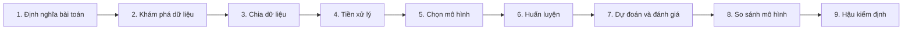

# BASIC KNOWLEDGE — Kiến thức nền theo từng bước xây dựng mô hình

Trang này đi theo một workflow hoàn chỉnh của bài toán chấm điểm tín dụng trong đồ án: từ định nghĩa bài toán tới so sánh và hậu kiểm định mô hình. Ở mỗi bước, trang liệt kê các khái niệm nền tảng trong `L0_Foundations` cần nắm, kèm lý do vì sao cần ở bước đó.

- Muốn đi sâu một mô hình cụ thể: xem [[03 Model Paths]].
- Muốn xem toàn bộ cây phân loại: xem [[00 Knowledge Tree]].
- Mỗi khái niệm có câu hỏi `question` và liên kết tới glossary của bài báo gốc trong chính ghi chú của nó.

---

## 1. Định nghĩa bài toán

Mỗi khoản vay có vector đặc trưng x và nhãn y ∈ {0, 1} (1 = vỡ nợ). Mô hình cần ước lượng p(x) = P(y = 1 | x), sau đó so với một ngưỡng để ra quyết định.

| Khái niệm                   | Vì sao cần ở bước này                                                  |
| --------------------------- | ---------------------------------------------------------------------- |
| [[Probability]]             | Đầu ra của mô hình là một xác suất, không phải một nhãn                |
| [[Bernoulli distribution]]  | Nhãn y chỉ có hai giá trị; đây là phân phối của y khi biết x           |
| [[Conditional probability]] | Đại lượng cần ước lượng là P(y = 1 \| x)                               |
| [[Prior probability]]       | Tỷ lệ vỡ nợ chung P(y = 1) — mức mất cân bằng nhãn của từng bộ dữ liệu |
| [[Odds]]                    | Cách nói khác của rủi ro: p / (1 − p); nền cho Logistic Regression     |

## 2. Khám phá dữ liệu

Tìm hiểu phân phối từng biến, quan hệ của biến với nhãn và các vấn đề chất lượng dữ liệu.

| Khái niệm | Vì sao cần ở bước này |
|---|---|
| [[Statistics]] | Thống kê mô tả: trung bình, phân vị, tỷ lệ thiếu |
| [[Probability distributions]] · [[Gaussian distribution]] | Biến liên tục có lệch, có ngoại lai không; Gaussian NB giả định phân phối chuẩn trong từng lớp |
| [[Contingency table]] | Bảng chéo biến phân loại × nhãn: tỷ lệ vỡ nợ theo từng hạng mục |
| [[Odds ratio]] | So sánh rủi ro giữa hai hạng mục, ví dụ "đã từng trễ hạn" và "chưa từng" |
| [[Empty cells and small counts]] | Hạng mục hiếm làm ước lượng không ổn định → tầng B.0 loại cột thưa |
| [[Sample size]] | Bộ nhỏ (South German, 1.000 dòng) và bộ lớn (Lending Club) cần cách đánh giá khác nhau |

## 3. Chia dữ liệu

Mô hình phải được đánh giá trên dữ liệu chưa thấy. Đồ án dùng 5-fold CV cho 6 bộ dữ liệu, lấy 20% tập train của mỗi fold làm validation; Lending Club được chia theo thời gian.

| Khái niệm | Vì sao cần ở bước này |
|---|---|
| [[Sampling]] | Tập train, validation, test là các mẫu phải đại diện cho tổng thể; với dữ liệu có thời gian thì test phải là giai đoạn sau |
| [[Sample size]] | Validation quá nhỏ cho kết quả dao động mạnh, như South German |
| [[Bootstrap]] | Lấy mẫu có hoàn lại; dùng lại ở bước 5 (Random Forest) và bước 8 (bootstrap ghép cặp) |

## 4. Tiền xử lý

Tầng B.1 gồm điền giá trị thiếu, mã hóa biến phân loại và chuẩn hóa cho nhóm classic ML. Mọi tham số tiền xử lý chỉ được học trên tập train.

| Khái niệm | Vì sao cần ở bước này |
|---|---|
| [[Geometry]] · [[Euclidean distance]] | KNN đo khoảng cách nên biến có thang lớn sẽ lấn át → phải chuẩn hóa; one-hot làm số chiều tăng |
| [[Statistics]] | Trung bình, độ lệch chuẩn, trung vị dùng để chuẩn hóa và điền giá trị thiếu; ngoại lai kéo lệch các con số này (GMSC) |
| [[Empty cells and small counts]] | Hạng mục hiếm sau one-hot thành cột gần như toàn 0 |

## 5. Chọn mô hình — hiểu giả định của từng mô hình

Mỗi mô hình đặt một giả định khác nhau về P(y = 1 | x). Hiểu giả định giúp giải thích vì sao mô hình thắng thay đổi giữa các bộ dữ liệu.

| Mô hình | Giả định | Khái niệm L0 |
|---|---|---|
| Logistic Regression | Log-odds tuyến tính theo x | [[Odds]] → [[Logit]] → [[Logistic function]]; diễn giải hệ số bằng [[Odds ratio]] |
| Naive Bayes | Các đặc trưng độc lập khi biết lớp | [[Bayes theorem]], [[Prior probability]], [[Posterior probability]], [[Independence assumption]], [[Gaussian distribution]] |
| KNN | Khách hàng gần nhau có rủi ro giống nhau | [[Euclidean distance]], [[Bayes error]] (KNN có sai số tối đa gấp đôi sai số Bayes khi n → ∞) |
| Random Forest | Chia vùng bằng cây, lấy trung bình nhiều cây | [[Shannon entropy]] → [[Information gain]] (tiêu chí tách), [[Bootstrap]] (bagging) |
| XGBoost / LightGBM / CatBoost | Cộng dồn các cây học trên phần dư | [[Information theory]] (tiêu chí tách), và các khái niệm tối ưu ở bước 6 |

## 6. Huấn luyện — ước lượng tham số

Huấn luyện là tìm tham số làm dữ liệu train "hợp lý" nhất, đồng thời không để mô hình học thuộc.

| Khái niệm                                         | Vì sao cần ở bước này                                                                                                                                |
| ------------------------------------------------- | ---------------------------------------------------------------------------------------------------------------------------------------------------- |
| [[Parameter estimation]]                          | Bài toán chung: từ dữ liệu suy ra tham số                                                                                                            |
| [[Likelihood]] → [[Maximum likelihood]]           | LR được học bằng cực đại hợp lý; log-loss chính là −log-likelihood của phân phối Bernoulli                                                           |
| [[Sufficient statistic]] · [[Nuisance parameter]] | Lý thuyết gốc của Cox (1958): dữ liệu được tóm gọn thế nào và cách loại bỏ hệ số chặn khi suy luận                                                   |
| [[Optimization]]                                  | Huấn luyện là cực tiểu một hàm mục tiêu                                                                                                              |
| [[Gradient descent]]                              | Gradient boosting là gradient descent trong không gian hàm: mỗi cây đi theo −gradient của loss                                                       |
| [[Newton method]]                                 | Solver `lbfgs` của LR là quasi-Newton; XGBoost, LightGBM và CatBoost dùng cả gradient và Hessian (bước Newton) để tính giá trị lá và độ lợi khi tách |
| [[Regularization]]                                | Phạt L2 trong LR (`C = 1`); λ trong XGBoost; `l2_leaf_reg` trong CatBoost                                                                            |

## 7. Dự đoán và đánh giá

Mô hình cho xác suất trên test. Đồ án đánh giá khả năng xếp hạng (AUC), chất lượng xác suất (Brier, LogLoss) và nhãn tại một ngưỡng (precision, recall, F1); định nghĩa chi tiết từng độ đo ở bước 9.

| Khái niệm | Vì sao cần ở bước này |
|---|---|
| [[Posterior probability]] | Đầu ra p(x) chính là xác suất hậu nghiệm của lớp xấu |
| [[Bayes error]] | Giới hạn dưới của sai số: không mô hình nào vượt qua được |
| [[Likelihood]] | LogLoss đo mức hợp lý của xác suất dự đoán trên test |
| [[Prior probability]] | Nhãn mất cân bằng nên accuracy gây hiểu lầm; ngưỡng tối đa F1 được chọn trên validation |

## 8. So sánh mô hình

Chênh lệch giữa các mô hình phải được kiểm định, vì 7 bộ dữ liệu là ít.

| Khái niệm | Vì sao cần ở bước này |
|---|---|
| [[Hypothesis testing]] · [[Statistical significance]] | Khung chung: giả thuyết "các mô hình như nhau", p-value |
| [[Friedman test]] | So sánh nhiều mô hình trên nhiều bộ dữ liệu bằng hạng trung bình (có hiệu chỉnh Iman–Davenport) |
| [[Nemenyi test]] | Kiểm định hậu nghiệm: critical difference giữa các hạng trung bình |
| [[Wilcoxon signed-rank test]] | So sánh từng cặp mô hình trên cùng các bộ dữ liệu |
| [[Holm correction]] | Hiệu chỉnh khi thực hiện nhiều phép so sánh |
| [[Bootstrap]] | Bootstrap ghép cặp (1.000 lần) chênh lệch AUC trên test của Lending Club |
| [[Sample size]] | Với 7 bộ, Wilcoxon có năng lực thấp: sau hiệu chỉnh Holm không cặp nào xuống dưới 0,05 |
| [[Wilcoxon rank-sum test]] | Phân biệt với bản hạng có dấu: bản tổng hạng so sánh hai mẫu độc lập (Cox, 1958), không dùng để so sánh mô hình |

## 9. Hậu kiểm định mô hình — các độ đo đánh giá

Sau khi huấn luyện và so sánh, cần kiểm tra lại mô hình từ nhiều góc: nhãn dự đoán tại một ngưỡng có đúng không, mô hình có xếp hạng rủi ro tốt không, xác suất có đáng tin không, và kết quả có ổn định, không overfit, không rò rỉ không. Lớp dương (positive) là **người vay xấu** (y = 1).

Ghi chú liên quan: [[Model evaluation]] · [[Project metrics]] · [[Threshold selection]].

### 9.1. Ma trận nhầm lẫn và các độ đo theo ngưỡng

Chọn ngưỡng t: dự đoán ŷ = 1 nếu p(x) ≥ t. Đối chiếu ŷ với y cho [[Confusion matrix|ma trận nhầm lẫn]], một [[Contingency table]] 2×2:

| | Dự đoán xấu (ŷ = 1) | Dự đoán tốt (ŷ = 0) |
|---|---|---|
| **Thực tế xấu (y = 1)** | TP — bắt đúng người xấu | FN — cho người xấu vay (mất vốn) |
| **Thực tế tốt (y = 0)** | FP — từ chối nhầm người tốt (mất khách) | TN — cho người tốt vay |

| Độ đo | Công thức | Ý nghĩa trong chấm điểm tín dụng |
|---|---|---|
| [[Accuracy]] | (TP + TN) / N | Tỷ lệ dự đoán đúng; **gây hiểu lầm khi nhãn mất cân bằng**: tỷ lệ xấu 7% thì đoán "tốt" cho tất cả đã đạt 93% ([[Prior probability]]) |
| [[Precision]] | TP / (TP + FP) | Trong số người bị gắn nhãn xấu, bao nhiêu thật sự xấu; precision thấp = từ chối nhầm nhiều khách tốt |
| [[Recall]] (TPR, sensitivity) | TP / (TP + FN) | Trong số người xấu thật, bắt được bao nhiêu; recall thấp = nhiều khoản vay xấu lọt qua |
| [[Specificity]] (TNR) | TN / (TN + FP) | Trong số người tốt, giữ lại được bao nhiêu |
| FPR (xem [[Specificity]]) | FP / (FP + TN) = 1 − Specificity | Tỷ lệ người tốt bị từ chối nhầm; trục hoành của ROC |
| [[F1 score]] | 2 · Precision · Recall / (Precision + Recall) | Trung bình điều hòa của precision và recall; cao chỉ khi cả hai cùng cao |

- Precision và recall là hai [[Conditional probability|xác suất có điều kiện]] theo hai chiều: P(y = 1 | ŷ = 1) và P(ŷ = 1 | y = 1).
- Giữa precision và recall luôn có đánh đổi: hạ ngưỡng thì recall tăng, precision giảm. Ngưỡng là quyết định kinh doanh (chi phí FN thường lớn hơn FP).
- Trong đồ án: ngưỡng được chọn để **tối đa F1 trên validation**, rồi áp nguyên sang test; không chọn ngưỡng trên test để tránh lạc quan quá mức ([[Data leakage]]).

### 9.2. Độ đo xếp hạng — không phụ thuộc ngưỡng

| Độ đo | Định nghĩa | Ý nghĩa |
|---|---|---|
| [[ROC curve]] | Đường (FPR, TPR) khi quét ngưỡng t từ 1 về 0 | Toàn bộ các đánh đổi bắt người xấu – từ chối nhầm người tốt mà mô hình có thể đạt được |
| [[AUC]] (ROC-AUC) | Diện tích dưới ROC = P(p(x_xấu) > p(x_tốt)) với một cặp xấu–tốt ngẫu nhiên | Khả năng xếp người xấu trên người tốt; 0,5 = đoán ngẫu nhiên, 1 = hoàn hảo. **Độ đo chính của đồ án** |
| [[Gini coefficient]] | 2 · AUC − 1 | Cách viết AUC quen thuộc trong ngành tín dụng; 0 = ngẫu nhiên |
| [[KS statistic]] (Kolmogorov–Smirnov) | max_t (TPR(t) − FPR(t)) | Khoảng cách lớn nhất giữa phân phối điểm của người xấu và người tốt; điểm trên ROC xa đường chéo nhất |
| [[PR curve]] | Đường (Recall, Precision) khi quét ngưỡng | Tập trung vào lớp thiểu số; nhạy hơn ROC khi tỷ lệ xấu rất thấp |
| [[Average Precision]] (AP) | Diện tích dưới PR curve (tổng có trọng số của precision theo mức tăng recall) | **Mức cơ sở bằng tỷ lệ xấu**, không phải 0,5; không so sánh được AP giữa các bộ có tỷ lệ xấu khác nhau |

- AUC tương đương thống kê Mann–Whitney, chính là [[Wilcoxon rank-sum test|kiểm định tổng hạng Wilcoxon]] chia cho n_xấu · n_tốt: so sánh hạng điểm của hai nhóm độc lập.
- Vì ngưỡng do chính sách quyết định và thay đổi theo thời gian, độ đo không phụ thuộc ngưỡng (AUC, Gini, KS) được dùng để xếp hạng mô hình.

### 9.3. Chất lượng xác suất

Với chấm điểm tín dụng, p(x) được dùng trực tiếp làm xác suất vỡ nợ (PD), nên xác suất phải đúng chứ không chỉ thứ hạng.

| Độ đo | Công thức | Ý nghĩa |
|---|---|---|
| [[Brier score]] | (1/N) Σ (p_i − y_i)² | Sai số bình phương của xác suất; càng nhỏ càng tốt |
| [[Log-loss]] | −(1/N) Σ [y_i log p_i + (1 − y_i) log(1 − p_i)] | −log-[[Likelihood]] của phân phối [[Bernoulli distribution\|Bernoulli]]; phạt nặng dự đoán tự tin mà sai |
| [[Calibration curve]] | Chia p(x) thành các nhóm, so trung bình p với tỷ lệ xấu thực tế trong nhóm | Điểm nằm trên đường chéo = xác suất đúng; dưới đường chéo = mô hình quá tự tin ([[Probability calibration]]) |

- Brier và LogLoss phụ thuộc tỷ lệ xấu của bộ dữ liệu, nên chỉ so sánh giữa các mô hình trên cùng một bộ.
- Mô hình có AUC cao vẫn có thể calibration kém (ví dụ RF với cây sâu cho xác suất sát 0 hoặc 1), và ngược lại.

### 9.4. Kiểm tra độ tin cậy của kết quả

| Kiểm tra        | Cách làm                                                                                                      | Khái niệm                                                         |
| --------------- | ------------------------------------------------------------------------------------------------------------- | ----------------------------------------------------------------- |
| Overfit         | So AUC train với AUC test/validation; khoảng cách lớn = học thuộc                                             | [[Overfitting]] · [[Generalization]] · [[Bias-variance tradeoff]] |
| [[Learning curve\|Learning curves]] | AUC theo tỷ lệ dữ liệu train: đường validation còn đi lên = thiếu dữ liệu; nằm ngang sớm = giới hạn ở mô hình | [[Bias-variance tradeoff]] · [[Sample size]]                      |
| Độ ổn định      | Độ lệch chuẩn của độ đo qua 5 fold; bộ nhỏ dao động mạnh                                                      | [[Cross-validation]] · [[Statistics]]                             |
| Khoảng tin cậy  | Bootstrap trên test để có khoảng tin cậy 95% cho AUC (Lending Club)                                           | [[Bootstrap]]                                                     |
| Rò rỉ dữ liệu   | AUC cao bất thường → kiểm tra biến chứa thông tin tương lai hoặc dấu vết của nhãn (giá trị thiếu ở HMEQ)      | [[Data leakage]]                                                  |

---

## Bảng tra ngược: khái niệm L0 → bước sử dụng

| Khái niệm | Bước |
|---|---|
| [[Bayes error]] | 5, 7 |
| [[Bayes theorem]] | 5 |
| [[Bernoulli distribution]] | 1, 9 |
| [[Bootstrap]] | 3, 5, 8, 9 |
| [[Conditional probability]] | 1, 9 |
| [[Contingency table]] | 2, 9 |
| [[Empty cells and small counts]] | 2, 4 |
| [[Euclidean distance]] | 4, 5 |
| [[Friedman test]] | 8 |
| [[Gaussian distribution]] | 2, 5 |
| [[Geometry]] | 4 |
| [[Gradient descent]] | 6 |
| [[Holm correction]] | 8 |
| [[Hypothesis testing]] | 8 |
| [[Independence assumption]] | 5 |
| [[Information gain]] | 5 |
| [[Information theory]] | 5 |
| [[Likelihood]] | 6, 7, 9 |
| [[Logistic function]] | 5 |
| [[Logit]] | 5 |
| [[Maximum likelihood]] | 6 |
| [[Nemenyi test]] | 8 |
| [[Newton method]] | 6 |
| [[Nuisance parameter]] | 6 |
| [[Odds]] | 1, 5 |
| [[Odds ratio]] | 2, 5 |
| [[Optimization]] | 6 |
| [[Parameter estimation]] | 6 |
| [[Posterior probability]] | 5, 7 |
| [[Prior probability]] | 1, 5, 7, 9 |
| [[Probability]] | 1 |
| [[Probability distributions]] | 2 |
| [[Regularization]] | 6 |
| [[Sample size]] | 2, 3, 8, 9 |
| [[Sampling]] | 3 |
| [[Shannon entropy]] | 5 |
| [[Statistical significance]] | 8 |
| [[Statistics]] | 2, 4, 9 |
| [[Sufficient statistic]] | 6 |
| [[Wilcoxon rank-sum test]] | 8, 9 |
| [[Wilcoxon signed-rank test]] | 8 |
