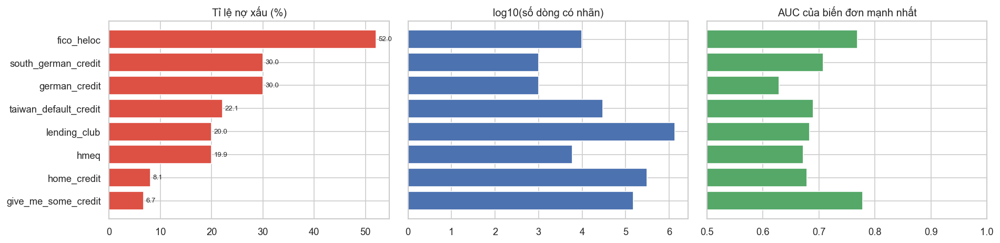
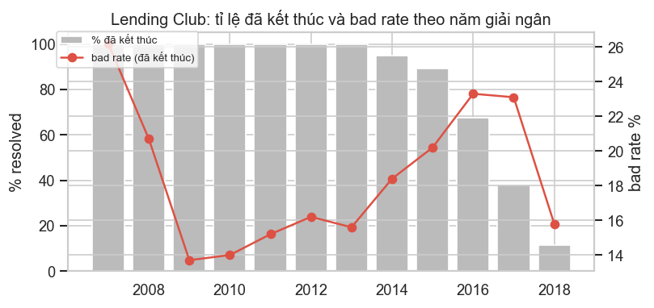
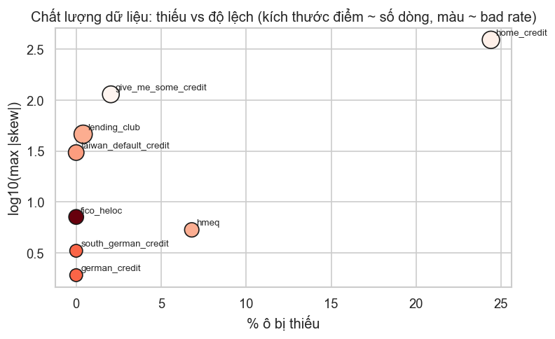

# Báo cáo dữ liệu — Project 2 (v2)

Báo cáo tổng hợp kết quả tiền xử lý và phân tích khám phá (EDA) cho 8 bộ dữ liệu chấm điểm tín dụng.
Chi tiết từng bộ nằm trong `notebooks/eda_01 … eda_08`, bảng so sánh trong `notebooks/eda_00_comparison.ipynb`
và `reports/tables/eda_comparison.csv`.

---

## 1. Tiền xử lý

Mục tiêu của bước này chỉ là **đưa dữ liệu thô về dạng bảng thống nhất**, chưa làm sạch hay tạo đặc trưng
(script: `src/data/make_interim.py`, kết quả ở `data/interim/`).

| Bộ dữ liệu | Định dạng thô | Đầu ra | Ghi chú |
|---|---|---|---|
| HMEQ | ARFF | `hmeq.csv` | `?` → NaN |
| FICO HELOC | ARFF | `fico_heloc.csv` | giữ nguyên mã âm -7/-8/-9 |
| Taiwan Default | ARFF | `taiwan_default_credit.csv` | |
| Give Me Some Credit | ARFF | `give_me_some_credit.csv` | |
| German Credit (Statlog) | ARFF | `german_credit.csv` | giá trị phân loại dạng chữ |
| South German Credit | ASC (khoảng trắng) | `south_german_credit.csv` | đặt lại tên cột theo Grömping (2019) |
| Home Credit | 9 file CSV (~2,6 GB) | `home_credit/*.parquet` | 8 bảng, nén zstd |
| Lending Club | 2 file CSV.gz (~620 MB) | `lending_club/{accepted,rejected}.parquet` | bỏ 33 dòng tổng ở cuối file |

**Chuẩn hoá nhãn:** mọi bộ đều có cột `target` với **1 = xấu / vỡ nợ, 0 = tốt**; cột nhãn gốc bị loại để tránh rò rỉ.
Hai trường hợp cần chú ý:

- *South German Credit* mã hoá ngược (1 = tốt) → `target = 1 − credit_risk`.
- *Lending Club* không có nhãn sẵn: suy ra từ trạng thái khoản vay (`Charged Off`/`Default` → 1, `Fully Paid` → 0).
  Các khoản **chưa kết thúc** (Current, Late, In Grace Period — 40% tổng số) được giữ lại với `target` rỗng.

CSV dùng cho các bộ nhỏ (< 7 MB) để dễ mở; Parquet cho hai bộ lớn vì giảm dung lượng ~4 lần, đọc nhanh theo cột
và giữ được kiểu dữ liệu.

---

## 2. Tổng quan

| Bộ dữ liệu | Số dòng có nhãn | Số đặc trưng | Bad rate | Tỉ lệ tốt:xấu | % ô thiếu | Biến số lệch mạnh (\|skew\|>2) | max \|skew\| |
|---|---:|---:|---:|---:|---:|---:|---:|
| FICO HELOC | 9.871 | 23 | **52,0%** | 0,9 | 0 (*) | 6/23 | 7 |
| German Credit | 1.000 | 20 | 30,0% | 2,3 | 0 | 0/6 | 2 |
| South German Credit | 1.000 | 20 | 30,0% | 2,3 | 0 | 1/17 | 3 |
| Taiwan Default | 30.000 | 24 | 22,1% | 3,5 | 0 | 12/23 | 30 |
| Lending Club (đã kết thúc) | 1.348.099 | 151 | 20,0% | 4,0 | cao (**) | — | 46 |
| HMEQ | 5.960 | 12 | 20,0% | 4,0 | 6,8 | 6/10 | 5 |
| Home Credit | 307.511 | 121 | **8,1%** | 11,4 | 24,4 | 45/73 | 392 |
| Give Me Some Credit | 150.000 | 10 | **6,7%** | 14,0 | 2,0 | 7/10 | 114 |

(*) FICO không có NaN nhưng dùng mã âm thay cho giá trị thiếu (≈ 58% số dòng có ít nhất một mã -7).
(**) 44/152 cột thiếu > 50%; trong 22 biến tại thời điểm vay được phân tích, tỉ lệ thiếu chỉ ~0,4%.

---

## 3. Tóm tắt từng bộ dữ liệu

### 3.1 HMEQ
- Bad rate 20%, mất cân bằng vừa.
- **Bất thường chính: giá trị thiếu mang thông tin rất mạnh.** Khi thiếu giá trị tài sản, 94% là nợ xấu; khi thiếu
  tỉ lệ nợ/thu nhập (21% số dòng), bad rate là 62% so với 9% khi có dữ liệu. Việc thiếu dường như gắn với quy trình
  xử lý hồ sơ nợ xấu → nguy cơ rò rỉ thông tin; mô hình có thể đạt điểm cao nhờ “đọc” việc thiếu chứ không phải hành vi
  của người vay.
- Các biến tiền tệ lệch phải vừa phải; các biến đếm sự kiện xấu tập trung ở 0 nhưng phân biệt tốt nhất.

### 3.2 FICO HELOC
- Bad rate 52% — **gần cân bằng một cách nhân tạo** (mẫu được chọn cho cuộc thi), không phản ánh tỉ lệ vỡ nợ thực.
  Xác suất dự đoán cần hiệu chỉnh nếu áp dụng thực tế.
- Không có NaN, nhưng có **missing ẩn** dưới dạng mã âm; nếu coi là số thực thì thống kê và mô hình tuyến tính bị sai lệch.
- Tín hiệu tập trung vào một điểm rủi ro tổng hợp bên ngoài (AUC đơn biến ≈ 0,77). Phân phối nhìn chung khá “hiền”.

### 3.3 Taiwan Default of Credit Card Clients
- Bad rate 22%.
- **Nhãn phụ thuộc gần như tuyệt đối vào trạng thái thanh toán tháng gần nhất:** bad rate ~13% nếu trả đúng hạn,
  ~34% nếu trễ 1 tháng, ~70% nếu trễ ≥ 2 tháng. Bài toán thực chất là dự báo ngắn hạn một tháng tới.
- Có mã không được mô tả trong tài liệu gốc (ở các biến trình độ học vấn, hôn nhân, trạng thái thanh toán).
- Các khoản thanh toán lệch cực mạnh (skew 10–30, kurtosis tới > 1.600); dư nợ có giá trị âm (~6% dòng).
  Nhóm biến dư nợ 6 tháng tương quan rất cao với nhau.

### 3.4 Give Me Some Credit
- **Mất cân bằng nặng nhất:** bad rate 6,7% (14:1).
- **Phân phối bất thường nhất trong các bộ nhỏ:** tỉ lệ sử dụng hạn mức (lẽ ra ≤ 1) lên tới ~50.000;
  debt ratio, thu nhập có skew ≈ 100 và kurtosis > 10⁴.
- **Mã lỗi 96/98** trong các biến đếm số lần trễ hạn (269 dòng, bad rate 55%); có người 0 tuổi; khi thiếu thu nhập
  (20%) thì debt ratio mang ý nghĩa khác (trung vị 1.159 thay vì 0,3).
- **Nhiễu nhãn:** 609 dòng trùng lặp, 37 nhóm có đặc trưng giống hệt nhưng nhãn khác nhau.

### 3.5 German Credit (Statlog) và 3.6 South German Credit
- Cùng 1.000 người vay, bad rate **đúng 30%** — tỉ lệ do *thiết kế lấy mẫu* (oversample người xấu), không phải tỉ lệ thực.
  Kèm ma trận chi phí 5:1 (nhận nhầm người xấu thành tốt đắt gấp 5 lần).
- Rất nhỏ, đa số biến phân loại, nhiều nhóm < 50 mẫu → kết quả đánh giá dao động mạnh.
- **Bản Statlog có quan hệ phản trực giác:** nhóm lịch sử tín dụng “xấu” lại có bad rate thấp nhất (~17%), nhóm “tốt”
  có bad rate cao nhất (~62%). Grömping (2019) chỉ ra đây là lỗi mã hoá; **bản South German đã sửa**, quan hệ trở nên
  hợp lý. Thông tin (và hiệu năng mô hình) như nhau — chỉ khác ở **khả năng diễn giải**.
- Không thiếu, không trùng, gần như không lệch.

### 3.7 Home Credit Default Risk
- Bad rate 8,1% (11:1), nhãn là **vỡ nợ sớm** (trễ hạn trong các kỳ đầu), không phải vỡ nợ cuối cùng.
- **Rộng và thưa nhất:** 24% ô bị thiếu, 41 cột thiếu > 50%; thiếu dữ liệu chỉ mang thông tin yếu.
- **Tín hiệu yếu và phân tán:** không biến đơn nào vượt AUC 0,68; mạnh nhất là các điểm tín dụng bên ngoài và tuổi
  (bad rate giảm từ 11,5% ở nhóm 20–30 tuổi xuống 4,9% ở nhóm 60–70).
- Giá trị bất thường: 18% hồ sơ có số ngày làm việc = 365.243 (mã cho người không đi làm; nhóm này bad rate *thấp hơn*);
  thu nhập max gấp ~800 lần trung vị (skew ≈ 390).
- **Cấu trúc quan hệ 7 bảng** (tới 27 triệu dòng) — bộ duy nhất cần tổng hợp dữ liệu lịch sử theo khách hàng.

### 3.8 Lending Club
- **Nhãn phải suy ra và 40% khoản vay chưa có kết cục.** Trên 1,35 triệu khoản đã kết thúc, bad rate 20%.
- **Nhãn phụ thuộc thời gian:** bad rate theo năm giải ngân dao động 14% → 23%; các năm 2017–2018 chỉ 11–38% khoản
  đã kết thúc nên mẫu có nhãn bị lệch về khoản vỡ nợ sớm / trả sớm. Kỳ hạn dài có bad rate gấp đôi kỳ hạn ngắn.

  

- **Rò rỉ nghiêm trọng:** nhiều cột chỉ có sau khi giải ngân (số tiền thu hồi, điểm tín dụng cập nhật sau cùng, cờ
  thoả thuận nợ…) cho AUC 0,84–0,94; một cờ trong số đó ⇒ 99,99% nợ xấu. Bắt buộc loại bỏ.
- **Thiên lệch chọn mẫu:** chỉ 5–15% hồ sơ được duyệt; hồ sơ bị từ chối có điểm rủi ro thấp hơn rõ. Nhãn chỉ đại diện
  cho người đã được cho vay.
- Nhãn gắn chặt với xếp hạng nội bộ (bad rate tăng đều từ ~6% hạng A đến ~50% hạng G) vì lãi suất được định giá từ rủi ro.

---

## 4. So sánh

### 4.1 Điểm giống nhau

1. **Cùng một bài toán:** phân loại nhị phân người vay tốt / xấu, trong đó “xấu” đều được định nghĩa qua **trễ hạn nghiêm
   trọng** (thường ≥ 90 ngày) hoặc vỡ nợ trong một cửa sổ quan sát. Sau chuẩn hoá, mọi bộ dùng chung quy ước `target = 1` là xấu.
2. **Lớp xấu luôn là lớp thiểu số** (trừ FICO): bad rate 7–30%. Do đó mọi bộ cần stratified split và đánh giá bằng
   AUC / PR-AUC thay vì accuracy.
3. **Lịch sử trễ hạn là tín hiệu mạnh nhất ở hầu hết các bộ:** số lần/mức độ trễ hạn trong quá khứ (HMEQ, Taiwan, GMSC,
   FICO) hoặc điểm tín dụng tổng hợp (FICO, Home Credit, Lending Club) luôn nằm trong nhóm biến có AUC đơn biến cao nhất.
   AUC của biến đơn mạnh nhất ở tất cả các bộ đều nằm trong khoảng hẹp **0,63–0,78** → không bộ nào có một biến
   “giải quyết” được bài toán, trừ khi có rò rỉ.
4. **Biến tiền tệ lệch phải:** thu nhập, dư nợ, số tiền vay, số tiền thanh toán ở mọi bộ đều có đuôi phải dài; biến đếm
   sự kiện xấu tập trung ở 0 (zero-inflated). Biến đổi log hoặc mô hình cây là lựa chọn tự nhiên.
5. **Dữ liệu “sạch” trên bề mặt nhưng có missing ẩn / mã đặc biệt:** mã âm (FICO), mã 96/98 (GMSC), mã 365.243 (Home Credit),
   mã không có trong tài liệu (Taiwan), giá trị -1/999 (Lending Club). Không bộ nào có thể dùng trực tiếp mà không kiểm tra mã.
6. **Tỉ lệ nhãn không phải tỉ lệ thực tế** ở nhiều bộ vì cách lấy mẫu (German, FICO) hoặc do chọn mẫu (Lending Club chỉ có
   khoản được duyệt) → xác suất dự đoán cần hiệu chỉnh trước khi dùng cho quyết định.

### 4.2 Điểm khác nhau

**a) Mức độ mất cân bằng nhãn** — chia thành ba nhóm rõ rệt:

| Nhóm | Bộ dữ liệu | Bad rate | Hệ quả |
|---|---|---|---|
| Cân bằng (nhân tạo) | FICO HELOC | 52% | Không cần xử lý mất cân bằng; nhưng xác suất không thực tế |
| Mất cân bằng vừa | German, South German, Taiwan, Lending Club, HMEQ | 20–30% | Stratify là đủ |
| Mất cân bằng nặng | Home Credit, Give Me Some Credit | 7–8% | Cần class weight, đánh giá bằng PR-AUC; accuracy vô nghĩa (93% nếu đoán tất cả “tốt”) |

**b) Bản chất nhãn**

- *Nhãn cố định do thiết kế:* German / South German (đúng 30%), FICO (≈ 50%).
- *Nhãn “tự nhiên” từ danh mục thực:* GMSC, Home Credit, Taiwan, HMEQ.
- *Nhãn phải suy ra và phụ thuộc thời gian:* chỉ Lending Club — bad rate thay đổi theo năm và bị kiểm duyệt (censoring) với
  các khoản còn đang chạy. Đây là bộ duy nhất cần chia train/test **theo thời gian**.
- *Cửa sổ dự báo khác nhau:* 1 tháng tới (Taiwan), các kỳ trả đầu tiên (Home Credit), 2 năm (GMSC, FICO), toàn bộ kỳ hạn
  (Lending Club). Vì vậy bad rate giữa các bộ **không so sánh trực tiếp được**.

**c) Mức độ lệch và giá trị ngoại lai**

- *Gần như không lệch:* German, South German (max |skew| ≤ 3), FICO (≤ 7).
- *Lệch vừa:* HMEQ (≈ 5).
- *Lệch cực đoan, có giá trị phi lý:* GMSC (skew > 100, tỉ lệ lẽ ra ≤ 1 lên tới 50.000), Home Credit (skew ≈ 390),
  Lending Club (thu nhập lệch mạnh, mã lỗi), Taiwan (khoản thanh toán skew ≈ 30).
  Điểm chung: độ lệch cực đoan xuất hiện ở **các bộ lớn thu thập tự động**, còn các bộ nhỏ được biên soạn kỹ thì gần chuẩn.

**d) Giá trị thiếu và ý nghĩa của nó**

- *Không thiếu:* German, South German, Taiwan (FICO không có NaN nhưng có mã thay thế).
- *Thiếu ít, không mang thông tin:* GMSC (2%), Lending Club (biến tại thời điểm vay).
- *Thiếu nhiều nhưng thông tin yếu:* Home Credit (24% ô, chênh lệch bad rate chỉ vài điểm %).
- *Thiếu ít nhưng thông tin cực mạnh:* **HMEQ** — điểm bất thường nhất: việc thiếu gần như tiết lộ nhãn.

**e) Rò rỉ thông tin (leakage)**

- *Nghiêm trọng:* Lending Club (biến sau giải ngân, AUC tới 0,94), HMEQ (qua mẫu thiếu dữ liệu).
- *Gần ranh giới:* Taiwan (trạng thái tháng gần nhất rất sát nhãn, nhưng hợp lệ về mặt thời gian).
- *Không phát hiện:* German, South German, FICO, GMSC, Home Credit (bảng chính).

**f) Chất lượng nhãn và độ tin cậy**

- *Nhiễu nhãn/trùng lặp:* GMSC (609 dòng trùng, 37 nhóm mâu thuẫn nhãn).
- *Lỗi ngữ nghĩa trong mã hoá:* German Statlog (đã được sửa ở South German).
- *Thiên lệch chọn mẫu:* Lending Club (chỉ người được duyệt), FICO (mẫu đã lọc).
- *Phương sai đánh giá cao do kích thước nhỏ:* German, South German (1.000), HMEQ (≈ 6.000).

**g) Cấu trúc và quy mô**

- Một bảng, nhỏ (1–10 nghìn dòng): German, South German, HMEQ, FICO.
- Một bảng, trung bình (30–150 nghìn): Taiwan, GMSC.
- Lớn, rộng: Lending Club (2,26 triệu × 151, kèm 27,6 triệu hồ sơ bị từ chối).
- Quan hệ nhiều bảng: Home Credit (7 bảng, tới 27 triệu dòng) — bộ duy nhất cần tổng hợp dữ liệu trước khi mô hình hoá.

---

## 5. Kết luận và khuyến nghị cho bước tiếp theo

| Vấn đề | Bộ dữ liệu | Hướng xử lý |
|---|---|---|
| Mất cân bằng nặng | GMSC, Home Credit | `class_weight` / `scale_pos_weight`, đánh giá PR-AUC, KS |
| Tỉ lệ nhãn nhân tạo | FICO, German, South German | hiệu chỉnh xác suất theo prior thực tế khi triển khai |
| Mã đặc biệt / missing ẩn | FICO, GMSC, Home Credit, Taiwan, Lending Club | đổi thành NaN + cờ chỉ báo |
| Lệch cực đoan, ngoại lai phi lý | GMSC, Home Credit, Taiwan, Lending Club | log-transform, winsorize, hoặc mô hình cây |
| Missing mang thông tin mạnh | HMEQ | giữ cờ missing nhưng báo cáo riêng hiệu năng có/không có cờ |
| Rò rỉ sau giải ngân | Lending Club | chỉ giữ biến có tại thời điểm nộp đơn |
| Nhãn phụ thuộc thời gian | Lending Club | chia train/test theo năm; loại khoản chưa kết thúc |
| Trùng lặp / nhiễu nhãn | GMSC | loại dòng trùng, xem xét nhóm mâu thuẫn |
| Dữ liệu nhỏ | German, South German, HMEQ | repeated stratified k-fold, báo cáo độ lệch chuẩn |
| Nhiều bảng | Home Credit | tổng hợp theo khách hàng trước khi ghép |

Nhìn chung, các bộ dữ liệu **giống nhau về bài toán và loại tín hiệu** (lịch sử trễ hạn, điểm tín dụng, gánh nặng nợ),
nhưng **khác nhau rõ về cách nhãn được tạo ra** (thiết kế lấy mẫu, danh mục tự nhiên, hay suy ra theo thời gian),
**mức mất cân bằng** (7% → 52%) và **chất lượng dữ liệu** (từ gần hoàn hảo ở German đến lệch cực đoan và rò rỉ ở GMSC,
HMEQ, Lending Club). Khi so sánh hiệu năng mô hình giữa các bộ, cần tính đến các khác biệt này thay vì so sánh trực tiếp
con số AUC.
