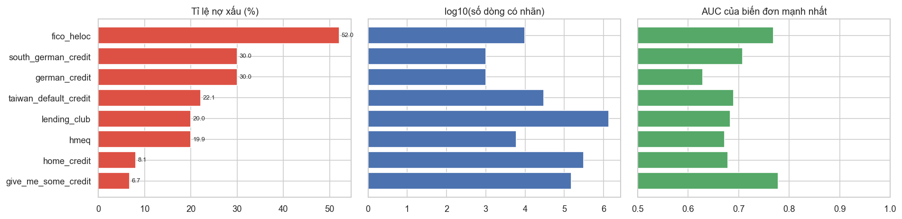
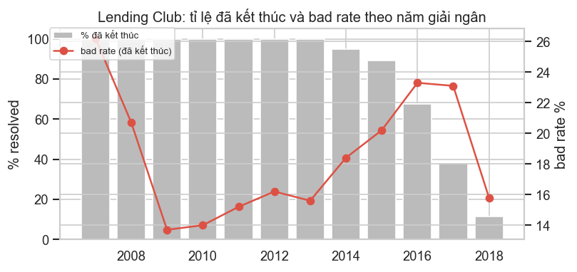

# 3. Dữ liệu

Chương này mô tả 7 bộ dữ liệu chấm điểm tín dụng dùng trong đồ án, đặc điểm của nhãn và chất lượng dữ liệu, cùng các bước khai báo dữ liệu (tầng A) trước khi chia. Phân tích khám phá chi tiết cho từng bộ nằm trong `notebooks/eda_*.ipynb` và [`report/data_report.md`](../data_report.md).

## 3.1. Các bộ dữ liệu

| Bộ dữ liệu | Nguồn | Đối tượng | Định nghĩa nhãn xấu (`target = 1`) |
|---|---|---|---|
| **Give Me Some Credit (GMSC)** | Kaggle 2011 | Khách hàng cá nhân | Quá hạn ≥ 90 ngày trong 2 năm tới |
| **Taiwan** | UCI (Yeh & Lien, 2009) | Chủ thẻ tín dụng tại Đài Loan, 04–09/2005 | Vỡ nợ ở tháng thanh toán kế tiếp |
| **Home Credit** | Kaggle 2018, bảng `application_train` | Khách hàng ít hoặc không có lịch sử tín dụng | Trễ hạn trong các kỳ trả nợ đầu tiên |
| **HMEQ** | SAS / Kaggle | Khoản vay thế chấp giá trị nhà | Vỡ nợ hoặc quá hạn nghiêm trọng |
| **South German** | UCI, bản hiệu chỉnh của Grömping (2019) | Người vay tại một ngân hàng Nam Đức | Rủi ro tín dụng xấu (mã gốc 0 → 1) |
| **FICO HELOC** | FICO Explainable ML Challenge, bản đã làm sạch | Người xin hạn mức vay thế chấp | Từng quá hạn ≥ 90 ngày trong 24 tháng |
| **Lending Club** | Kaggle, khoản vay được chấp nhận 2007–2018 | Khoản vay P2P tại Mỹ | `Charged Off` hoặc `Default` (khoản vay đã kết thúc) |

Đồ án dùng bản **South German** thay cho bản Statlog German gốc: hai bộ cùng 1.000 người vay và cùng tỷ lệ xấu 30%, nhưng bản Statlog có lỗi mã hóa ở biến lịch sử tín dụng (nhóm "đã trả hết" lại có tỷ lệ xấu cao nhất). Bản South German đã sửa lỗi này nên diễn giải hợp lý hơn.

Nhãn được chuẩn hóa về cùng một quy ước ở mọi bộ: **1 = xấu / vỡ nợ, 0 = tốt**.

## 3.2. Tổng quan sau khi khai báo

Số liệu dưới đây là sau tầng A (mục 3.4), tức đúng dữ liệu được đưa vào bước chia.

| Bộ dữ liệu | Số dòng | Biến số | Biến phân loại | Tỷ lệ xấu | Tỷ lệ tốt : xấu | Dòng thuộc nhóm trùng lặp |
|---|---:|---:|---:|---:|---:|---:|
| GMSC | 150.000 | 10 | 0 | 6,68% | 14,0 | 1.000 |
| Taiwan | 30.000 | 20 | 3 | 22,12% | 3,5 | 108 |
| Home Credit | 307.511 | 104 | 16 | 8,07% | 11,4 | 0 |
| HMEQ | 5.960 | 10 | 2 | 19,95% | 4,0 | 0 |
| South German | 1.000 | 3 | 17 | 30,00% | 2,3 | 0 |
| FICO HELOC | 9.871 | 21 | 2 | 52,03% | 0,9 | 2 |
| Lending Club | 545.779 | 92 | 9 | 14,07% | 6,1 | — |

Lending Club tính trên các khoản vay dùng cho train, validation và test (phát hành 2013–2015); chi tiết ở mục 3.5.

## 3.3. Đặc điểm của nhãn và chất lượng dữ liệu

### Mức mất cân bằng nhãn

| Nhóm | Bộ dữ liệu | Tỷ lệ xấu | Hệ quả |
|---|---|---|---|
| Gần cân bằng (nhân tạo) | FICO HELOC | 52% | Mẫu được chọn lọc cho cuộc thi; xác suất dự đoán không phản ánh tỷ lệ vỡ nợ thực |
| Mất cân bằng vừa | South German, Taiwan, HMEQ, Lending Club | 14–30% | Chia phân tầng là đủ |
| Mất cân bằng nặng | Home Credit, GMSC | 7–8% | Accuracy không có ý nghĩa (đoán "tốt" cho tất cả đã đạt 92–93%); cần AUC, AP |

Tỷ lệ 30% của South German là do **thiết kế lấy mẫu** (lấy dư người xấu), không phải tỷ lệ thực của ngân hàng. Tương tự, tỷ lệ 52% của HELOC là tỷ lệ nhân tạo.

### Các điểm bất thường chính

| Bộ dữ liệu | Bất thường | Ảnh hưởng |
|---|---|---|
| GMSC | Tỷ lệ sử dụng hạn mức (lẽ ra ≤ 1) lên tới ~50.000; `DebtRatio`, thu nhập có độ lệch (skew) ≈ 100; mã 96/98 trong các cột đếm số lần trễ hạn; có người 0 tuổi | Phân phối lệch cực đoan nhất trong 7 bộ |
| Taiwan | Mã không có trong tài liệu gốc (`EDUCATION` 0/5/6, `MARRIAGE` 0); nhãn phụ thuộc rất mạnh vào trạng thái thanh toán tháng gần nhất | Bài toán gần như dự báo một tháng tới |
| Home Credit | 24% ô bị thiếu, 41 cột thiếu > 50%; `DAYS_EMPLOYED = 365243` ở 18% hồ sơ (mã cho người không đi làm) | Dữ liệu rộng và thưa; tín hiệu phân tán |
| HMEQ | Việc thiếu dữ liệu mang thông tin rất mạnh: thiếu giá trị tài sản → 94% là xấu; thiếu tỷ lệ nợ/thu nhập → 62% là xấu | Mô hình có thể "đọc" việc thiếu thay vì hành vi người vay |
| FICO HELOC | Không có NaN nhưng dùng mã âm −7/−8/−9 thay cho giá trị thiếu (~58% số dòng có mã −7) | Phải đổi về NaN trước khi xử lý |
| Lending Club | Nhãn phải suy ra từ trạng thái khoản vay; tỷ lệ xấu thay đổi theo năm; nhiều cột chỉ có sau khi giải ngân (rò rỉ); nhiều trường bureau chỉ có từ khoảng 2013 | Phải chia theo thời gian và loại cột rò rỉ |

### Dòng trùng lặp

Một số bộ có các dòng giống hệt nhau về mọi đặc trưng: GMSC 1.000 dòng (37 nhóm có nhãn khác nhau), Taiwan 108 dòng (52 nhóm, 21 nhóm có nhãn khác nhau), HELOC 1 cặp. Các dòng này **được giữ lại** vì có thể là những người vay khác nhau có hồ sơ giống nhau (nhiều giá trị 0, thiếu thu nhập), nhưng được xử lý bằng cách chia theo nhóm (chương 4) để không có bản sao nào nằm ở cả train và test.

## 3.4. Khai báo dữ liệu (tầng A)

Tầng A chỉ sửa **cách hiểu dữ liệu**, không học bất kỳ giá trị nào từ dữ liệu (không tính median, trung bình, tần suất…), nên được chạy một lần trên toàn bộ dữ liệu trước khi chia mà không gây rò rỉ. Phép thử: nếu một bước cho cùng kết quả khi chỉ đưa vào một dòng duy nhất, bước đó không học từ dữ liệu.

| Bộ dữ liệu | Bỏ cột | Mã đặc biệt → NaN | Biến phân loại | Ghi chú |
|---|---|---|---|---|
| GMSC | Không | Không | Không có | Giữ nguyên mã 96/98 |
| Taiwan | `ID` | Không | `SEX`, `EDUCATION`, `MARRIAGE` | `PAY_0`…`PAY_6` giữ là biến số |
| Home Credit | Không (giữ `SK_ID_CURR` làm khóa, **không phải feature**) | `DAYS_EMPLOYED = 365243` | 16 cột kiểu chuỗi | Chỉ dùng bảng chính; bảng phụ để dành cho bước FE |
| HMEQ | Không | Không | `REASON`, `JOB` | |
| South German | Không | Không | 17 biến mã hóa dạng nhóm | Biến số: `duration`, `amount`, `age` |
| FICO HELOC | Không | −7, −8, −9 ở mọi cột | `MaxDelq2PublicRecLast12M`, `MaxDelqEver` | Bản đã làm sạch (9.871 dòng, đã loại 588 dòng có mọi đặc trưng = −9) |
| Lending Club | ID/văn bản, cột rò rỉ, `zip_code`, cột hằng số do bộ lọc | Không | 9 biến (`grade`, `sub_grade`, `purpose`, `addr_state`…) | Xem mục 3.5 |

Các việc **không làm** ở tầng A vì học từ dữ liệu hoặc là tạo đặc trưng: điền giá trị thiếu, chuẩn hóa, one-hot, cắt ngoại lai, bỏ cột theo thống kê, tạo feature mới.

## 3.5. Lending Club — khai báo chi tiết

### Lọc dòng

| Thứ tự | Bộ lọc | Lý do |
|---|---|---|
| 1 | Chỉ giữ khoản vay đã kết thúc: `Fully Paid` → 0; `Charged Off`, `Default` → 1 (các trạng thái "Does not meet the credit policy" được gộp vào trạng thái tương ứng) | Chỉ khoản vay đã kết thúc mới có nhãn |
| 2 | Chỉ giữ hồ sơ cá nhân (`application_type = Individual`) | Hồ sơ đồng vay chỉ có từ khoảng 2015, gây dịch chuyển theo thời gian |
| 3 | Chỉ giữ khoản vay kỳ hạn 36 tháng | Khoản vay 60 tháng đáo hạn chậm, làm nặng vấn đề khoản vay chưa kết thúc |
| 4 | Chỉ giữ khoản vay phát hành từ **năm 2013** | 22 trường bureau không có ở khoản vay trước 2013 |

**Cách chọn năm 2013.** Tỷ lệ thiếu trung bình của 22 trường bureau (`tot_cur_bal`, `avg_cur_bal`, `num_*`, `mo_sin_*`…) theo năm phát hành, trên giai đoạn train:

| Năm | 2007–2011 | 2012 | 2013 |
|---|---:|---:|---:|
| Tỷ lệ thiếu | 100% | 52,0% | **0,2%** |

Năm đầu tiên có tỷ lệ thiếu ≤ 2% là 2013. Nếu giữ các năm trước, khoảng 31% dữ liệu train thiếu các trường này trong khi validation và test đầy đủ; khi đó việc điền median thực chất là một tín hiệu "khoản vay cũ" chỉ tồn tại ở train. Bộ lọc loại **75.004** dòng train (2007–2012), tỷ lệ xấu của train gần như không đổi (12,63% → 12,33%).

### Bỏ cột

| Nhóm | Cột |
|---|---|
| ID / văn bản | `id`, `member_id`, `url`, `desc`, `title`, `emp_title` |
| Rò rỉ (chỉ biết sau khi giải ngân) | `loan_status`, `total_pymnt*`, `total_rec_*`, `recoveries`, `collection_recovery_fee`, `out_prncp*`, `last_pymnt_*`, `next_pymnt_d`, `last_credit_pull_d`, `last_fico_range_*`, `debt_settlement_*`, `settlement_*`, `hardship_*`, `pymnt_plan`, `deferral_term`, `payment_plan_start_date`, `orig_projected_additional_accrued_interest` |
| Hằng số do bộ lọc | `application_type`, `verification_status_joint`, `term` |
| Khác | `zip_code`: gần trùng thông tin với `addr_state`, là biến đại diện nhạy cảm và sinh 884 cột khi one-hot |

Ở giai đoạn EDA, các cột rò rỉ cho AUC đơn biến tới 0,84–0,94 (ví dụ cờ thỏa thuận nợ tương ứng 99,99% là xấu), nên việc loại bỏ là bắt buộc.

**Đổi định dạng:** `earliest_cr_line` (dạng "tháng-năm") đổi sang năm thập phân. `issue_d` chỉ dùng để chia theo thời gian, không đưa vào đặc trưng.

### Mốc thời gian

Tỷ lệ khoản vay 36 tháng (hồ sơ cá nhân) đã kết thúc tại thời điểm chốt dữ liệu (quý 4/2018):

| Năm phát hành | 2007–2014 | 2015 | 2016 | 2017 | 2018 |
|---|---:|---:|---:|---:|---:|
| Đã kết thúc | 100% | 99,95% | 71,9% | 40,7% | 12,1% |

Năm test được chọn là năm gần nhất có ít nhất 95% khoản vay đã kết thúc (**2015**), năm validation là năm liền trước (**2014**), train từ năm 2013 đến trước năm validation (**2013**). Các năm 2016–2018 không được dùng: khi chỉ giữ khoản vay đã kết thúc, mẫu của các năm này lệch về các khoản vỡ nợ sớm hoặc trả hết sớm, không đại diện cho khoản vay của năm đó.

Tỷ lệ xấu tăng dần theo năm: 12,33% (2013) → 13,73% (2014) → 14,88% (2015). Đây là trôi dạt thật theo thời gian và ảnh hưởng đến calibration trên test (chương 6).
