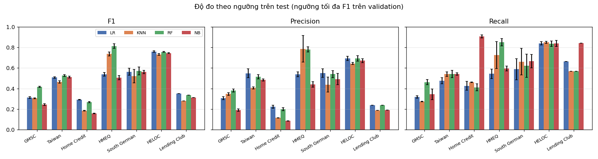
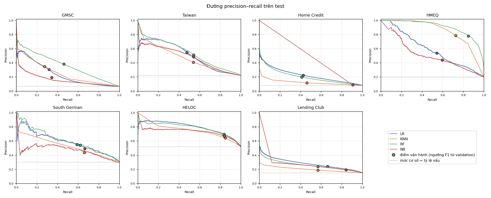
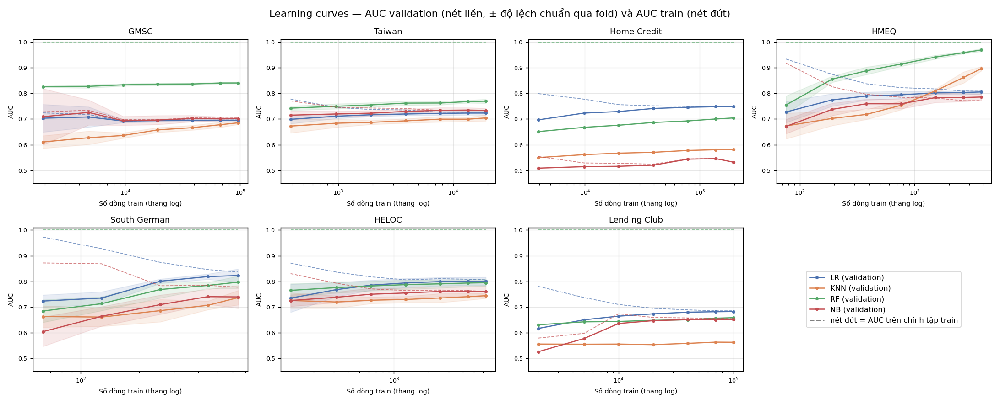

# 6. Kết quả

Mục 6.1–6.6 phân tích mô hình cơ sở Logistic Regression; mục 6.7 so sánh bốn mô hình classic ML (LR, KNN, RF, NB) theo AUC; mục 6.8 so sánh theo precision, recall, F1; mục 6.9 trình bày learning curves. Tất cả mô hình dùng tham số mặc định. Số liệu gốc nằm trong `reports/models/lr_default/` (`summary.csv`, `fold_metrics.csv`, `run.json`).

## 6.1. Kết quả chính

| Bộ dữ liệu | Đánh giá | AUC | Gini | KS | Brier | LogLoss | AP |
|---|---|---|---|---|---|---|---|
| HMEQ | 5-fold CV | **0,8030 ± 0,0161** | 0,6061 ± 0,0322 | 0,4655 ± 0,0394 | 0,1196 ± 0,0071 | 0,3884 ± 0,0184 | 0,5919 ± 0,0182 |
| FICO HELOC | 5-fold CV | **0,8019 ± 0,0098** | 0,6038 ± 0,0196 | 0,4736 ± 0,0194 | 0,1813 ± 0,0044 | 0,5442 ± 0,0101 | 0,7947 ± 0,0043 |
| South German | 5-fold CV | 0,7663 ± 0,0281 | 0,5327 ± 0,0562 | 0,4340 ± 0,0305 | 0,1716 ± 0,0131 | 0,5196 ± 0,0416 | 0,5983 ± 0,0445 |
| Home Credit | 5-fold CV | 0,7461 ± 0,0022 | 0,4922 ± 0,0044 | 0,3678 ± 0,0043 | 0,0687 ± 0,0010 | 0,2500 ± 0,0027 | 0,2225 ± 0,0044 |
| Taiwan | 5-fold CV | 0,7237 ± 0,0082 | 0,4473 ± 0,0165 | 0,3821 ± 0,0173 | 0,1449 ± 0,0038 | 0,4659 ± 0,0102 | 0,5043 ± 0,0094 |
| Lending Club | Fit lại train + val | 0,7018 (KTC 95%: 0,6992–0,7045) | 0,4037 | 0,2955 | 0,1185 | 0,3885 | 0,2800 |
| GMSC | 5-fold CV | **0,6981 ± 0,0110** | 0,3962 ± 0,0220 | 0,3196 ± 0,0221 | 0,0576 ± 0,0019 | 0,2253 ± 0,0065 | 0,2344 ± 0,0088 |

Brier, LogLoss và AP phụ thuộc tỷ lệ xấu nên không so sánh được giữa các bộ: GMSC có Brier thấp nhất nhưng AUC thấp nhất; HELOC có AP cao nhất (0,79) một phần vì tỷ lệ xấu 52%.

**Độ đo theo ngưỡng** (ngưỡng tối đa F1 trên validation):

| Bộ dữ liệu | Precision | Recall | F1 | Accuracy |
|---|---|---|---|---|
| HMEQ | 0,538 ± 0,023 | 0,543 ± 0,045 | 0,539 ± 0,018 | 0,815 ± 0,006 |
| FICO HELOC | 0,694 ± 0,021 | 0,839 ± 0,016 | 0,759 ± 0,006 | 0,723 ± 0,017 |
| South German | 0,551 ± 0,041 | 0,588 ± 0,103 | 0,563 ± 0,034 | 0,729 ± 0,027 |
| Home Credit | 0,223 ± 0,014 | 0,426 ± 0,043 | 0,291 ± 0,002 | 0,833 ± 0,016 |
| Taiwan | 0,547 ± 0,043 | 0,477 ± 0,030 | 0,508 ± 0,008 | 0,795 ± 0,019 |
| Lending Club | 0,239 | 0,662 | 0,352 | 0,637 |
| GMSC | 0,306 ± 0,014 | 0,319 ± 0,013 | 0,312 ± 0,009 | 0,906 ± 0,004 |

Accuracy cao của GMSC (0,906) và Home Credit (0,833) chỉ phản ánh mất cân bằng nhãn: đoán "tốt" cho mọi người đã đạt 93% và 92%.

## 6.2. Overfit: gần như không có, trừ South German

| Bộ dữ liệu | AUC train | AUC validation | AUC test | Train − test |
|---|---|---|---|---|
| GMSC | 0,6997 | 0,6945 | 0,6981 | +0,002 |
| Taiwan | 0,7271 | 0,7233 | 0,7237 | +0,003 |
| Home Credit | 0,7495 | 0,7465 | 0,7461 | +0,003 |
| HMEQ | 0,8081 | 0,8054 | 0,8030 | +0,005 |
| **South German** | **0,8365** | 0,8228 | **0,7663** | **+0,070** |
| FICO HELOC | 0,8059 | 0,8006 | 0,8019 | +0,004 |
| Lending Club | 0,6856 | 0,6827 | 0,7018 | −0,016 |

- Với 6 bộ, AUC train gần bằng AUC test: giới hạn hiệu năng của LR đến từ **dạng quan hệ tuyến tính**, không phải từ overfit.
- **South German** là ngoại lệ: 71 đặc trưng (68 cột one-hot) cho 640 dòng train dẫn đến overfit rõ (+0,07) và AUC dao động lớn nhất giữa các fold (0,734 ở fold 1 đến 0,790 ở fold 3). Đây là bộ hưởng lợi nhiều nhất khi tinh chỉnh tham số phạt `C`.
- Lending Club có AUC test **cao hơn** AUC train không phải do lỗi: mô hình cuối được fit trên 2013–2014 (262.992 dòng) thay vì chỉ 2013. Mô hình chỉ fit trên 2013 cho AUC test 0,6936; fit lại trên train + validation tăng AUC thêm **+0,008**.

## 6.3. GMSC: AUC thấp do ngoại lai cực đoan

AUC 0,698 của GMSC thấp hơn cả AUC đơn biến của biến mạnh nhất, tỷ lệ sử dụng hạn mức tín dụng `RevolvingUtilizationOfUnsecuredLines` (0,776 ở giai đoạn EDA). Nguyên nhân:

- Biến này lẽ ra nằm trong [0, 1] nhưng có giá trị tới ~50.000. Sau chuẩn hóa, độ lệch chuẩn bị ngoại lai kéo lên ~205, nên gần như mọi người vay dồn về cùng một giá trị (~ −0,02). Hệ số LR của biến này chỉ ≈ −0,015: mô hình tuyến tính **không khai thác được** biến mạnh nhất.
- Mã 96/98 trong các cột đếm trễ hạn làm ba cột này gần như cộng tuyến trên các dòng đó, dẫn đến hệ số trái dấu. Tuy nhiên, bỏ 49 dòng có mã 96/98 khỏi test không cải thiện AUC (0,683 → 0,678), nên đây không phải nguyên nhân chính.

**Phân tích phụ** (fold 1; *không* thuộc pipeline chính vì đặc tả không cắt ngoại lai): cắt mỗi biến số về khoảng phân vị 1%–99% **học trên train**, sau đó chạy lại đúng B.1 và LR mặc định.

| Bộ dữ liệu | AUC test fold 1 (pipeline chuẩn) | AUC sau khi cắt 1%–99% | Chênh lệch |
|---|---|---|---|
| **GMSC** | 0,6825 | **0,8517** | **+0,169** |
| Home Credit | 0,7497 | 0,7499 | +0,000 |
| Lending Club | 0,6937 | 0,6943 | +0,001 |

Với GMSC, gần như toàn bộ khoảng cách là do ngoại lai. Kết quả LR của GMSC theo pipeline chuẩn vì vậy **đánh giá thấp** mô hình tuyến tính; khi so sánh với các mô hình cây (vốn không nhạy với ngoại lai), cần nêu rõ điểm này để không quy toàn bộ chênh lệch cho tính phi tuyến. Home Credit và Lending Club, dù cũng có giá trị chuẩn hóa tới hàng trăm độ lệch chuẩn, không bị ảnh hưởng vì ngoại lai không nằm ở các biến quan trọng.

## 6.4. Calibration

| Bộ dữ liệu | Tỷ lệ xấu thực tế (test) | Xác suất dự đoán trung bình |
|---|---:|---:|
| GMSC | 6,68% | 6,70% |
| Taiwan | 22,12% | 22,16% |
| Home Credit | 8,07% | 8,10% |
| HMEQ | 19,95% | 19,90% |
| South German | 30,00% | 30,60% |
| FICO HELOC | 52,03% | 52,10% |
| Lending Club | **14,88%** | **13,51%** |

- Ở 6 bộ CV, xác suất dự đoán trung bình gần như bằng tỷ lệ xấu thực (chênh ≤ 0,6 điểm %), đúng kỳ vọng với LR không cân bằng lớp khi train và test cùng phân phối.
- **Lending Club** dự đoán thấp hơn thực tế 1,4 điểm %: mô hình học trên 2013–2014 (tỷ lệ xấu 13,2%) nhưng năm 2015 có tỷ lệ xấu 14,9%. Đây là trôi dạt theo thời gian — mô hình vẫn xếp hạng tốt nhưng mức rủi ro cần được hiệu chỉnh lại khi áp dụng cho năm sau.
- **South German** quá tự tin ở nhóm rủi ro cao (dự đoán ~0,8 nhưng thực tế ~0,68), là hệ quả của overfit ở mục 6.2.
- **Taiwan** lệch ở vùng giữa (dự đoán 0,2–0,25 nhưng thực tế ~0,12): quan hệ phi tuyến của các biến trạng thái thanh toán `PAY_*` (giữ là biến số) mà LR không nắm được.

## 6.5. Độ ổn định

- Độ lệch chuẩn AUC giữa các fold tỷ lệ nghịch với kích thước bộ dữ liệu: Home Credit ± 0,002 (307.511 dòng) → HMEQ ± 0,016 → South German ± 0,028 (1.000 dòng).
- Lending Club có khoảng tin cậy bootstrap rất hẹp (± 0,0027) vì tập test lớn (282.787 dòng). Khoảng này chỉ phản ánh biến động do lấy mẫu test, không phản ánh biến động do việc chọn năm.

| Bộ dữ liệu | Fold 1 | Fold 2 | Fold 3 | Fold 4 | Fold 5 |
|---|---|---|---|---|---|
| GMSC | 0,6825 | 0,7057 | 0,6910 | 0,7087 | 0,7026 |
| Taiwan | 0,7315 | 0,7270 | 0,7296 | 0,7183 | 0,7120 |
| Home Credit | 0,7497 | 0,7437 | 0,7458 | 0,7458 | 0,7454 |
| HMEQ | 0,8268 | 0,7956 | 0,8090 | 0,7838 | 0,8000 |
| South German | 0,7336 | 0,7377 | 0,7895 | 0,7841 | 0,7868 |
| FICO HELOC | 0,8009 | 0,7990 | 0,8171 | 0,7899 | 0,8025 |

## 6.6. Tóm tắt

| Mức độ khó (theo AUC của LR) | Bộ dữ liệu | Nhận xét |
|---|---|---|
| Dễ (AUC ≈ 0,80) | HMEQ, FICO HELOC | HMEQ hưởng lợi từ việc thiếu dữ liệu mang thông tin (qua nhóm `__missing__`); HELOC có sẵn điểm rủi ro tổng hợp |
| Trung bình (0,72–0,77) | South German, Home Credit, Taiwan | South German bị giới hạn bởi kích thước; Taiwan bởi quan hệ phi tuyến của `PAY_*` |
| Khó (≈ 0,70) | Lending Club, GMSC | Lending Club: tín hiệu yếu thật và có trôi dạt theo thời gian. GMSC: do ngoại lai, không phải do tín hiệu yếu (mục 6.3) |

**Giới hạn của kết quả này:**

1. Tham số mặc định, chưa tinh chỉnh — đặc biệt tham số phạt `C` với South German.
2. Theo đặc tả, không cắt ngoại lai, nên LR của GMSC bị đánh giá thấp nghiêm trọng (mục 6.3).
3. Ngưỡng F1 của Lending Club lấy từ mô hình fit trên 2013 (validation 2014) và áp cho mô hình fit lại trên 2013–2014, vì mô hình fit lại không còn phần validation.
4. Lending Club chỉ có một lần chia; khoảng tin cậy bootstrap không phản ánh biến động do chọn năm.

## 6.7. So sánh các mô hình classic ML

Bốn mô hình dùng cùng các fold, cùng ma trận đặc trưng và cùng cách đánh giá (chương 4), nên chênh lệch chỉ đến từ mô hình. Số liệu gốc: `reports/models/comparison/` (`tables.md`, `auc.csv`, `ranks.csv`, `stats.json`).

### AUC trên test

| Bộ dữ liệu | LR | KNN | RF | NB | Tốt nhất |
|---|---|---|---|---|---|
| GMSC | 0,6981 ± 0,0110 | 0,6859 ± 0,0038 | **0,8399 ± 0,0047** | 0,7042 ± 0,0119 | RF |
| Taiwan | 0,7237 ± 0,0082 | 0,6985 ± 0,0126 | **0,7633 ± 0,0081** | 0,7323 ± 0,0142 | RF |
| Home Credit | **0,7461 ± 0,0022** | 0,5819 ± 0,0009 | 0,7084 ± 0,0030 | 0,5310 ± 0,0066 | LR |
| HMEQ | 0,8030 ± 0,0161 | 0,8993 ± 0,0195 | **0,9703 ± 0,0060** | 0,7704 ± 0,0179 | RF |
| South German | 0,7663 ± 0,0281 | 0,7084 ± 0,0431 | **0,7710 ± 0,0284** | 0,7156 ± 0,0414 | RF |
| FICO HELOC | **0,8019 ± 0,0098** | 0,7427 ± 0,0075 | 0,7946 ± 0,0066 | 0,7587 ± 0,0069 | LR |
| Lending Club | **0,7018** | 0,5782 | 0,6777 | 0,6749 | LR |
| **Hạng trung bình** | 2,00 | 3,57 | **1,43** | 3,00 | |

### Hạng trung bình theo từng độ đo (1 = tốt nhất)

| Độ đo | LR | KNN | RF | NB |
|---|---|---|---|---|
| AUC / Gini | 2,00 | 3,57 | **1,43** | 3,00 |
| KS | 2,00 | 3,29 | **1,57** | 3,14 |
| AP | 1,71 | 3,29 | **1,43** | 3,57 |
| F1 | 1,86 | 3,43 | **1,43** | 3,29 |
| Precision | **1,57** | 3,14 | 1,86 | 3,43 |
| Recall | 3,14 | 2,43 | 2,71 | **1,71** |
| Brier | 1,71 | 2,86 | **1,43** | 4,00 |
| LogLoss | **1,43** | 3,29 | 1,57 | 3,71 |

Thứ tự **RF > LR > NB, KNN** giữ nguyên ở hầu hết các độ đo; precision và recall được phân tích riêng ở mục 6.8. Riêng LogLoss, LR xếp nhất vì xác suất của LR được hiệu chỉnh tốt nhất (mục 6.4), trong khi RF với cây phát triển hết độ sâu cho xác suất sát 0 hoặc 1 nhiều hơn.

### Kiểm định thống kê

| Kiểm định | Kết quả |
|---|---|
| Friedman (N = 7 bộ, k = 4 mô hình) | χ²_F = 11,74; p = 0,0083 |
| Iman–Davenport | F = 7,61; **p = 0,0017** |

→ Bác bỏ giả thuyết "bốn mô hình có hạng như nhau": có khác biệt có ý nghĩa thống kê giữa các mô hình.

| Cặp (A vs B) | Số bộ A thắng / B thắng | Chênh AUC trung bình (A − B) | p | p (Holm) |
|---|---|---|---|---|
| RF vs KNN | 7 / 0 | +0,0900 | 0,0156 | 0,0938 |
| RF vs NB | 7 / 0 | +0,0912 | 0,0156 | 0,0938 |
| LR vs NB | 5 / 2 | +0,0506 | 0,0781 | 0,3125 |
| LR vs KNN | 6 / 1 | +0,0494 | 0,1562 | 0,4688 |
| RF vs LR | 4 / 3 | +0,0406 | 0,4688 | 0,9375 |
| NB vs KNN | 5 / 2 | −0,0011 | 0,8125 | 0,9375 |

- RF thắng KNN và NB ở **cả 7 bộ**, nhưng sau hiệu chỉnh Holm p = 0,094, chưa đạt mức 0,05. Đây là giới hạn của số bộ dữ liệu: với N = 7, p nhỏ nhất có thể có của Wilcoxon là 0,0156, và nhân với 6 cặp theo Holm thì không cặp nào có thể xuống dưới 0,05. Kết luận "RF tốt hơn KNN và NB" là nhất quán nhưng chưa được khẳng định thống kê ở mức từng cặp.
- **RF và LR không khác biệt có ý nghĩa** (4 thắng / 3 thua, p = 0,47): mỗi mô hình mạnh trên một nhóm bộ dữ liệu khác nhau (xem dưới).

### Ở mức từng bộ dữ liệu

Số fold (trên 5) mô hình thắng LR về AUC test:

| Bộ dữ liệu | KNN | RF | NB |
|---|---|---|---|
| GMSC | 1/5 | **5/5** | 4/5 |
| Taiwan | 0/5 | **5/5** | **5/5** |
| Home Credit | 0/5 | 0/5 | 0/5 |
| HMEQ | **5/5** | **5/5** | 0/5 |
| South German | 0/5 | 3/5 | 0/5 |
| FICO HELOC | 0/5 | 1/5 | 0/5 |

Lending Club — chênh lệch AUC so với LR trên cùng 282.787 dòng test (bootstrap ghép cặp, 1.000 lần):

| Mô hình | Chênh AUC | KTC 95% |
|---|---|---|
| KNN − LR | −0,1237 | −0,1268 đến −0,1207 |
| RF − LR | −0,0241 | −0,0261 đến −0,0221 |
| NB − LR | −0,0270 | −0,0285 đến −0,0253 |

Trên Lending Club, LR tốt hơn cả ba mô hình còn lại một cách rõ ràng (mọi khoảng tin cậy đều nằm hoàn toàn dưới 0).

### Nhận xét theo mô hình

**Random Forest — tốt nhất nói chung, mạnh ở dữ liệu nhỏ và vừa có quan hệ phi tuyến.**

- Thắng rõ trên **GMSC** (0,840 so với 0,698 của LR): RF chia theo ngưỡng nên không bị ngoại lai ảnh hưởng, khai thác được biến tỷ lệ sử dụng hạn mức mà LR bỏ qua (mục 6.3). Kết quả này gần với mức LR đạt được khi cắt ngoại lai ở phân tích phụ (0,852), củng cố nhận định rằng khoảng cách của LR trên GMSC chủ yếu do ngoại lai.
- Thắng rất lớn trên **HMEQ** (0,970 so với 0,803). Mức tăng này không đến từ mẫu giá trị thiếu: trên các dòng test không thiếu giá trị nào, RF vẫn đạt 0,972 so với 0,798 của LR, và RF chỉ huấn luyện trên các dòng đầy đủ vẫn đạt 0,957. Biến quan trọng nhất là tỷ lệ nợ/thu nhập `DEBTINC` (22% độ quan trọng), có quan hệ phi tuyến với nhãn.
- Thắng trên **Taiwan** (0,763): nắm được quan hệ phi tuyến của các biến trạng thái thanh toán `PAY_*`.
- **Thua LR** trên Home Credit, HELOC và Lending Club — các bộ có nhiều đặc trưng (HELOC 37, Lending Club 184, Home Credit 250), tín hiệu phân tán, gần tuyến tính. Với tham số mặc định, mỗi cây phát triển hết độ sâu nên **AUC train = 1,000 ở mọi bộ** (học thuộc dữ liệu train); trên các bộ tín hiệu yếu và nhiễu, việc học thuộc này làm giảm khả năng tổng quát. Đây là mô hình hưởng lợi nhiều nhất khi tinh chỉnh (độ sâu, số dòng tối thiểu ở lá).

**Logistic Regression — ổn định và được hiệu chỉnh tốt nhất.**

- Tốt nhất trên 3 bộ lớn/rộng (Home Credit, HELOC, Lending Club) và thắng khẳng định trên Lending Club.
- Xác suất dự đoán trung bình khớp tỷ lệ xấu thực trong khoảng 0,6 điểm % ở mọi bộ CV; xếp nhất về LogLoss.
- Điểm yếu: không nắm được quan hệ phi tuyến (HMEQ, Taiwan) và nhạy với ngoại lai (GMSC).

**K-Nearest Neighbors — tệ nhất, sụp đổ khi số chiều lớn.**

- Trên Home Credit (250 đặc trưng) và Lending Club (184 đặc trưng), AUC chỉ còn 0,58: với số chiều lớn, khoảng cách Euclid giữa các điểm gần như bằng nhau ("lời nguyền số chiều"), lại bị chi phối bởi các biến có ngoại lai lớn sau chuẩn hóa.
- Ngược lại, KNN tốt thứ hai trên HMEQ (0,899, hơn LR 0,10): HMEQ có ít chiều (20) và cấu trúc cục bộ rõ, cùng hướng với kết quả của RF. Mức tăng lớn của cả hai mô hình dựa trên láng giềng/phân vùng trên HMEQ có thể một phần do các hồ sơ gần giống nhau trong dữ liệu; điều này chưa được kiểm tra (việc nhóm dòng trùng chỉ xử lý các dòng **giống hệt** nhau).
- Chậm nhất khi dự đoán (chiếm khoảng 80% tổng thời gian chạy, mục 5.3).

**Naive Bayes — xếp hạng kém và xác suất sai lệch nghiêm trọng.**

- Thất bại trên **Home Credit** (AUC 0,531, gần ngẫu nhiên). Nguyên nhân: giả định các đặc trưng độc lập bị vi phạm nặng — Home Credit có nhiều nhóm cột gần trùng nhau (các biến nhà ở dạng `*_AVG`/`*_MODE`/`*_MEDI`), nên tích các xác suất có điều kiện bị bão hòa: 98,5% dự đoán rơi sát 0 hoặc 1, thứ tự xếp hạng bị phá vỡ. Cắt ngoại lai không khắc phục được (0,547).
- Xác suất sai lệch rất lớn: trung bình xác suất dự đoán cao hơn tỷ lệ xấu thực **69 điểm %** trên Taiwan và **85 điểm %** trên Home Credit, nên NB xếp cuối về Brier ở mọi bộ; F1 trên Home Credit chỉ 0,157.
- Vẫn khá trên các bộ ít biến và ít tương quan (Taiwan 0,732, hơn LR).

### Kết luận so sánh

| Nhóm bộ dữ liệu | Mô hình tốt nhất | Lý do |
|---|---|---|
| Nhỏ và vừa, ít đặc trưng, quan hệ phi tuyến hoặc có ngoại lai (GMSC, Taiwan, HMEQ, South German) | **RF** | Chia theo ngưỡng: không nhạy với ngoại lai, nắm được phi tuyến và tương tác |
| Lớn hoặc rộng, tín hiệu phân tán, có trôi dạt theo thời gian (Home Credit, HELOC, Lending Club) | **LR** | Mô hình đơn giản, ổn định, ít học thuộc nhiễu; xác suất được hiệu chỉnh tốt |
| — | KNN, NB | Không phù hợp làm mô hình chính: KNN hỏng khi số chiều lớn; NB vi phạm giả định độc lập và cho xác suất sai lệch |

Với tham số mặc định, **RF có hạng trung bình tốt nhất (1,43)** và khác biệt giữa các mô hình là có ý nghĩa thống kê theo Friedman (p = 0,0017); nhưng RF **không vượt trội LR một cách nhất quán** (4 thắng / 3 thua). Hai hướng tiếp theo có khả năng thay đổi thứ tự: tinh chỉnh tham số (đặc biệt độ sâu cây của RF và tham số phạt `C` của LR) và các mô hình GBDT.

**Giới hạn của so sánh:** tất cả là tham số mặc định, chưa tinh chỉnh; mới có 7 bộ dữ liệu nên năng lực của kiểm định từng cặp thấp; chưa có SVM (mục 4.5); ma trận đặc trưng one-hot và chuẩn hóa là lựa chọn của đặc tả cho nhóm classic, không nhất thiết tối ưu cho từng mô hình (ví dụ NB và RF không cần chuẩn hóa).

## 6.8. Precision, recall và F1

Các độ đo này được tính tại **ngưỡng tối đa F1 chọn trên validation** của từng fold, rồi áp nguyên sang test. Khác với AUC (đánh giá toàn bộ thứ tự xếp hạng), chúng phản ánh một quyết định cụ thể "từ chối / chấp nhận": precision là tỷ lệ người bị gắn nhãn xấu thực sự xấu; recall là tỷ lệ người xấu bị phát hiện.

### F1

| Bộ dữ liệu | LR | KNN | RF | NB | Tốt nhất |
|---|---|---|---|---|---|
| GMSC | 0,312 ± 0,009 | 0,306 ± 0,004 | **0,417 ± 0,006** | 0,244 ± 0,009 | RF |
| Taiwan | 0,508 ± 0,008 | 0,464 ± 0,012 | **0,526 ± 0,009** | 0,511 ± 0,008 | RF |
| Home Credit | **0,291 ± 0,002** | 0,185 ± 0,003 | 0,268 ± 0,005 | 0,157 ± 0,003 | LR |
| HMEQ | 0,539 ± 0,018 | 0,737 ± 0,019 | **0,813 ± 0,022** | 0,506 ± 0,022 | RF |
| South German | 0,563 ± 0,034 | 0,521 ± 0,067 | **0,571 ± 0,039** | 0,562 ± 0,017 | RF |
| FICO HELOC | **0,759 ± 0,006** | 0,732 ± 0,009 | 0,757 ± 0,005 | 0,744 ± 0,004 | LR |
| Lending Club | **0,352** | 0,281 | 0,335 | 0,312 | LR |
| **Hạng trung bình** | 1,86 | 3,43 | **1,43** | 3,29 | |

### Precision

| Bộ dữ liệu | LR | KNN | RF | NB | Tốt nhất |
|---|---|---|---|---|---|
| GMSC | 0,306 ± 0,014 | 0,347 ± 0,012 | **0,381 ± 0,016** | 0,191 ± 0,012 | RF |
| Taiwan | **0,548 ± 0,043** | 0,407 ± 0,011 | 0,514 ± 0,020 | 0,484 ± 0,011 | LR |
| Home Credit | **0,223 ± 0,014** | 0,116 ± 0,002 | 0,200 ± 0,014 | 0,086 ± 0,002 | LR |
| HMEQ | 0,538 ± 0,023 | **0,786 ± 0,129** | 0,780 ± 0,027 | 0,440 ± 0,028 | KNN |
| South German | **0,551 ± 0,041** | 0,438 ± 0,073 | 0,540 ± 0,035 | 0,492 ± 0,055 | LR |
| FICO HELOC | **0,694 ± 0,021** | 0,643 ± 0,010 | 0,693 ± 0,026 | 0,671 ± 0,020 | LR |
| Lending Club | **0,239** | 0,187 | 0,238 | 0,192 | LR |
| **Hạng trung bình** | **1,57** | 3,14 | 1,86 | 3,43 | |

### Recall

| Bộ dữ liệu | LR | KNN | RF | NB | Tốt nhất |
|---|---|---|---|---|---|
| GMSC | 0,319 ± 0,013 | 0,274 ± 0,003 | **0,463 ± 0,025** | 0,344 ± 0,052 | RF |
| Taiwan | 0,477 ± 0,030 | 0,540 ± 0,023 | 0,541 ± 0,036 | **0,542 ± 0,013** | NB |
| Home Credit | 0,426 ± 0,043 | 0,462 ± 0,003 | 0,412 ± 0,035 | **0,906 ± 0,015** | NB |
| HMEQ | 0,543 ± 0,045 | 0,726 ± 0,130 | **0,849 ± 0,036** | 0,595 ± 0,023 | RF |
| South German | 0,588 ± 0,103 | 0,661 ± 0,129 | 0,622 ± 0,113 | **0,666 ± 0,066** | NB |
| FICO HELOC | 0,839 ± 0,016 | **0,849 ± 0,010** | 0,835 ± 0,027 | 0,838 ± 0,029 | KNN |
| Lending Club | 0,662 | 0,569 | 0,568 | **0,842** | NB |
| **Hạng trung bình** | 3,14 | 2,43 | 2,71 | **1,71** | |

### Ngưỡng quyết định

| Bộ dữ liệu | LR | KNN | RF | NB | Tỷ lệ xấu |
|---|---|---|---|---|---|
| GMSC | 0,125 | 0,400 | 0,260 | 0,016 | 0,067 |
| Taiwan | 0,296 | 0,400 | 0,325 | **1,000** | 0,221 |
| Home Credit | 0,140 | 0,200 | 0,152 | **1,000** | 0,081 |
| HMEQ | 0,283 | 0,320 | 0,314 | 0,061 | 0,199 |
| South German | 0,407 | 0,360 | 0,386 | 0,704 | 0,300 |
| FICO HELOC | 0,396 | 0,400 | 0,432 | 0,002 | 0,520 |
| Lending Club | 0,139 | 0,200 | 0,180 | 0,012 | 0,149 |

(Trung bình qua các fold; KNN với k = 5 chỉ có 6 mức xác suất nên ngưỡng rơi vào 0,2 / 0,4.)

### Nhận xét

- **F1 cho cùng kết luận với AUC**: RF tốt nhất (hạng 1,43), mạnh nhất ở GMSC (+0,105 so với LR) và HMEQ (+0,274); LR tốt nhất ở Home Credit, HELOC, Lending Club.
- **LR có precision tốt nhất** (hạng 1,57, nhất ở 5/7 bộ): khi LR gắn nhãn xấu, khả năng đúng cao nhất. Đây là ưu thế quan trọng trong tín dụng, vì mỗi dự báo "xấu" sai là một khách hàng tốt bị từ chối.
- **Recall "tốt nhất" của NB là ảo** (hạng 1,71): NB đạt recall cao vì gắn nhãn xấu cho phần lớn người vay, không phải vì phân biệt tốt. Trên Lending Club, ngưỡng chỉ 0,012, recall 0,84 nhưng precision 0,19 — gần bằng tỷ lệ xấu 0,15. Trên Home Credit, recall 0,91 nhưng precision chỉ 0,086 — gần như bằng tỷ lệ xấu 0,081, tức không tốt hơn gắn nhãn ngẫu nhiên. Hạng recall vì vậy không nên đọc riêng lẻ mà phải đi cùng precision; F1 và đường precision–recall cho bức tranh đúng hơn.
- **NB cho thấy rõ hiện tượng bão hòa xác suất**: trên Home Credit, khoảng 87% dự đoán test bằng **đúng 1** và khoảng 5% gần bằng 0, nên ngưỡng tối ưu trên validation bằng đúng 1,000 và mọi dự đoán bằng 1 đều bị gắn nhãn xấu (khoảng 52 nghìn trên 61,5 nghìn dòng test mỗi fold). Đường precision–recall của NB trên Home Credit vì vậy gần như một đoạn thẳng. Taiwan có hiện tượng tương tự (ngưỡng ≈ 1,000).
- **Mọi mô hình đều khó trên các bộ mất cân bằng nặng**: F1 tốt nhất chỉ 0,29 (Home Credit), 0,35 (Lending Club), 0,42 (GMSC). Precision ở các bộ này chỉ 0,2–0,4: cứ 3–5 người bị gắn nhãn xấu thì chỉ khoảng 1 người thực sự xấu.

Đường precision–recall xác nhận thứ tự theo AUC: đường của RF nằm trên các mô hình khác ở GMSC, HMEQ và Taiwan; đường của LR nằm trên ở Home Credit và Lending Club. Ở HMEQ, RF duy trì precision gần 1 tới recall khoảng 0,5.

## 6.9. Learning curves

### AUC validation theo tỷ lệ dữ liệu train

| Bộ dữ liệu | Mô hình | 5% | 20% | 100% | Tăng 20% → 100% |
|---|---|---|---|---|---|
| GMSC | LR | 0,708 | 0,694 | 0,695 | +0,001 |
| | RF | 0,827 | 0,836 | 0,840 | +0,005 |
| | KNN | 0,627 | 0,658 | 0,685 | +0,028 |
| Taiwan | LR | 0,711 | 0,720 | 0,723 | +0,004 |
| | RF | 0,750 | 0,762 | 0,770 | +0,008 |
| Home Credit | LR | 0,723 | 0,741 | 0,748 | +0,007 |
| | RF | 0,668 | 0,687 | 0,704 | +0,018 |
| | KNN | 0,561 | 0,571 | 0,581 | +0,010 |
| HMEQ | LR | 0,774 | 0,794 | 0,805 | +0,011 |
| | RF | 0,855 | 0,914 | 0,969 | **+0,055** |
| | KNN | 0,702 | 0,754 | 0,896 | **+0,143** |
| South German | LR | — | 0,735 | 0,823 | **+0,088** |
| | RF | — | 0,713 | 0,797 | **+0,084** |
| FICO HELOC | LR | 0,768 | 0,794 | 0,801 | +0,007 |
| | RF | 0,776 | 0,787 | 0,795 | +0,008 |
| Lending Club | LR | 0,651 | 0,674 | 0,683 | +0,009 |
| | RF | 0,643 | 0,648 | 0,659 | +0,010 |
| | KNN | 0,555 | 0,554 | 0,563 | +0,009 |

(Bảng đầy đủ cho cả 4 mô hình và 7 mức tỷ lệ: `reports/models/learning_curves/tables.md`. South German không có mức 5% vì dưới 50 dòng.)

### Khoảng cách AUC train − validation ở 100% dữ liệu train

| Bộ dữ liệu | LR | RF | NB |
|---|---|---|---|
| GMSC | +0,005 | +0,160 | +0,003 |
| Taiwan | +0,004 | +0,231 | +0,001 |
| Home Credit | −0,000 | +0,296 | +0,001 |
| HMEQ | +0,003 | +0,031 | −0,014 |
| South German | +0,014 | +0,203 | +0,038 |
| FICO HELOC | +0,005 | +0,205 | +0,000 |
| Lending Club | +0,003 | +0,341 | +0,002 |

### Nhận xét

**1. Bộ dữ liệu nào còn thiếu dữ liệu?**

- **South German** là bộ duy nhất mà mọi mô hình vẫn tăng mạnh tới 100% dữ liệu (LR +0,088 từ 20% lên 100%). Với 640 dòng train, hiệu năng bị giới hạn bởi **lượng dữ liệu**; độ dao động lớn giữa các fold (mục 6.5) cũng xuất phát từ đây.
- **HMEQ** với RF và KNN vẫn tăng rõ (+0,055 và +0,143) và chưa nằm ngang: các mô hình dựa trên phân vùng/láng giềng hưởng lợi khi mật độ dữ liệu tăng. Đường của KNN tăng rất dốc ở phần cuối, phù hợp với giả thuyết ở mục 6.7 rằng HMEQ có các hồ sơ gần giống nhau (càng nhiều dòng, láng giềng gần nhất càng có khả năng là một hồ sơ gần như trùng) — giả thuyết này vẫn cần kiểm tra trực tiếp.
- Các bộ còn lại gần như **đã bão hòa** với LR: tăng dưới 0,01 AUC từ 20% lên 100%. Thêm dữ liệu cùng loại không cải thiện đáng kể; muốn cải thiện cần mô hình hoặc đặc trưng tốt hơn.

**2. LR bị giới hạn bởi dạng mô hình, không phải bởi dữ liệu.**

- Đường validation của LR nằm ngang sớm, và AUC train ≈ AUC validation ở mọi bộ (khoảng cách ≤ 0,014): LR **không overfit**, giới hạn nằm ở **độ lệch (bias)** của mô hình tuyến tính.
- Rõ nhất ở **GMSC**: LR nằm ngang ở ~0,69 ngay từ 2% dữ liệu, trong khi RF đạt 0,83 cũng chỉ với 2% (khoảng 1.900 dòng). Nguyên nhân là ngoại lai (mục 6.3), không phải thiếu dữ liệu — thêm dữ liệu không giúp được LR.

**3. RF học thuộc tập train nhưng vẫn tổng quát tốt ở nhiều bộ.**

- AUC train của RF luôn bằng 1,000 ở mọi mức dữ liệu (đường nét đứt nằm trên cùng): cây phát triển hết độ sâu học thuộc từng dòng train. Khoảng cách train − validation lên tới 0,16–0,34, ngoại trừ HMEQ (0,03).
- Dù vậy, AUC validation của RF vẫn tăng đều theo dữ liệu, nên việc học thuộc không làm hỏng mô hình mà chủ yếu làm lãng phí dung lượng. Đây là dấu hiệu RF sẽ hưởng lợi khi tinh chỉnh các tham số hạn chế độ phức tạp (độ sâu tối đa, số dòng tối thiểu ở lá).

**4. Mô hình tốt nhất phụ thuộc lượng dữ liệu.**

- **HELOC**: RF tốt hơn LR khi có ít dữ liệu (2%: 0,765 so với 0,735), LR vượt lên từ khoảng 10% (≈ 630 dòng) và giữ ưu thế.
- **Lending Club**: RF tốt hơn ở 2% (0,631 so với 0,617), LR vượt từ 5% trở đi và bỏ xa dần (100%: 0,683 so với 0,659).
- **Home Credit**: LR tốt hơn RF ở mọi mức, nhưng RF tăng nhanh hơn (+0,018 so với +0,007 từ 20% lên 100%), nên khoảng cách thu hẹp dần khi có thêm dữ liệu.

**5. KNN và NB.**

- KNN trên Home Credit và Lending Club gần như **không tăng** theo dữ liệu (0,55–0,58): với 184–250 chiều, thêm điểm không làm khoảng cách Euclid có ý nghĩa hơn. Đây là giới hạn cấu trúc, không phải do thiếu dữ liệu.
- NB có AUC train ≈ AUC validation (không overfit) và nằm ngang sớm: mô hình rất đơn giản, giới hạn bởi giả định độc lập. Trên Home Credit, đường của NB dao động và giảm ở 100% (0,546 → 0,532), phù hợp với hiện tượng bão hòa xác suất.

### Tóm tắt mục 6.8–6.9

| Câu hỏi | Trả lời |
|---|---|
| Xét theo F1, mô hình nào tốt nhất? | RF (hạng 1,43), cùng kết luận với AUC |
| Mô hình nào gắn nhãn xấu chính xác nhất? | LR (precision hạng 1,57) |
| Recall cao của NB có đáng tin? | Không — do ngưỡng rất thấp, precision gần mức cơ sở |
| Bộ nào cần thêm dữ liệu? | South German (mọi mô hình), HMEQ (RF, KNN) |
| Vì sao LR yếu trên GMSC? | Giới hạn của mô hình tuyến tính trước ngoại lai; thêm dữ liệu không giúp |
| RF có overfit? | Có học thuộc train (AUC train = 1), nhưng AUC validation vẫn tăng theo dữ liệu; cần tinh chỉnh độ phức tạp |
