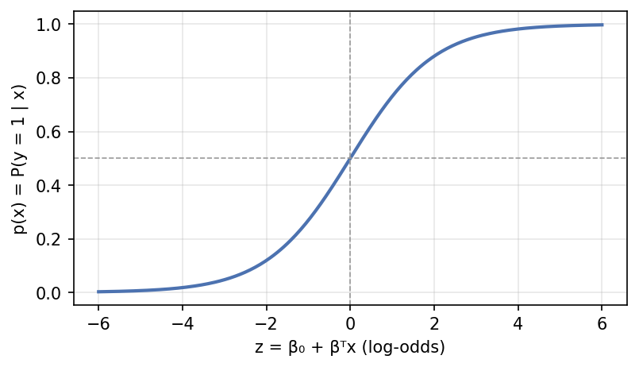
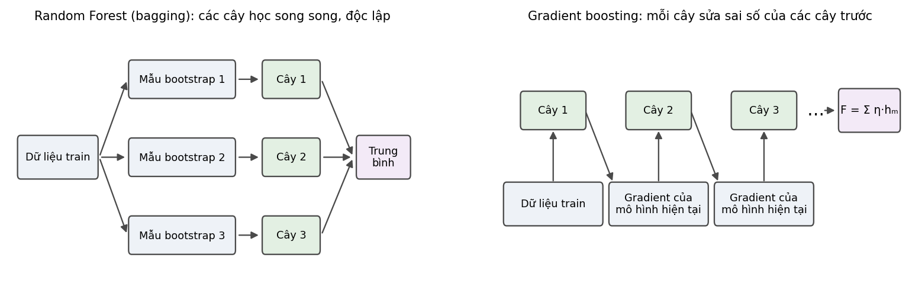
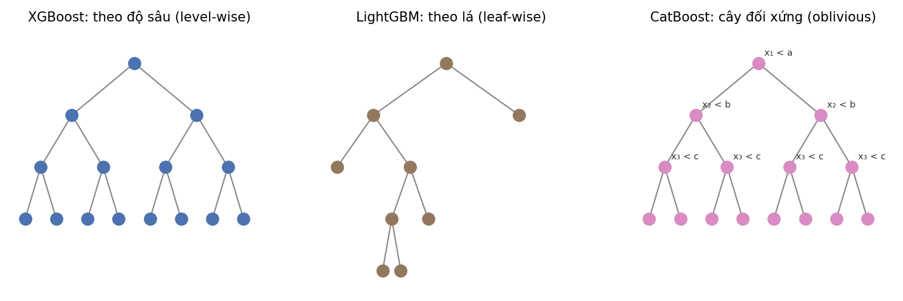

# Chương 2. Cơ sở lý thuyết

Chương 1 đã nêu bài toán chấm điểm tín dụng, hạn chế của các nghiên cứu hiện có và định hướng giải pháp của đồ án. Chương này trình bày cơ sở để hiểu các lựa chọn ở các chương sau. Mục 2.1 mô tả ngữ cảnh của bài toán và các yêu cầu riêng của nó. Mục 2.2 tổng quan các nghiên cứu liên quan. Mục 2.3 trình bày bốn mô hình classic ML, và mục 2.4 trình bày gradient boosting trên cây quyết định cùng ba cách cài đặt được dùng trong đồ án.

## 2.1. Ngữ cảnh của bài toán

Mỗi khoản vay được mô tả bởi một vector đặc trưng x, gồm thông tin nhân khẩu học, tài chính và lịch sử tín dụng của người vay tại thời điểm xét duyệt, và một nhãn y ∈ {0, 1}, với y = 1 nếu người vay rơi vào trạng thái xấu (vỡ nợ hoặc quá hạn nghiêm trọng) trong một cửa sổ quan sát. Mô hình học hàm ước lượng xác suất p(x) = P(y = 1 | x) từ dữ liệu quá khứ, và tổ chức cho vay ra quyết định bằng cách so p(x) với một ngưỡng.

Bài toán có ba đặc điểm ảnh hưởng đến cách đánh giá. Thứ nhất, nhãn thường mất cân bằng, nên accuracy không phản ánh chất lượng mô hình; khả năng xếp hạng (AUC) và chất lượng xác suất (Brier, LogLoss) quan trọng hơn. Thứ hai, ngưỡng quyết định do chính sách kinh doanh đặt ra chứ không cố định, nên độ đo không phụ thuộc ngưỡng như AUC được dùng làm độ đo chính. Thứ ba, dữ liệu được thu thập theo thời gian và hành vi người vay có thể thay đổi, nên mô hình phải được đánh giá trên dữ liệu mà nó chưa thấy, và với dữ liệu có mốc thời gian thì nên đánh giá trên giai đoạn sau giai đoạn huấn luyện.

## 2.2. Các kết quả nghiên cứu tương tự

<!-- TODO: tổng quan các nghiên cứu so sánh mô hình chấm điểm tín dụng, phân tích ưu nhược điểm của chúng và nêu động lực của đồ án. Cần bổ sung tài liệu tham khảo (ví dụ các benchmark so sánh nhiều mô hình trên nhiều bộ dữ liệu tín dụng); hiện thư mục references/ chỉ có các bài gốc của mô hình. -->

## 2.3. Các mô hình phân loại classic ML

**Logistic Regression** (Cox, 1958) mô hình hóa log-odds của xác suất xấu là một hàm tuyến tính của đặc trưng: log(p / (1 − p)) = β₀ + βᵀx. Tham số được ước lượng bằng cực đại hợp lý, thường kèm phạt L2 để tránh hệ số quá lớn. Mỗi hệ số cho biết tác động của một đặc trưng lên log-odds, nên mô hình dễ diễn giải và là chuẩn của ngành chấm điểm tín dụng. Hạn chế là mô hình chỉ nắm được quan hệ tuyến tính trên thang log-odds và nhạy với ngoại lai, trừ khi đặc trưng được biến đổi trước. Hình 2.1 minh họa hàm sigmoid p = 1 / (1 + e^(−z)) ánh xạ log-odds z sang xác suất: p bằng 0,5 khi z = 0 và tiến dần về 0 hoặc 1 khi |z| tăng.

*Hình 2.1. Hàm sigmoid của Logistic Regression*

**K-Nearest Neighbors** (Cover & Hart, 1967) không học tham số mà ghi nhớ toàn bộ tập train. Xác suất xấu của một điểm mới là tỷ lệ điểm xấu trong k láng giềng gần nhất theo một khoảng cách, thường là khoảng cách Euclid trên đặc trưng đã chuẩn hóa. Mô hình linh hoạt nhưng chậm khi dự đoán, vì phải tính khoảng cách tới mọi điểm train, và kém đi khi số chiều lớn, vì khi đó khoảng cách giữa các điểm trở nên gần như nhau.

**Naive Bayes** (Maron, 1961) áp dụng định lý Bayes, P(y | x) ∝ P(y) · ∏ⱼ P(xⱼ | y), với giả định các đặc trưng độc lập có điều kiện khi biết nhãn. Biến thể Gaussian giả định thêm mỗi đặc trưng có phân phối chuẩn trong từng lớp. Mô hình huấn luyện rất nhanh và cần ít dữ liệu, nhưng khi các đặc trưng tương quan mạnh, bằng chứng từ chúng bị đếm lặp và xác suất dự đoán dồn về gần 0 hoặc 1.

**Random Forest** (Breiman, 2001) là tổ hợp của nhiều cây quyết định, mỗi cây học trên một mẫu bootstrap của tập train và chỉ xét một tập con ngẫu nhiên các đặc trưng ở mỗi lần tách. Hai nguồn ngẫu nhiên này làm các cây ít tương quan với nhau, nên trung bình dự đoán của chúng có phương sai thấp hơn một cây đơn lẻ. Mô hình nắm được quan hệ phi tuyến và tương tác, không cần chuẩn hóa đặc trưng và ít nhạy với ngoại lai; khi để cây phát triển hết độ sâu, mô hình có thể học thuộc tập train.

## 2.4. Gradient boosting trên cây quyết định

Gradient boosting (Friedman, 2001) là phương pháp xây dựng một mô hình mạnh bằng cách cộng dồn nhiều cây quyết định nhỏ, trong đó mỗi cây mới được học để sửa phần sai của các cây trước. Ba mô hình mạnh nhất trong đồ án, XGBoost, LightGBM và CatBoost, đều là các cách cài đặt của cùng nguyên lý này. Mục 2.4.1 định nghĩa các khái niệm cần dùng, mục 2.4.2 trình bày từng bước của thuật toán, mục 2.4.3 nêu những gì phương pháp làm được và hạn chế của nó, các mục 2.4.4 đến 2.4.6 trình bày cải tiến riêng của từng thư viện, và mục 2.4.7 so sánh ba thư viện.

### 2.4.1. Các khái niệm cơ bản

Bảng 2.1 định nghĩa các khái niệm được dùng trong phần còn lại của mục này.

*Bảng 2.1. Các khái niệm dùng trong gradient boosting*

| Khái niệm | Ý nghĩa |
|---|---|
| Cây quyết định | Mô hình chia dữ liệu bằng một chuỗi câu hỏi có/không trên đặc trưng, ví dụ "tỷ lệ sử dụng hạn mức > 0,9?". Mỗi câu hỏi là một **nút tách**; đường đi từ gốc xuống dừng ở một **lá**. |
| Lá và giá trị lá | Lá là nhóm các khoản vay trả lời giống nhau cho mọi câu hỏi trên đường đi. Mỗi lá có một **giá trị lá** (trọng số lá), là con số mà cây trả về cho mọi khoản vay rơi vào lá đó. |
| Độ sâu, số lá | Độ sâu là số câu hỏi tối đa từ gốc tới lá; cây độ sâu d có tối đa 2^d lá. Cây càng sâu hoặc càng nhiều lá thì càng nắm được quan hệ phức tạp, nhưng cũng càng dễ học thuộc dữ liệu. |
| Cây hồi quy | Cây quyết định có giá trị lá là số thực thay vì nhãn lớp. Gradient boosting dùng cây hồi quy ngay cả cho bài toán phân loại, vì mỗi cây dự đoán một lượng hiệu chỉnh chứ không dự đoán nhãn. |
| Điểm F(x) và log-odds | Mô hình không trực tiếp cho xác suất mà cho một điểm F(x) trên thang log-odds, F = log(p / (1 − p)). Xác suất được suy ra bằng hàm sigmoid p = 1 / (1 + e^(−F)) (Hình 2.1). Điểm càng cao thì rủi ro càng lớn. |
| Mô hình cộng tính | Điểm cuối cùng là tổng đóng góp của các cây: F(x) = F₀ + η·h₁(x) + η·h₂(x) + … + η·h_M(x), trong đó h_m là cây thứ m và F₀ là điểm khởi tạo. |
| Hàm mất mát | Con số đo mức sai của mô hình trên tập train; thuật toán tìm cách làm nó nhỏ nhất. Với phân loại nhị phân, hàm mất mát là **log-loss**: L = −[y·log p + (1 − y)·log(1 − p)], phạt nặng khi mô hình tự tin nhưng sai. |
| Gradient và phần dư giả | Gradient của hàm mất mát theo điểm F cho biết nên tăng hay giảm điểm của từng khoản vay để giảm mất mát. Với log-loss, gradient âm bằng **r = y − p**, gọi là phần dư giả (pseudo-residual): dương nếu khoản vay xấu nhưng mô hình đang dự đoán thấp, âm nếu khoản vay tốt nhưng bị dự đoán cao. |
| Learning rate η | Hệ số trong khoảng (0, 1] nhân với đóng góp của mỗi cây trước khi cộng vào mô hình. η nhỏ làm mỗi bước thận trọng hơn, thường cho kết quả tổng quát hóa tốt hơn nhưng cần nhiều cây hơn. |
| Số cây M | Số vòng boosting, tức số cây được cộng vào mô hình. Quá ít cây thì mô hình chưa học đủ (underfit); quá nhiều cây với η lớn thì mô hình học cả nhiễu (overfit). |
| Điều chuẩn | Các ràng buộc ngăn mô hình quá phức tạp, ví dụ giới hạn độ sâu, phạt giá trị lá quá lớn, hay yêu cầu mỗi lá có tối thiểu một số dòng. |
| Overfit | Hiện tượng mô hình khớp rất tốt tập train nhưng kém trên dữ liệu mới, đo bằng khoảng cách giữa AUC train và AUC test (mục 4.8). |

### 2.4.2. Cách gradient boosting hoạt động

Ý tưởng của gradient boosting giống một người học lần lượt sửa lỗi: sau mỗi lần dự đoán, xem khoản vay nào bị dự đoán sai và sai theo hướng nào, rồi học thêm một quy tắc nhỏ để sửa đúng những lỗi đó. Với bài toán phân loại nhị phân và log-loss, thuật toán gồm các bước sau.

1. **Khởi tạo.** Mọi khoản vay nhận cùng một điểm F₀ = log(p̄ / (1 − p̄)), trong đó p̄ là tỷ lệ xấu trên tập train. Đây là dự đoán tốt nhất khi chưa dùng đặc trưng nào.
2. **Lặp lại với m = 1, 2, …, M:**
   1. Tính xác suất hiện tại của từng khoản vay: pᵢ = 1 / (1 + e^(−F_{m−1}(xᵢ))).
   2. Tính phần dư giả rᵢ = yᵢ − pᵢ. Ví dụ, một khoản vay xấu (y = 1) đang được dự đoán p = 0,2 có r = 0,8, cần tăng điểm mạnh; một khoản vay tốt (y = 0) dự đoán p = 0,2 có r = −0,2, cần giảm điểm nhẹ.
   3. Học một cây hồi quy h_m dự đoán rᵢ từ xᵢ. Cây chọn các câu hỏi tách sao cho các khoản vay trong cùng một lá có phần dư giống nhau, tức gom các khoản vay "bị sai theo cùng một kiểu" vào chung một lá.
   4. Đặt giá trị cho mỗi lá. Friedman (2001) dùng một bước Newton cho log-loss: giá trị lá = Σ rᵢ / Σ pᵢ(1 − pᵢ), lấy tổng trên các khoản vay trong lá.
   5. Cập nhật điểm: F_m(x) = F_{m−1}(x) + η · h_m(x).
3. **Dự đoán.** Với một khoản vay mới, cho nó đi qua cả M cây, cộng các giá trị lá nhận được với F₀ để có F_M(x), rồi đổi sang xác suất bằng hàm sigmoid.

Vì mỗi cây được học trên phần dư của mô hình hiện tại, các cây phụ thuộc vào nhau và phải được học tuần tự. Điều này khác căn bản với Random Forest, nơi các cây được học độc lập trên các mẫu bootstrap rồi lấy trung bình. Hình 2.2 so sánh hai cách tổ hợp cây này: bagging giảm phương sai bằng cách lấy trung bình nhiều cây sâu, còn boosting giảm sai lệch (bias) bằng cách cộng dồn nhiều cây nông.

*Hình 2.2. Tổ hợp cây theo bagging (Random Forest) và theo boosting*

### 2.4.3. Khả năng và hạn chế

Gradient boosting trên cây có năm khả năng quan trọng với dữ liệu tín dụng dạng bảng. Thứ nhất, mô hình nắm được quan hệ phi tuyến và các ngưỡng, ví dụ rủi ro tăng vọt khi tỷ lệ sử dụng hạn mức vượt 1, điều mà Logistic Regression chỉ biểu diễn được nếu đặc trưng được biến đổi trước. Thứ hai, mô hình tự học tương tác giữa các đặc trưng, vì các câu hỏi nối tiếp trên một đường đi của cây tạo thành các điều kiện kết hợp như "thu nhập thấp **và** đã từng trễ hạn". Thứ ba, câu hỏi tách chỉ phụ thuộc vào thứ tự giá trị chứ không phụ thuộc độ lớn, nên mô hình không cần chuẩn hóa đặc trưng và ít bị ảnh hưởng bởi ngoại lai của đặc trưng đầu vào. Thứ tư, đầu ra là xác suất, nên dùng được trực tiếp cho xếp hạng rủi ro và đánh giá bằng AUC, Brier hay LogLoss. Thứ năm, nhờ η và các cơ chế điều chuẩn, có thể điều chỉnh mức phức tạp của mô hình để cân bằng giữa underfit và overfit.

Phương pháp cũng có các hạn chế. Mô hình có nhiều tham số (số cây, η, độ sâu, điều chuẩn) và kết quả nhạy với chúng; với η lớn, cây sâu hoặc quá nhiều cây, mô hình dễ overfit, nhất là trên bộ dữ liệu nhỏ. Mô hình gồm hàng trăm cây nên khó diễn giải hơn Logistic Regression, vốn có mỗi hệ số gắn với một đặc trưng. Ngoài ra, các cây phải được học tuần tự nên khó song song hóa ở mức cây, chỉ song song hóa được bên trong việc tìm câu hỏi tách của từng cây. Ba thư viện trình bày dưới đây là ba cách khác nhau để tăng tốc và giảm overfit cho cùng thuật toán.

### 2.4.4. XGBoost

XGBoost (Chen & Guestrin, 2016) bổ sung điều chuẩn trực tiếp vào hàm mục tiêu của mỗi cây. Thay vì chỉ giảm mất mát, mỗi cây h_m được chọn để làm nhỏ nhất

Obj = Σᵢ L(yᵢ, ŷᵢ) + γ·T + ½·λ·Σⱼ wⱼ²,

trong đó T là số lá, wⱼ là giá trị lá thứ j, γ là chi phí cho mỗi lá thêm vào, và λ là hệ số phạt giá trị lá lớn. Hai thành phần sau là điều chuẩn: chúng làm cây ít lá hơn và giá trị lá nhỏ hơn, nên mỗi cây đóng góp thận trọng hơn.

Để tối ưu hàm này nhanh, XGBoost xấp xỉ hàm mất mát bằng khai triển Taylor bậc hai, dùng cả đạo hàm bậc một gᵢ = pᵢ − yᵢ và đạo hàm bậc hai Hᵢ = pᵢ(1 − pᵢ) của từng khoản vay. Với G và H là tổng gᵢ và Hᵢ của các khoản vay trong một lá, giá trị lá tối ưu có công thức đóng w* = −G / (H + λ). Mức cải thiện khi tách một lá thành hai nhánh trái (L) và phải (R) là

Gain = ½·[G_L² / (H_L + λ) + G_R² / (H_R + λ) − (G_L + G_R)² / (H_L + H_R + λ)] − γ.

XGBoost thử các câu hỏi tách và chọn câu hỏi có Gain lớn nhất; nếu Gain âm thì không tách, nên γ đóng vai trò cắt tỉa cây. Để tìm câu hỏi tách nhanh trên dữ liệu lớn, thư viện gom giá trị của mỗi đặc trưng vào các khoảng (histogram) và chỉ thử ranh giới giữa các khoảng. XGBoost cũng xử lý được giá trị thiếu bằng cách học một hướng mặc định ở mỗi nút; trong đồ án, giá trị thiếu đã được điền ở tầng B.1 nên cơ chế này không được dùng. Cây được phát triển theo độ sâu (level-wise): mọi nút ở cùng độ sâu được tách trước khi xuống độ sâu tiếp theo. Cấu hình mặc định dùng trong đồ án là 100 cây, độ sâu 6, η = 0,3, λ = 1 và γ = 0.

### 2.4.5. LightGBM

LightGBM (Ke et al., 2017) nhắm vào tốc độ trên dữ liệu lớn. Giống XGBoost, LightGBM tìm câu hỏi tách trên histogram và dùng đạo hàm bậc một, bậc hai để tính giá trị lá. Khác biệt chính là cách phát triển cây theo lá (leaf-wise): ở mỗi bước, thuật toán chỉ tách **một** lá, là lá cho mức giảm mất mát lớn nhất trong toàn cây, và dừng khi đạt số lá tối đa. Với cùng số lá, cây theo lá thường giảm mất mát nhiều hơn cây theo độ sâu, vì nó dồn các câu hỏi vào vùng dữ liệu còn sai nhiều nhất; đổi lại, cây có thể rất sâu ở một nhánh và dễ overfit trên bộ dữ liệu nhỏ, nên cần giới hạn số lá và số dòng tối thiểu ở mỗi lá.

Bài báo gốc đề xuất thêm hai kỹ thuật giảm khối lượng tính toán. Gradient-based One-Side Sampling (GOSS) giữ lại mọi khoản vay có |gradient| lớn, tức những khoản đang bị dự đoán sai nhiều, và chỉ lấy mẫu ngẫu nhiên một phần các khoản có gradient nhỏ, đồng thời nhân trọng số phần được lấy mẫu để không làm lệch tổng gradient. Exclusive Feature Bundling (EFB) gộp các đặc trưng hiếm khi khác 0 cùng lúc, như các cột one-hot của cùng một biến phân loại, thành một đặc trưng, nhờ đó giảm số đặc trưng phải duyệt. Trong cấu hình mặc định của thư viện, EFB được bật còn GOSS thì không (`boosting_type = gbdt`), nên các thí nghiệm của đồ án không dùng GOSS. Cấu hình mặc định dùng trong đồ án là 100 cây, tối đa 31 lá mỗi cây, không giới hạn độ sâu, η = 0,1 và tối thiểu 20 dòng mỗi lá.

### 2.4.6. CatBoost

CatBoost (Prokhorenkova et al., 2018; Dorogush et al., 2018) xuất phát từ một nhược điểm của gradient boosting thông thường mà các tác giả gọi là dịch chuyển dự đoán (prediction shift). Ở bước tính phần dư giả (mục 2.4.2), phần dư của một khoản vay được tính bằng chính mô hình đã học trên khoản vay đó, nên trên tập train phần dư nhỏ hơn so với trên dữ liệu mới. Các cây sau vì vậy được học trên một phân phối phần dư lạc quan hơn thực tế, một dạng rò rỉ mục tiêu nhỏ lặp lại ở mọi vòng, làm mô hình dễ overfit.

CatBoost đề xuất hai cơ chế dựa trên cùng một nguyên tắc: thông tin về nhãn của một khoản vay chỉ được dùng cho các khoản vay "đứng sau" nó. Các khoản vay được xếp theo một hoán vị ngẫu nhiên. Với **ordered boosting**, phần dư của khoản vay thứ i được tính bằng mô hình chỉ học trên các khoản vay đứng trước i, nên không khoản vay nào tự ảnh hưởng tới phần dư của chính nó. Với **ordered target statistics**, mỗi giá trị của biến phân loại được thay bằng tỷ lệ xấu của các khoản vay đứng trước có cùng giá trị, cộng thêm một giá trị tiên nghiệm để ổn định khi có ít quan sát; cách này mã hóa biến phân loại bằng thông tin nhãn mà không làm rò rỉ nhãn của chính dòng đang mã hóa.

Khác biệt thứ ba là cây đối xứng (oblivious tree): mọi nút ở cùng độ sâu dùng **chung một** câu hỏi tách. Cây độ sâu d vì vậy chỉ có d câu hỏi, và một khoản vay được xếp vào lá bằng cách trả lời d câu hỏi đó. Cấu trúc này hạn chế độ phức tạp của mỗi cây, đóng vai trò điều chuẩn, và cho tốc độ dự đoán rất nhanh.

Cần lưu ý hai cơ chế đầu không có tác dụng trong các thí nghiệm của đồ án. Với cấu hình mặc định của thư viện trong các thí nghiệm, CatBoost dùng chế độ boosting thông thường (`boosting_type = Plain`) chứ không dùng ordered boosting, và biến phân loại được đưa vào dưới dạng mã số nguyên như biến số (mục 3.6), nên ordered target statistics cũng không được dùng. Những gì có tác dụng là cây đối xứng, điều chuẩn L2 trên giá trị lá (hệ số mặc định 3) và cấu hình 1.000 cây độ sâu 6 với learning rate nhỏ do thư viện tự chọn theo kích thước dữ liệu.

### 2.4.7. So sánh ba thư viện

Bảng 2.2 tóm tắt khác biệt giữa ba thư viện, và Hình 2.3 minh họa ba cách phát triển cây. Cây của XGBoost được tách đều theo từng độ sâu; cây của LightGBM chỉ tách tiếp lá làm giảm mất mát nhiều nhất nên có thể lệch hẳn về một nhánh; cây của CatBoost dùng cùng một câu hỏi tách (x₁ < a, x₂ < b, x₃ < c) cho mọi nút ở cùng độ sâu.

*Bảng 2.2. So sánh XGBoost, LightGBM và CatBoost*

| Tiêu chí | XGBoost | LightGBM | CatBoost |
|---|---|---|---|
| Cách phát triển cây | Theo độ sâu (level-wise) | Theo lá (leaf-wise) | Cây đối xứng (oblivious) |
| Điều chuẩn chính | Phạt số lá (γ) và độ lớn giá trị lá (λ) | Giới hạn số lá, số dòng tối thiểu mỗi lá | Cây đối xứng, phạt L2 giá trị lá |
| Cải tiến đặc trưng | Mục tiêu có điều chuẩn, xấp xỉ bậc hai, tìm tách trên histogram | GOSS, EFB, tách trên histogram | Ordered boosting, ordered target statistics |
| Biến phân loại | Thường mã hóa trước; các phiên bản gần đây hỗ trợ trực tiếp (`enable_categorical`) | Hỗ trợ trực tiếp hoặc mã hóa trước | Hỗ trợ trực tiếp bằng target statistics |
| Cấu hình mặc định trong đồ án | 100 cây, độ sâu 6, η = 0,3 | 100 cây, 31 lá, η = 0,1 | 1.000 cây, độ sâu 6, η tự chọn |
| Cơ chế thực sự dùng trong đồ án | Như mô tả, trừ hướng mặc định cho giá trị thiếu | Như mô tả, trừ GOSS | Cây đối xứng và L2; không dùng ordered boosting và target statistics |

*Hình 2.3. Cách phát triển cây của XGBoost, LightGBM và CatBoost (minh họa)*

Chương này đã trình bày ngữ cảnh của bài toán chấm điểm tín dụng, với ba đặc điểm chính là nhãn mất cân bằng, ngưỡng quyết định thay đổi theo chính sách và dữ liệu có yếu tố thời gian; các đặc điểm này dẫn tới việc dùng AUC làm độ đo chính và đánh giá trên dữ liệu chưa thấy. Bảy mô hình được so sánh khác nhau về giả định: Logistic Regression giả định quan hệ tuyến tính trên log-odds, KNN dựa vào khoảng cách, Naive Bayes giả định các đặc trưng độc lập, còn Random Forest và ba mô hình gradient boosting dựa trên tổ hợp cây quyết định. Các giả định này là cơ sở để giải thích vì sao mô hình tốt nhất thay đổi giữa các bộ dữ liệu ở Chương 4. Chương 3 trình bày quy trình dùng để huấn luyện và đánh giá các mô hình này trong cùng điều kiện.
