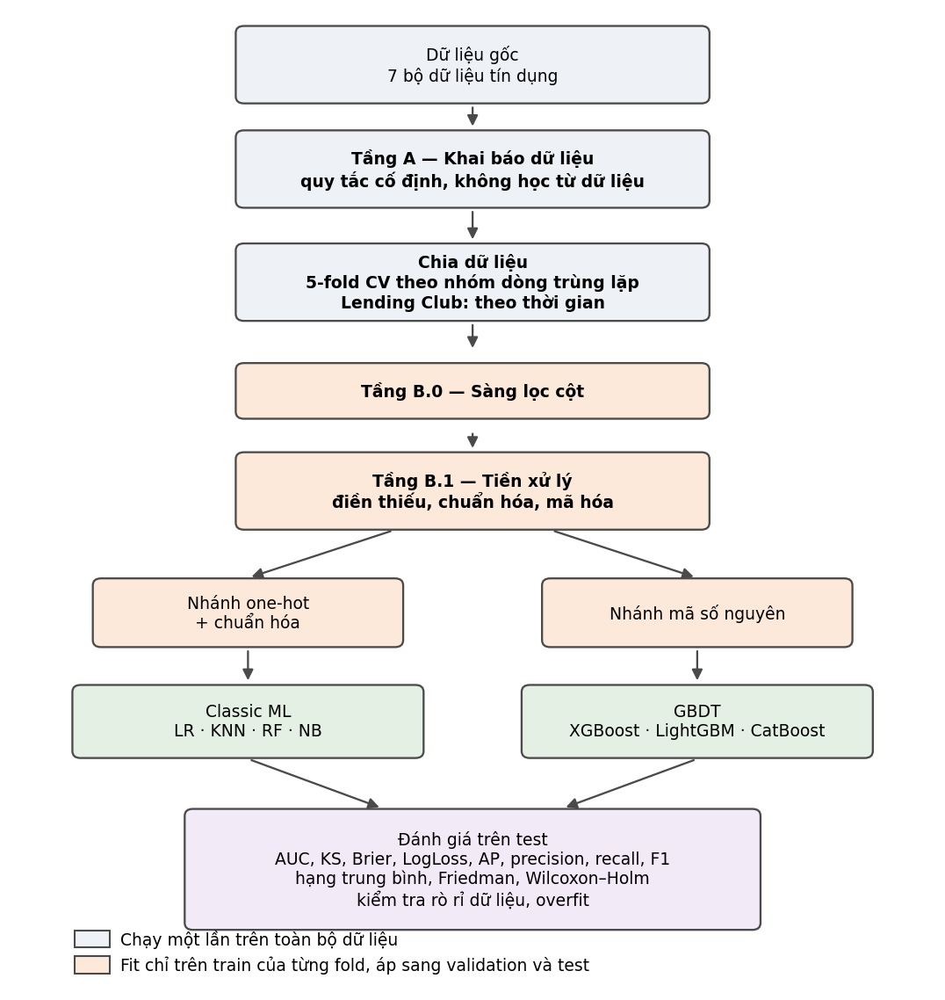
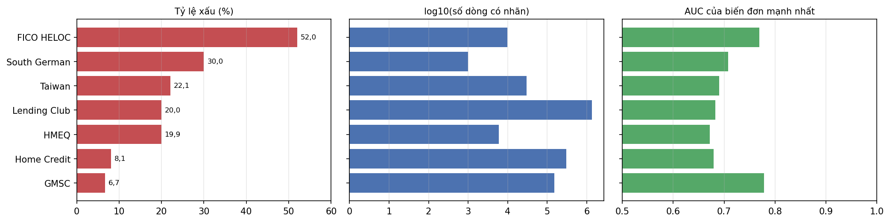
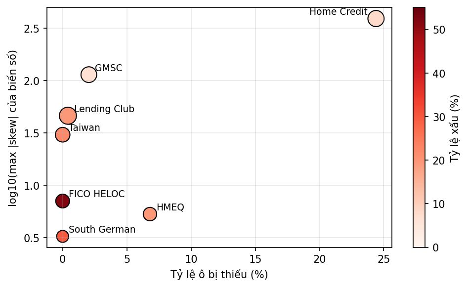
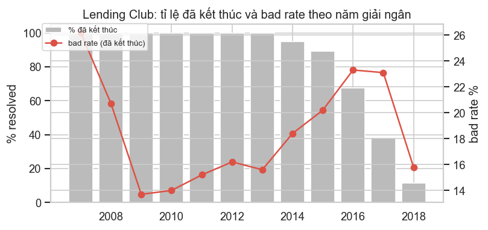
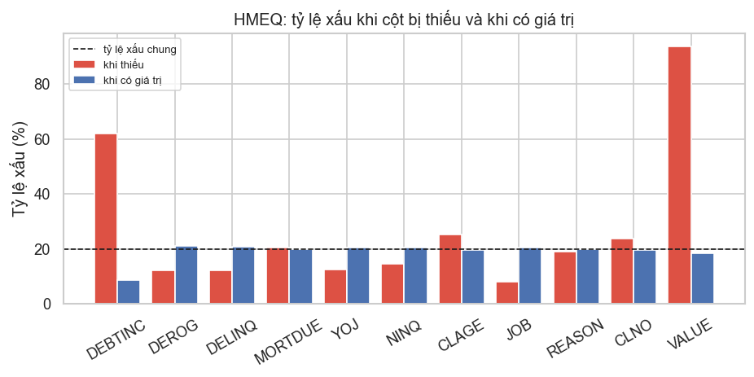
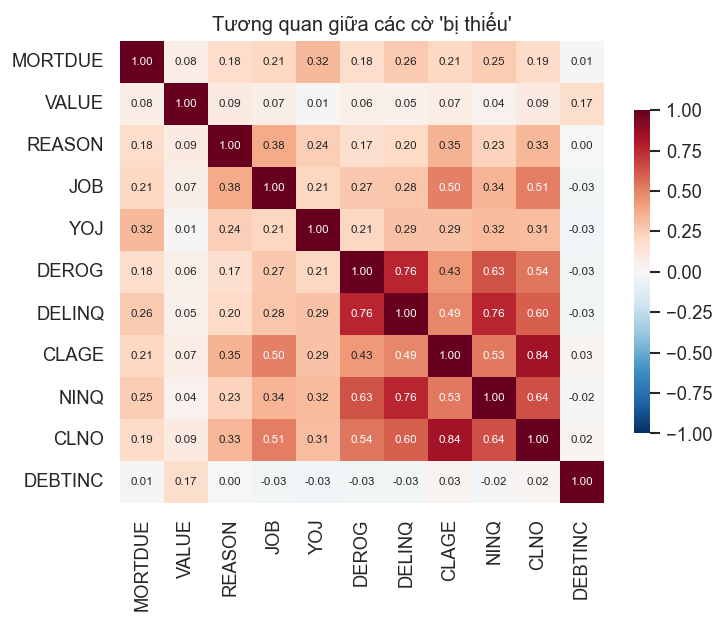
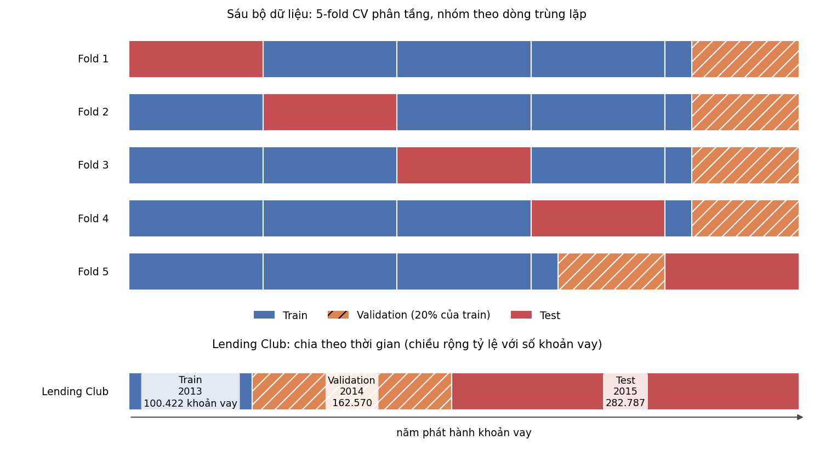

# Chương 3. Giải pháp đề xuất

Chương 2 đã trình bày bối cảnh của bài toán chấm điểm tín dụng và cơ sở lý thuyết của bảy mô hình được so sánh. Để kết quả so sánh có ý nghĩa, mọi mô hình phải được huấn luyện và đánh giá trên cùng dữ liệu, cùng cách chia và cùng tiền xử lý, đồng thời không bước nào được dùng thông tin của tập test. Chương này trình bày quy trình đáp ứng yêu cầu đó; mô tả chi tiết từng bước nằm trong [`configs/preprocessing_v1.md`](../../configs/preprocessing_v1.md).

Mục 3.1 trình bày tổng quan quy trình và nguyên tắc chống rò rỉ. Mục 3.2 mô tả bảy bộ dữ liệu và bước khai báo dữ liệu (tầng A). Mục 3.3 đến 3.5 trình bày cách chia dữ liệu và hai tầng tiền xử lý B.0, B.1. Mục 3.6 nêu cấu hình của bảy mô hình. Mục 3.7 và 3.8 trình bày cách kiểm soát rò rỉ qua giá trị thiếu ở HMEQ và các kiểm tra rò rỉ, overfit áp dụng cho mọi bộ dữ liệu.

## 3.1. Tổng quan quy trình

Hình 3.1 trình bày toàn bộ quy trình. Các bước màu xám chạy một lần trên toàn bộ dữ liệu và không học từ dữ liệu: tầng A khai báo dữ liệu bằng quy tắc cố định (mục 3.2), sau đó dữ liệu được chia (mục 3.3). Các bước màu cam học từ dữ liệu nên chỉ được fit trên phần train của từng fold: tầng B.0 sàng lọc cột (mục 3.4) và tầng B.1 tiền xử lý (mục 3.5). Tầng B.1 có hai nhánh, nhánh one-hot cho bốn mô hình classic ML và nhánh mã số nguyên cho ba mô hình GBDT (mục 3.6). Mọi mô hình được đánh giá trên cùng phần test bằng cùng các độ đo và kiểm định (chương 4).

*Hình 3.1. Tổng quan quy trình huấn luyện và đánh giá*

**Nguyên tắc chống rò rỉ.** Mọi bước học từ dữ liệu (median, trung bình, độ lệch chuẩn, danh sách nhóm, tỷ lệ thiếu, số giá trị khác nhau…) chỉ được fit trên phần train của từng fold, rồi áp dụng nguyên sang validation và test của fold đó.

## 3.2. Dữ liệu

Mục này mô tả bảy bộ dữ liệu chấm điểm tín dụng, đặc điểm của nhãn và chất lượng dữ liệu, cùng các bước khai báo dữ liệu (tầng A) trước khi chia. Phân tích khám phá chi tiết cho từng bộ nằm trong `notebooks/eda_*.ipynb` và [`report/data_report.md`](../data_report.md).

### 3.2.1. Các bộ dữ liệu

| Bộ dữ liệu | Nguồn | Đối tượng | Định nghĩa nhãn xấu (`target = 1`) |
|---|---|---|---|
| **Give Me Some Credit (GMSC)** | Kaggle 2011 | Khách hàng cá nhân | Quá hạn ≥ 90 ngày trong 2 năm tới |
| **Taiwan** | UCI (Yeh & Lien, 2009) | Chủ thẻ tín dụng tại Đài Loan, 04–09/2005 | Vỡ nợ ở tháng thanh toán kế tiếp |
| **Home Credit** | Kaggle 2018, bảng `application_train` | Khách hàng ít hoặc không có lịch sử tín dụng | Trễ hạn trong các kỳ trả nợ đầu tiên |
| **HMEQ** | SAS / Kaggle | Khoản vay thế chấp giá trị nhà | Vỡ nợ hoặc quá hạn nghiêm trọng |
| **South German** | UCI, bản hiệu chỉnh của Grömping (2019) | Người vay tại một ngân hàng Nam Đức | Rủi ro tín dụng xấu (mã gốc 0 → 1) |
| **FICO HELOC** | FICO Explainable ML Challenge, bản đã làm sạch | Người xin hạn mức vay thế chấp | Từng quá hạn ≥ 90 ngày trong 24 tháng |
| **Lending Club** | Kaggle, khoản vay được chấp nhận 2007–2018 | Khoản vay P2P tại Mỹ | `Charged Off` hoặc `Default` (khoản vay đã kết thúc) |

Đồ án dùng bản **South German** thay cho bản Statlog German gốc: hai bộ cùng 1.000 người vay và cùng tỷ lệ xấu 30%, nhưng bản Statlog có lỗi mã hóa ở biến lịch sử tín dụng (nhóm "đã trả hết" lại có tỷ lệ xấu cao nhất). Bản South German đã sửa lỗi này nên diễn giải hợp lý hơn.

Nhãn được chuẩn hóa về cùng một quy ước ở mọi bộ: **1 = xấu / vỡ nợ, 0 = tốt**.

### 3.2.2. Tổng quan sau khi khai báo

Số liệu dưới đây là sau tầng A (mục 3.2.4), tức đúng dữ liệu được đưa vào bước chia.

| Bộ dữ liệu | Số dòng | Biến số | Biến phân loại | Tỷ lệ xấu | Tỷ lệ tốt : xấu | Dòng thuộc nhóm trùng lặp |
|---|---:|---:|---:|---:|---:|---:|
| GMSC | 150.000 | 10 | 0 | 6,68% | 14,0 | 1.000 |
| Taiwan | 30.000 | 20 | 3 | 22,12% | 3,5 | 108 |
| Home Credit | 307.511 | 104 | 16 | 8,07% | 11,4 | 0 |
| HMEQ | 5.960 | 10 | 2 | 19,95% | 4,0 | 0 |
| South German | 1.000 | 3 | 17 | 30,00% | 2,3 | 0 |
| FICO HELOC | 9.871 | 21 | 2 | 52,03% | 0,9 | 2 |
| Lending Club | 545.779 | 92 | 9 | 14,07% | 6,1 | — |

Lending Club tính trên các khoản vay dùng cho train, validation và test (phát hành 2013–2015); chi tiết ở mục 3.2.5.

Hình 3.2 so sánh bảy bộ dữ liệu ở giai đoạn phân tích khám phá. Tỷ lệ xấu trải từ 6,7% (GMSC) đến 52% (FICO HELOC), số dòng chênh nhau ba bậc độ lớn, và không bộ nào có một biến đơn lẻ đạt AUC trên 0,78, nên không bộ nào dễ đến mức chỉ cần một biến.

*Hình 3.2. Tỷ lệ xấu, số dòng và AUC của biến đơn mạnh nhất theo bộ dữ liệu (giai đoạn EDA, trước tầng A; Lending Club tính trên toàn bộ khoản vay có nhãn)*

### 3.2.3. Đặc điểm của nhãn và chất lượng dữ liệu

#### Mức mất cân bằng nhãn

| Nhóm | Bộ dữ liệu | Tỷ lệ xấu | Hệ quả |
|---|---|---|---|
| Gần cân bằng (nhân tạo) | FICO HELOC | 52% | Mẫu được chọn lọc cho cuộc thi; xác suất dự đoán không phản ánh tỷ lệ vỡ nợ thực |
| Mất cân bằng vừa | South German, Taiwan, HMEQ, Lending Club | 14–30% | Chia phân tầng là đủ |
| Mất cân bằng nặng | Home Credit, GMSC | 7–8% | Accuracy không có ý nghĩa (đoán "tốt" cho tất cả đã đạt 92–93%); cần AUC, AP |

Hình 3.3 đặt các bộ dữ liệu theo hai khía cạnh chất lượng: tỷ lệ ô bị thiếu và độ lệch lớn nhất của biến số. Home Credit vừa thiếu nhiều (24% số ô) vừa lệch mạnh; GMSC và Lending Club ít thiếu nhưng có biến lệch rất mạnh; HMEQ thiếu ở mức vừa và chính các giá trị thiếu này mang thông tin về nhãn (mục 3.2.6).

*Hình 3.3. Tỷ lệ ô bị thiếu và độ lệch lớn nhất của biến số theo bộ dữ liệu (kích thước điểm theo số dòng, màu theo tỷ lệ xấu; giai đoạn EDA)*

Tỷ lệ 30% của South German là do **thiết kế lấy mẫu** (lấy dư người xấu), không phải tỷ lệ thực của ngân hàng. Tương tự, tỷ lệ 52% của HELOC là tỷ lệ nhân tạo.

#### Các điểm bất thường chính

| Bộ dữ liệu | Bất thường | Ảnh hưởng |
|---|---|---|
| GMSC | Tỷ lệ sử dụng hạn mức (lẽ ra ≤ 1) lên tới ~50.000; `DebtRatio`, thu nhập có độ lệch (skew) ≈ 100; mã 96/98 trong các cột đếm số lần trễ hạn; có người 0 tuổi | Phân phối lệch cực đoan nhất trong 7 bộ |
| Taiwan | Mã không có trong tài liệu gốc (`EDUCATION` 0/5/6, `MARRIAGE` 0); nhãn phụ thuộc rất mạnh vào trạng thái thanh toán tháng gần nhất | Bài toán gần như dự báo một tháng tới |
| Home Credit | 24% ô bị thiếu, 41 cột thiếu > 50%; `DAYS_EMPLOYED = 365243` ở 18% hồ sơ (mã cho người không đi làm) | Dữ liệu rộng và thưa; tín hiệu phân tán |
| HMEQ | Việc thiếu dữ liệu mang thông tin rất mạnh: thiếu giá trị tài sản → 94% là xấu; thiếu tỷ lệ nợ/thu nhập → 62% là xấu | Mô hình có thể "đọc" việc thiếu thay vì hành vi người vay |
| FICO HELOC | Không có NaN nhưng dùng mã âm −7/−8/−9 thay cho giá trị thiếu (~58% số dòng có mã −7) | Phải đổi về NaN trước khi xử lý |
| Lending Club | Nhãn phải suy ra từ trạng thái khoản vay; tỷ lệ xấu thay đổi theo năm; nhiều cột chỉ có sau khi giải ngân (rò rỉ); nhiều trường bureau chỉ có từ khoảng 2013 | Phải chia theo thời gian và loại cột rò rỉ |

#### Dòng trùng lặp

Một số bộ có các dòng giống hệt nhau về mọi đặc trưng: GMSC 1.000 dòng (37 nhóm có nhãn khác nhau), Taiwan 108 dòng (52 nhóm, 21 nhóm có nhãn khác nhau), HELOC 1 cặp. Các dòng này **được giữ lại** vì có thể là những người vay khác nhau có hồ sơ giống nhau (nhiều giá trị 0, thiếu thu nhập), nhưng được xử lý bằng cách chia theo nhóm (mục 3.3) để không có bản sao nào nằm ở cả train và test.

### 3.2.4. Khai báo dữ liệu (tầng A)

Tầng A chỉ sửa **cách hiểu dữ liệu**, không học bất kỳ giá trị nào từ dữ liệu (không tính median, trung bình, tần suất…), nên được chạy một lần trên toàn bộ dữ liệu trước khi chia mà không gây rò rỉ. Phép thử: nếu một bước cho cùng kết quả khi chỉ đưa vào một dòng duy nhất, bước đó không học từ dữ liệu.

| Bộ dữ liệu | Bỏ cột | Mã đặc biệt → NaN | Biến phân loại | Ghi chú |
|---|---|---|---|---|
| GMSC | Không | Không | Không có | Giữ nguyên mã 96/98 |
| Taiwan | `ID` | Không | `SEX`, `EDUCATION`, `MARRIAGE` | `PAY_0`…`PAY_6` giữ là biến số |
| Home Credit | Không (giữ `SK_ID_CURR` làm khóa, **không phải feature**) | `DAYS_EMPLOYED = 365243` | 16 cột kiểu chuỗi | Chỉ dùng bảng chính; bảng phụ để dành cho bước FE |
| HMEQ | Không | Không | `REASON`, `JOB` | |
| South German | Không | Không | 17 biến mã hóa dạng nhóm | Biến số: `duration`, `amount`, `age` |
| FICO HELOC | Không | −7, −8, −9 ở mọi cột | `MaxDelq2PublicRecLast12M`, `MaxDelqEver` | Bản đã làm sạch (9.871 dòng, đã loại 588 dòng có mọi đặc trưng = −9) |
| Lending Club | ID/văn bản, cột rò rỉ, `zip_code`, cột hằng số do bộ lọc | Không | 9 biến (`grade`, `sub_grade`, `purpose`, `addr_state`…) | Xem mục 3.2.5 |

Các việc **không làm** ở tầng A vì học từ dữ liệu hoặc là tạo đặc trưng: điền giá trị thiếu, chuẩn hóa, one-hot, cắt ngoại lai, bỏ cột theo thống kê, tạo feature mới.

### 3.2.5. Lending Club — khai báo chi tiết

#### Lọc dòng

| Thứ tự | Bộ lọc | Lý do |
|---|---|---|
| 1 | Chỉ giữ khoản vay đã kết thúc: `Fully Paid` → 0; `Charged Off`, `Default` → 1 (các trạng thái "Does not meet the credit policy" được gộp vào trạng thái tương ứng) | Chỉ khoản vay đã kết thúc mới có nhãn |
| 2 | Chỉ giữ hồ sơ cá nhân (`application_type = Individual`) | Hồ sơ đồng vay chỉ có từ khoảng 2015, gây dịch chuyển theo thời gian |
| 3 | Chỉ giữ khoản vay kỳ hạn 36 tháng | Khoản vay 60 tháng đáo hạn chậm, làm nặng vấn đề khoản vay chưa kết thúc |
| 4 | Chỉ giữ khoản vay phát hành từ **năm 2013** | 22 trường bureau không có ở khoản vay trước 2013 |

**Cách chọn năm 2013.** Tỷ lệ thiếu trung bình của 22 trường bureau (`tot_cur_bal`, `avg_cur_bal`, `num_*`, `mo_sin_*`…) theo năm phát hành, trên giai đoạn train:

| Năm | 2007–2011 | 2012 | 2013 |
|---|---:|---:|---:|
| Tỷ lệ thiếu | 100% | 52,0% | **0,2%** |

Năm đầu tiên có tỷ lệ thiếu ≤ 2% là 2013. Nếu giữ các năm trước, khoảng 31% dữ liệu train thiếu các trường này trong khi validation và test đầy đủ; khi đó việc điền median thực chất là một tín hiệu "khoản vay cũ" chỉ tồn tại ở train. Bộ lọc loại **75.004** dòng train (2007–2012), tỷ lệ xấu của train gần như không đổi (12,63% → 12,33%).

#### Bỏ cột

| Nhóm | Cột |
|---|---|
| ID / văn bản | `id`, `member_id`, `url`, `desc`, `title`, `emp_title` |
| Rò rỉ (chỉ biết sau khi giải ngân) | `loan_status`, `total_pymnt*`, `total_rec_*`, `recoveries`, `collection_recovery_fee`, `out_prncp*`, `last_pymnt_*`, `next_pymnt_d`, `last_credit_pull_d`, `last_fico_range_*`, `debt_settlement_*`, `settlement_*`, `hardship_*`, `pymnt_plan`, `deferral_term`, `payment_plan_start_date`, `orig_projected_additional_accrued_interest` |
| Hằng số do bộ lọc | `application_type`, `verification_status_joint`, `term` |
| Khác | `zip_code`: gần trùng thông tin với `addr_state`, là biến đại diện nhạy cảm và sinh 884 cột khi one-hot |

Ở giai đoạn EDA, các cột rò rỉ cho AUC đơn biến tới 0,84–0,94 (ví dụ cờ thỏa thuận nợ tương ứng 99,99% là xấu), nên việc loại bỏ là bắt buộc.

**Đổi định dạng:** `earliest_cr_line` (dạng "tháng-năm") đổi sang năm thập phân. `issue_d` chỉ dùng để chia theo thời gian, không đưa vào đặc trưng.

#### Mốc thời gian

Tỷ lệ khoản vay 36 tháng (hồ sơ cá nhân) đã kết thúc tại thời điểm chốt dữ liệu (quý 4/2018):

| Năm phát hành | 2007–2014 | 2015 | 2016 | 2017 | 2018 |
|---|---:|---:|---:|---:|---:|
| Đã kết thúc | 100% | 99,95% | 71,9% | 40,7% | 12,1% |

Năm test được chọn là năm gần nhất có ít nhất 95% khoản vay đã kết thúc (**2015**), năm validation là năm liền trước (**2014**), train từ năm 2013 đến trước năm validation (**2013**). Các năm 2016–2018 không được dùng: khi chỉ giữ khoản vay đã kết thúc, mẫu của các năm này lệch về các khoản vỡ nợ sớm hoặc trả hết sớm, không đại diện cho khoản vay của năm đó.

*Hình 3.4. Tỷ lệ khoản vay đã kết thúc và tỷ lệ xấu theo năm phát hành (toàn bộ Lending Club, gồm cả kỳ hạn 60 tháng, giai đoạn EDA)*

Hình 3.4 tính trên toàn bộ khoản vay, gồm cả kỳ hạn 60 tháng và chưa qua các bước lọc ở trên, nên tỷ lệ đã kết thúc của 2014–2015 và tỷ lệ xấu cao hơn so với bảng trên và với dữ liệu dùng để huấn luyện. Dù vậy, hình cho thấy cùng một xu hướng: từ 2016, tỷ lệ khoản vay đã kết thúc giảm mạnh, nên tỷ lệ xấu quan sát được ở các năm này không còn đáng tin. Trên dữ liệu sau khi lọc, tỷ lệ xấu tăng dần theo năm: 12,33% (2013) → 13,73% (2014) → 14,88% (2015). Đây là trôi dạt thật theo thời gian và ảnh hưởng đến calibration trên test (chương 4).

### 3.2.6. HMEQ — giá trị thiếu là dấu hiệu rò rỉ

Kiểm tra rò rỉ (mục 4.8) cho thấy một điểm bất thường ở HMEQ: một mô hình **chỉ biết cột nào bị thiếu**, không thấy bất kỳ giá trị nào, đạt AUC 0,836 trên test — cao hơn Logistic Regression dùng toàn bộ dữ liệu (0,803). Phân tích chi tiết nằm trong `notebooks/eda_09_hmeq_missingness.ipynb`.

Hình 3.5 so sánh tỷ lệ xấu giữa các dòng thiếu và có giá trị ở từng cột, còn Hình 3.6 cho thấy các cột thường bị thiếu cùng nhau: các cột lịch sử tín dụng `DEROG`, `DELINQ`, `NINQ`, `CLAGE`, `CLNO` có tương quan về việc bị thiếu từ 0,43 đến 0,84, tức chúng thường cùng vắng mặt trong một hồ sơ. Vì vậy mẫu thiếu tạo thành các nhóm hồ sơ rõ rệt, và mô hình có thể nhận ra các nhóm này.

*Hình 3.5. HMEQ: tỷ lệ xấu khi từng cột bị thiếu và khi có giá trị*

*Hình 3.6. HMEQ: tương quan giữa các cờ "bị thiếu" của các cột*

**Mẫu thiếu tách nhãn theo cả hai chiều:**

| Mẫu giá trị thiếu | Số dòng | Tỷ lệ xấu |
|---|---:|---:|
| Đủ dữ liệu | 3.364 | 8,9% |
| Chỉ thiếu `DEBTINC` (tỷ lệ nợ/thu nhập) | 883 | 61,2% |
| Thiếu `MORTDUE` và `DEBTINC` | 52 | 65,4% |
| Thiếu `VALUE` (giá trị nhà) và `DEBTINC` | 47 | **100%** |
| Chỉ thiếu `YOJ` (số năm làm việc) | 184 | 4,9% |
| Chỉ thiếu `JOB` | 81 | 1,2% |
| Thiếu `DEROG`, `DELINQ` và `NINQ` (lịch sử tín dụng) | 87 | **0%** |

- Hồ sơ thiếu ít nhất một cột (2.596 dòng, 43,6%) có tỷ lệ xấu **34,2%**, gấp gần 4 lần hồ sơ đủ dữ liệu (8,9%).
- Trong 17 mẫu thiếu có ít nhất 30 dòng, tỷ lệ xấu trải từ **0% đến 100%**.
- Chỉ riêng các cờ "bị thiếu" (không dùng giá trị nào) đạt AUC 0,825 ± 0,011 trong 5-fold CV.

**Vì sao đây nhiều khả năng là rò rỉ.** Theo mô tả gốc, dữ liệu gồm *các khoản vay đã được cấp*, nhãn `BAD` được ghi nhận sau đó. Một quy luật "sạch" như 100% xấu khi thiếu giá trị nhà và tỷ lệ nợ/thu nhập, và 0% xấu khi thiếu toàn bộ lịch sử tín dụng, khó giải thích bằng hành vi của người vay lúc nộp đơn. Nó phù hợp hơn với giả thuyết các trường được **điền hoặc để trống khác nhau tùy theo kết cục** của khoản vay (ví dụ hồ sơ khoản vay xấu được xử lý, cập nhật theo quy trình khác). Khi đó, mẫu thiếu chứa thông tin về nhãn mà ngân hàng không có tại thời điểm xét duyệt.

**Tiền xử lý ở tầng B.1 truyền tín hiệu này cho mô hình:** biến phân loại thiếu được gom vào nhóm `__missing__`, còn biến số thiếu được điền bằng median — một giá trị lặp lại đúng y hệt mà mô hình cây nhận ra dễ dàng. Sau tầng B.1, một mô hình nhận ra được dòng nào từng bị thiếu với AUC **0,995**. Cách ngăn rò rỉ được trình bày ở mục 3.7.

## 3.3. Chia dữ liệu

### Sáu bộ dữ liệu không có yếu tố thời gian

Sáu bộ dữ liệu được đánh giá trên phần test giữ lại trong sơ đồ **5-fold CV**; phần validation để tinh chỉnh là **20% tập train của mỗi fold**, tương tự thiết lập đánh giá trong Baesens et al. (2026). Hình 3.7 minh họa hai cách chia: ở sáu bộ dữ liệu, mỗi fold lần lượt dùng một phần năm dữ liệu làm test và lấy 20% phần còn lại làm validation; ở Lending Club, train, validation và test là ba năm phát hành liên tiếp, nên mô hình luôn được đánh giá trên các khoản vay phát hành sau dữ liệu huấn luyện.

*Hình 3.7. Sơ đồ chia dữ liệu: 5-fold CV cho sáu bộ dữ liệu và chia theo thời gian cho Lending Club (phần validation trong 5-fold CV được vẽ gộp để dễ nhìn; thực tế là mẫu phân tầng 20% của phần train)*

| Phần | Tỷ lệ trên toàn bộ dữ liệu | Dùng cho |
|---|---|---|
| Test (1 fold) | 20% | Đánh giá |
| Validation (20% của phần train) | 16% | Chọn ngưỡng, tinh chỉnh |
| Train | 64% | Huấn luyện, fit tầng B.0 và B.1 |

Các lựa chọn chi tiết:

| Mục | Giá trị | Lý do |
|---|---|---|
| Phân tầng theo nhãn | Có | Giữ tỷ lệ xấu như nhau giữa các fold |
| Nhóm dòng trùng lặp | `StratifiedGroupKFold`, nhóm = mã băm của toàn bộ giá trị đặc trưng; validation cũng tách theo nhóm | Các dòng giống hệt nhau luôn nằm cùng một phần, nên không có bản sao nào ở cả train và test |
| Xáo trộn, seed | `shuffle=True`, `random_state=42` | Tái lập được |

Mọi bước sau (các mô hình khác nhau) dùng **đúng cùng một bộ chỉ số fold**, được lưu trong `data/splits/<bộ dữ liệu>/folds.parquet`.

### Lending Club — chia theo thời gian

Lending Club không dùng 5-fold ngẫu nhiên vì dữ liệu có yếu tố thời gian: xáo trộn sẽ cho mô hình "nhìn thấy tương lai". Dữ liệu được sắp theo `issue_d`, không xáo trộn, và chỉ có **một lần chia**: train 2013, validation 2014, test 2015 (cách chọn mốc ở mục 3.2.5).

- Vì chỉ có một lần chia, độ bất định được đo bằng **bootstrap trên tập test** (1.000 lần lặp).
- Sau khi chọn ngưỡng trên validation, mô hình cuối được **fit lại trên train + validation** (2013–2014) rồi đánh giá trên test 2015.

## 3.4. Tầng B.0 — Sàng lọc cột

Bước này cần thiết: `SimpleImputer` của scikit-learn âm thầm bỏ những cột trống hoàn toàn, và Lending Club có các cột trống ở giai đoạn train nhưng đầy đủ ở giai đoạn test. B.0 làm việc bỏ cột trở nên tường minh và có ghi lại.

| Quy tắc (fit chỉ trên train của fold) | Hành động |
|---|---|
| Cột thiếu 100% | Bỏ, ghi log |
| Cột số chỉ có một giá trị (không tính NaN) | Bỏ, ghi log |
| Cột phân loại chỉ có một giá trị (tính NaN là một nhóm) | Bỏ, ghi log |
| Tỷ lệ thiếu chênh lệch giữa train và validation/test > 30 điểm phần trăm | Giữ, đưa vào bảng cảnh báo |

Kết quả:

| Bộ dữ liệu | Cột bị bỏ | Cảnh báo |
|---|---|---|
| GMSC, Taiwan, HMEQ, South German, HELOC | Không | Không |
| Home Credit | `FLAG_MOBIL` ở fold 2, 4, 5 (chỉ có một dòng khác giá trị) | Không |
| Lending Club | 31 cột: 29 cột trống ở train (12 cột người đồng vay `sec_app_*`, 3 cột hồ sơ đồng vay, 14 trường bureau có từ khoảng 2015–2016) và 2 cột hằng số (`policy_code`, `disbursement_method`) | **Không** (trước khi lọc năm 2013 có 22 cột lệch ~31 điểm) |

## 3.5. Tầng B.1 — Tiền xử lý

Tầng B.1 gồm ba bước tiền xử lý thường dùng cho dữ liệu tín dụng dạng bảng (xem thêm Baesens et al., 2026):

| Bước | Biến số | Biến phân loại |
|---|---|---|
| 1. Giá trị thiếu | Điền bằng **median** của train | Đổi sang chuỗi, tạo **một nhóm mới** `__missing__` cho giá trị thiếu |
| 2. Mã hóa | — | **One-hot**; nhóm chưa từng xuất hiện ở train → toàn số 0 |
| 3. Chuẩn hóa | **Standardize** về trung bình 0, độ lệch chuẩn 1 theo thống kê của train | — |

Bước 2 có hai nhánh, tùy nhóm mô hình:

| Nhóm mô hình | Giá trị thiếu | Mã hóa biến phân loại | Chuẩn hóa biến số | Thư mục |
|---|---|---|---|---|
| Classic ML (LR, KNN, RF, NB) | Có | **One-hot** | Có | `data/processed/classic/` |
| GBDT (XGBoost, LightGBM, CatBoost) | Có | **Mã số nguyên** (`OrdinalEncoder`; nhóm chưa thấy ở train → −1) | Có | `data/processed/gbdt/` |

Hai nhánh dùng cùng fold, cùng cột sau B.0 và cùng median, trung bình, độ lệch chuẩn của train; chỉ khác cách mã hóa biến phân loại. Đồ án **không** thêm các bước ngoài pipeline này:

| Không làm | Lý do |
|---|---|
| Cắt hoặc xử lý ngoại lai | Để mọi mô hình nhận cùng dữ liệu đầu vào; ảnh hưởng của ngoại lai được báo cáo riêng như phân tích phụ (mục 4.3.3) |
| Cân bằng lớp (oversampling, undersampling, `class_weight`) | Giữ nguyên phân phối nhãn |
| Cột đánh dấu giá trị thiếu | Giữ pipeline tối giản; thông tin thiếu của biến phân loại vẫn được giữ qua nhóm `__missing__` |
| Tạo đặc trưng (tỷ lệ, tương tác, tổng hợp bảng phụ) | Dành cho bước sau |

**Kiểm tra tự động** cho mọi fold: không còn NaN hay giá trị vô cực; các biến số ở train có trung bình ≈ 0 và độ lệch chuẩn ≈ 1. Validation và test **không** có đúng trung bình 0 và độ lệch chuẩn 1 vì được biến đổi bằng thống kê của train — đây là dấu hiệu không có rò rỉ.

Số đặc trưng sau B.1:

| Bộ dữ liệu | Đầu vào | Nhánh classic (one-hot) | Nhánh GBDT (mã số nguyên) |
|---|---|---:|---:|
| GMSC | 10 số | 10 | 10 |
| Taiwan | 20 số + 3 phân loại | 33 | 23 |
| Home Credit | 104 số + 16 phân loại | 250 (249 ở các fold bỏ `FLAG_MOBIL`) | 120 (119) |
| HMEQ | 10 số + 2 phân loại | 20 | 12 |
| South German | 3 số + 17 phân loại | 71 | 20 |
| FICO HELOC | 21 số + 2 phân loại | 37 | 23 |
| Lending Club | 62 số + 8 phân loại | 184 (188 khi fit lại trên train + validation) | 70 |

## 3.6. Mô hình

Bốn mô hình classic ML được huấn luyện với **tham số mặc định** của scikit-learn 1.7, chưa tinh chỉnh. Cả bốn dùng **cùng các fold** và **cùng ma trận đặc trưng** sau B.1 (one-hot, chuẩn hóa), nên khác biệt về kết quả chỉ đến từ mô hình.

| Mô hình | Cấu hình mặc định | Đặc điểm |
|---|---|---|
| **Logistic Regression (LR)** (Cox, 1958) | `C = 1,0`, phạt L2, solver `lbfgs`; `max_iter = 2000` | Tuyến tính, dễ diễn giải; là chuẩn của ngành chấm điểm tín dụng |
| **K-Nearest Neighbors (KNN)** (Cover & Hart, 1967) | `k = 5`, trọng số đều, khoảng cách Euclid | Phi tham số, dựa trên khoảng cách; xác suất chỉ nhận 6 giá trị (0; 0,2; …; 1) |
| **Random Forest (RF)** (Breiman, 2001) | 100 cây, cây phát triển hết độ sâu, mỗi lần tách xét √p đặc trưng | Tổ hợp cây quyết định; nắm được quan hệ phi tuyến và tương tác; không nhạy với ngoại lai |
| **Naive Bayes (NB)** (Maron, 1961) | `GaussianNB` | Giả định các đặc trưng độc lập có điều kiện và có phân phối chuẩn |

Với LR, mọi lần fit hội tụ sau tối đa 89 vòng (dưới giới hạn mặc định 100 của scikit-learn), nên kết quả trùng với `LogisticRegression()` mặc định hoàn toàn. KNN **không được chấm điểm trên chính tập train**, vì mỗi điểm train là láng giềng gần nhất của chính nó (AUC train vô nghĩa) và phép tính khoảng cách train × train rất tốn kém.

Ba mô hình **gradient boosting (GBDT)** — các cách cài đặt khác nhau của gradient boosting trên cây quyết định (Friedman, 2001) — dùng nhánh mã số nguyên, với **tham số mặc định của từng thư viện**; chỉ đặt seed (42), số luồng CPU và tắt log:

| Mô hình | Thư viện | Cấu hình mặc định | Đặc điểm |
|---|---|---|---|
| **XGBoost (XGB)** (Chen & Guestrin, 2016) | xgboost 3.3 | 100 cây, độ sâu 6, learning rate 0,3, thuật toán `hist` | Boosting theo độ sâu (level-wise), có điều chuẩn L2 |
| **LightGBM (LGBM)** (Ke et al., 2017) | lightgbm 4.7 | 100 cây, 31 lá, learning rate 0,1 | Boosting theo lá (leaf-wise), chia theo histogram |
| **CatBoost** (Prokhorenkova et al., 2018; Dorogush et al., 2018) | catboost 1.2 | 1.000 cây, độ sâu 6, learning rate tự chọn theo dữ liệu | Cây đối xứng (oblivious), điều chuẩn L2 giá trị lá; với cấu hình mặc định dùng boosting thông thường (`Plain`), không dùng ordered boosting (mục 2.4.6) |

Mã số nguyên của biến phân loại được đưa vào cả ba mô hình **như biến số**. Cách này không tận dụng cơ chế xử lý biến phân loại riêng của CatBoost (target statistics) hay LightGBM; đây là lựa chọn để ba thư viện được so sánh trên cùng đầu vào. Không dùng dừng sớm (early stopping) vì không phải tham số mặc định.

SVM, một mô hình classic phổ biến trong chấm điểm tín dụng, chưa được đưa vào: SVM hạt nhân có chi phí huấn luyện tăng xấp xỉ theo bình phương số dòng, không khả thi trên Home Credit và Lending Club (100–263 nghìn dòng train) nếu không lấy mẫu con, mà lấy mẫu con thì so sánh không còn cùng điều kiện.

## 3.7. Kiểm soát rò rỉ qua giá trị thiếu (HMEQ)

Để đo mức ảnh hưởng của rò rỉ ở HMEQ (mục 3.2.6), đồ án tạo thêm hai phiên bản, chạy đủ 7 mô hình và so sánh với bản gốc. Bản gốc `hmeq` vẫn được giữ trong so sánh chính để mọi bộ dữ liệu dùng cùng một cách tiền xử lý.

| Phiên bản | Cách làm | Tầng | Ưu điểm | Nhược điểm |
|---|---|---|---|---|
| `hmeq` (gốc) | Tiền xử lý B.1: median và nhóm `__missing__` | — | Cùng cách xử lý với mọi bộ dữ liệu | Mô hình đọc được mẫu thiếu |
| `hmeq_complete` | Chỉ giữ hồ sơ đủ dữ liệu (3.364 dòng) | A (lọc dòng theo quy tắc cố định) | Không còn giá trị thiếu nào: sạch tuyệt đối | Đổi tổng thể: bỏ 43,6% dữ liệu, tỷ lệ xấu còn 8,9%; chia fold lại |
| `hmeq_blind` | Giữ mọi dòng và **đúng các fold** của bản gốc; mỗi giá trị thiếu (số và phân loại) được điền bằng **một giá trị rút ngẫu nhiên** từ các giá trị quan sát được của cột đó trên train | B.1 (học trên train của fold) | Giữ tổng thể; so sánh ghép cặp với bản gốc; xóa nhóm `__missing__` và điểm median | Không xóa hết dấu vết (mục 4.8) |

Cách điền ngẫu nhiên được cài đặt trong `src/features/preprocess.py` (`RandomDrawImputer`, seed cố định) và chỉ áp dụng cho `hmeq_blind`; mọi bộ dữ liệu khác vẫn dùng tiền xử lý B.1.

## 3.8. Kiểm tra rò rỉ và overfit

Script `src/models/validity_checks.py` chạy các kiểm tra sau trên fold 1 của mỗi bộ dữ liệu (chỉ phần test), kết quả trong `reports/models/validity/`:

| Kiểm tra | Câu hỏi | Dấu hiệu bất thường |
|---|---|---|
| Khoảng cách láng giềng gần nhất | Dòng test có phải bản sao gần đúng của dòng train không? | Khoảng cách test → train nhỏ hơn rõ so với train → train |
| Đặc trưng đơn mạnh nhất | Có cột nào gần như tiết lộ nhãn không? | AUC của một cột đơn lẻ (mô hình cây, giữ NaN) > 0,9 |
| Mô hình chỉ dùng mẫu thiếu | Việc thiếu dữ liệu có mang thông tin về nhãn không? | AUC cao, nhất là khi tiệm cận AUC của mô hình đầy đủ |
| Nhận ra dòng thiếu sau B.1 | Sau tiền xử lý, mô hình còn nhận ra được dòng nào từng bị thiếu không? | AUC gần 1 (đi cùng mẫu thiếu có thông tin thì là kênh rò rỉ) |
| Khoảng cách AUC train − test | Mô hình có học thuộc tập train không? | Khoảng cách lớn |
| Khoảng cách AUC validation − test | Lựa chọn trên validation (ngưỡng, sau này là tham số) có tổng quát hóa sang test không? | Validation cao hơn test một cách hệ thống |

Ngoài ra, các kiểm soát rò rỉ có sẵn trong thiết kế: tiền xử lý chỉ học trên train (mục 3.1), chia theo nhóm dòng trùng lặp, Lending Club chia theo thời gian và bỏ cột chỉ có sau khi giải ngân, ngưỡng chọn trên validation.

Chương này đã trình bày quy trình chấm điểm tín dụng thống nhất trên bảy bộ dữ liệu. Tầng A khai báo dữ liệu bằng các quy tắc cố định, không học từ dữ liệu; sau đó dữ liệu được chia theo 5-fold CV có nhóm theo dòng trùng lặp, riêng Lending Club chia theo thời gian. Hai tầng tiền xử lý B.0 và B.1 chỉ học trên phần train của từng fold, với nhánh one-hot cho classic ML và nhánh mã số nguyên cho GBDT, nên bảy mô hình nhận cùng dữ liệu và khác biệt về kết quả chỉ đến từ mô hình. Rò rỉ qua giá trị thiếu ở HMEQ được kiểm soát bằng hai phiên bản dữ liệu bổ sung, và mọi bộ dữ liệu đều được kiểm tra rò rỉ, overfit. Chương 4 trình bày các độ đo, thiết lập thí nghiệm và kết quả thu được từ quy trình này.
