# Chương 4. Đánh giá thực nghiệm

Chương 3 đã trình bày quy trình dữ liệu, tiền xử lý và cấu hình của bảy mô hình. Chương này đánh giá các mô hình đó bằng thực nghiệm nhằm trả lời các câu hỏi nghiên cứu nêu ở mục 1.3: mô hình học máy có vượt trội Logistic Regression không, mô hình nào tốt nhất tổng thể, đặc điểm nào của dữ liệu quyết định mô hình thắng, và kết quả có đáng tin không.

Mục 4.1 trình bày các độ đo và phương pháp so sánh thống kê. Mục 4.2 mô tả thiết lập thí nghiệm, kích thước dữ liệu, thời gian chạy, cách tái lập và cách xây dựng learning curves. Mục 4.3 phân tích mô hình cơ sở Logistic Regression. Mục 4.4 so sánh bốn mô hình classic ML theo AUC, mục 4.5 theo precision, recall và F1, mục 4.6 trình bày learning curves. Mục 4.7 so sánh ba mô hình gradient boosting với classic ML. Mục 4.8 kiểm tra rò rỉ dữ liệu và overfit. Tất cả mô hình dùng tham số mặc định.

## 4.1. Các tham số đánh giá

### 4.1.1. Độ đo đánh giá

| Nhóm | Độ đo | Ý nghĩa |
|---|---|---|
| Khả năng xếp hạng | **AUC**, Gini = 2·AUC − 1, KS | Mô hình có xếp người xấu có rủi ro cao hơn người tốt không; không phụ thuộc ngưỡng |
| Chất lượng xác suất | Brier, LogLoss | Xác suất dự đoán có gần tỷ lệ thực không; phụ thuộc tỷ lệ xấu nên không so sánh được giữa các bộ |
| Lớp thiểu số | Average Precision (AP) | Tóm tắt đường precision–recall; mức cơ sở bằng tỷ lệ xấu |
| Theo ngưỡng | Precision, Recall, F1, Accuracy | Tại ngưỡng tối đa hóa F1 **trên validation**, áp nguyên sang test |

Với 6 bộ dữ liệu CV, kết quả được báo cáo là trung bình ± độ lệch chuẩn trên 5 fold test. Với Lending Club, kết quả là mô hình fit lại trên train + validation, kèm khoảng tin cậy 95% của AUC bằng bootstrap.

### 4.1.2. So sánh mô hình

Các mô hình được so sánh trên 7 bộ dữ liệu bằng:

1. **Hạng trung bình**: trên mỗi bộ, xếp hạng các mô hình theo độ đo (1 = tốt nhất), rồi lấy trung bình qua các bộ.
2. **Kiểm định Friedman** kèm hiệu chỉnh **Iman–Davenport**: kiểm tra giả thuyết "mọi mô hình có hạng như nhau".
3. **Wilcoxon signed-rank từng cặp** với hiệu chỉnh **Holm** cho nhiều phép so sánh.
4. Bổ sung ở mức từng bộ dữ liệu: số fold mô hình thắng LR (6 bộ CV); với Lending Club, **bootstrap ghép cặp** (1.000 lần) của chênh lệch AUC trên cùng 282.787 dòng test.

Ngoài AUC, các mô hình được so sánh trên **precision, recall và F1** tại ngưỡng tối đa F1 chọn trên validation (mục 4.1.1), cùng **đường precision–recall** trên test.

Với chỉ 7 bộ dữ liệu, Wilcoxon có năng lực thống kê thấp: p nhỏ nhất có thể đạt được (khi một mô hình thắng ở cả 7 bộ) là 0,0156 trước hiệu chỉnh. Với 4 mô hình (6 cặp) hay 7 mô hình (21 cặp), sau hiệu chỉnh Holm không cặp nào có thể xuống dưới 0,05.

Vì vậy, khi so sánh 7 mô hình, đồ án bổ sung hai kiểm định hậu nghiệm trên **hạng trung bình** theo Demšar (2006), là cách làm chuẩn khi có nhiều mô hình nhưng ít bộ dữ liệu:

- **So sánh với mô hình có hạng tốt nhất (control)**: kiểm định z trên chênh lệch hạng, z = (Rᵢ − R_best) / √(k(k+1)/(6N)), hiệu chỉnh Holm cho k − 1 phép so sánh. Ít phép so sánh hơn nên mạnh hơn so sánh mọi cặp.
- **Nemenyi critical difference (CD)**: CD = q₀.₀₅ · √(k(k+1)/(6N)); hai mô hình có hạng trung bình cách nhau ít hơn CD được coi là chưa khác biệt có ý nghĩa. Với k = 7, N = 7: CD = 3,41.

## 4.2. Phương pháp thí nghiệm

### 4.2.1. Thiết lập

| Mục | Giá trị |
|---|---|
| Mô hình | Classic ML: LR, KNN, RF, NB (scikit-learn 1.7). GBDT: XGBoost 3.3, LightGBM 4.7, CatBoost 1.2. Tất cả tham số mặc định (mục 3.6); seed 42 |
| Tiền xử lý | Tầng A → chia dữ liệu → B.0 → B.1: nhánh one-hot cho classic ML, nhánh mã số nguyên cho GBDT (chương 3) |
| Số lần fit mỗi mô hình | 5 fold × 6 bộ = 30; Lending Club: 2 (train 2013, và fit lại trên 2013–2014) |
| Seed | 42 cho chia dữ liệu, mô hình và bootstrap |
| Phần cứng | Máy tính cá nhân, CPU |

### 4.2.2. Kích thước các phần dữ liệu

| Bộ dữ liệu | Cách chia | Train | Validation | Test | Tỷ lệ xấu train / val / test (fold 1) |
|---|---|---:|---:|---:|---|
| GMSC | Stratified group 5-fold | ~96.000 | ~24.010 | ~30.000 | 6,70% / 6,67% / 6,63% |
| Taiwan | Stratified group 5-fold | ~19.200 | ~4.800 | ~6.000 | 22,19% / 22,04% / 21,95% |
| Home Credit | Stratified group 5-fold | 196.807 | 49.202 | 61.502 | 8,07% / 7,93% / 8,21% |
| HMEQ | Stratified group 5-fold | 3.814 | 954 | 1.192 | 20,32% / 18,55% / 19,88% |
| South German | Stratified group 5-fold | 640 | 160 | 200 | 30,47% / 27,50% / 30,50% |
| FICO HELOC | Stratified group 5-fold | ~6.318 | ~1.579 | ~1.974 | 52,59% / 48,96% / 52,71% |
| Lending Club | Theo thời gian | 100.422 (2013) | 162.570 (2014) | 282.787 (2015) | 12,33% / 13,73% / 14,88% |

Kích thước các fold dao động nhẹ (vài chục dòng) vì việc chia theo nhóm dòng trùng lặp. Với Lending Club, train nhỏ hơn validation (1,6 lần) và test (2,8 lần) do quy mô cho vay tăng nhanh theo năm; mô hình cuối được fit lại trên train + validation (262.992 dòng).

### 4.2.3. Thời gian chạy

Tổng thời gian fit và dự đoán của mỗi mô hình (giây, CPU 10 nhân; mỗi mô hình chạy riêng, không chạy song song với mô hình khác):

| Bộ dữ liệu | LR | KNN | RF | NB | XGB | LGBM | CatBoost |
|---|---:|---:|---:|---:|---:|---:|---:|
| GMSC | 0,5 | 3,8 | 7,5 | 0,1 | 0,9 | 2,7 | 19,4 |
| Taiwan | 0,3 | 0,7 | 2,2 | < 0,1 | 0,7 | 2,2 | 10,1 |
| Home Credit | 9,3 | 185,2 | 40,6 | 2,2 | 3,8 | 7,3 | 65,3 |
| HMEQ | < 0,1 | 0,1 | 0,6 | < 0,1 | 0,6 | 2,1 | 3,6 |
| South German | < 0,1 | < 0,1 | 0,4 | < 0,1 | 0,6 | 1,4 | 1,6 |
| FICO HELOC | 0,1 | 0,1 | 0,8 | < 0,1 | 0,6 | 1,8 | 4,8 |
| Lending Club | 3,4 | 150,0 | 16,1 | 0,9 | 1,1 | 2,3 | 19,6 |
| **Tổng** | **13,6** | **339,9** | **68,2** | **3,2** | **8,3** | **19,8** | **124,4** |

Hình 4.1 biểu diễn tổng thời gian trên thang log: các mô hình chênh nhau hai bậc độ lớn, từ 3 giây (NB) đến 340 giây (KNN).

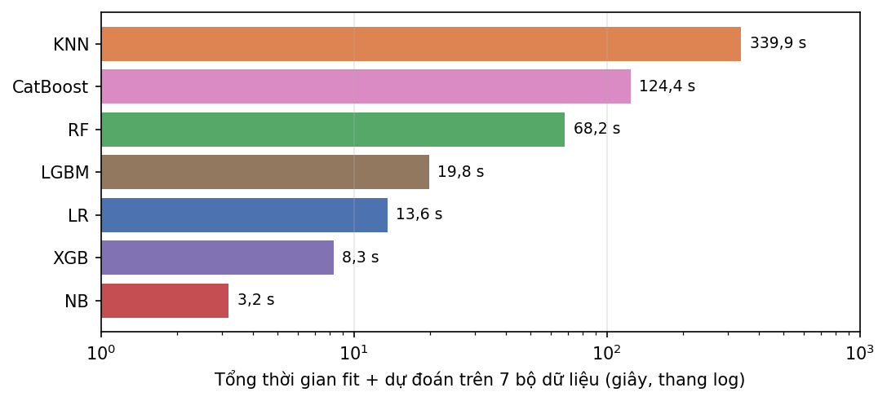

*Hình 4.1. Tổng thời gian fit và dự đoán trên 7 bộ dữ liệu theo mô hình*

- LR hội tụ ở mọi lần fit (tối đa 89 vòng lặp).
- KNN gần như không tốn thời gian fit nhưng rất chậm khi dự đoán: mỗi dòng validation/test phải tính khoảng cách tới toàn bộ dòng train. Trong 4 mô hình classic, KNN chiếm khoảng 80% tổng thời gian chạy.
- XGBoost là mô hình cây nhanh nhất (8 giây cho cả 7 bộ, nhanh hơn RF 8 lần). CatBoost chậm nhất trong nhóm GBDT vì mặc định dùng 1.000 cây (gấp 10 lần XGBoost và LightGBM). Các kết quả GBDT tái lập chính xác khi chạy lại (chênh AUC bằng 0).
- RF dùng tối đa khoảng 3 GB bộ nhớ trên Home Credit.
- Learning curves (716 lần fit: 4 mô hình × 7 tỷ lệ × các fold) chạy trong khoảng 4 phút; phần lớn thời gian là KNN (113 giây) và RF (70 giây).

### 4.2.4. Tái lập

Toàn bộ quy trình được đóng gói thành pipeline:

```bash
python run_pipeline.py                        # interim → splits → preprocess → train → report → compare
python run_pipeline.py --only train report    # chỉ huấn luyện và tạo bảng, hình (~1 phút)
```

| Bước | Mã nguồn | Đầu ra |
|---|---|---|
| Chuyển đổi dữ liệu thô | `src/data/make_interim.py` | `data/interim/` |
| Tầng A, chia dữ liệu, B.0 | `src/data/datasets.py`, `src/data/make_splits.py` | `data/splits/` |
| Tầng B.1 | `src/features/preprocess.py`, `src/features/make_processed.py` | `data/processed/classic/`, `data/processed/gbdt/` |
| Huấn luyện, đánh giá (cả 7 mô hình) | `src/models/train_classic.py`, `src/models/metrics.py` | `reports/models/<mô hình>_default/` |
| Bảng, hình từng mô hình | `src/models/report_classic.py` | `reports/models/<mô hình>_default/tables.md`, `figures/` |
| So sánh mô hình (AUC, precision, recall, F1, kiểm định) | `src/models/compare_models.py` | `reports/models/comparison/` |
| Learning curves | `src/models/learning_curves.py` | `reports/models/learning_curves/` |

Dự đoán của từng dòng validation và test được lưu trong `reports/models/<mô hình>_default/predictions/`, dùng cho kiểm định bootstrap ghép cặp và các so sánh sau này.

### 4.2.5. Learning curves

Learning curve cho biết hiệu năng thay đổi thế nào khi tăng lượng dữ liệu huấn luyện, từ đó phân biệt mô hình bị giới hạn bởi **dữ liệu** (đường validation còn đi lên) hay bởi **chính mô hình** (đường validation đã nằm ngang), và mức overfit (khoảng cách giữa AUC train và AUC validation).

| Mục | Cách làm |
|---|---|
| Tỷ lệ dữ liệu train | 2%, 5%, 10%, 20%, 40%, 70%, 100% phần train của fold; bỏ các mức dưới 50 dòng |
| Lấy mẫu con | Phân tầng theo nhãn và **lồng nhau** (các dòng ở mức nhỏ luôn nằm trong mức lớn hơn), seed cố định |
| Tiền xử lý | Tầng B.1 được **fit lại trên chính mẫu con** (cột theo kết quả B.0 của fold), để mẫu con nhỏ không được hưởng thống kê của các dòng mà mô hình không thấy |
| Đánh giá | AUC trên mẫu con (đường train; không tính cho KNN) và AUC trên **validation** của fold (đường validation). Tập test **không** được dùng |
| Fold | 5 fold cho các bộ CV; riêng Home Credit chỉ fold 1 (giới hạn chi phí của KNN); Lending Club: train 2013, validation 2014 |

## 4.3. Kết quả của mô hình cơ sở Logistic Regression

Logistic Regression là chuẩn của ngành chấm điểm tín dụng nên được dùng làm mô hình cơ sở để so sánh. Số liệu gốc nằm trong `reports/models/lr_default/` (`summary.csv`, `fold_metrics.csv`, `run.json`).

### 4.3.1. Kết quả chính

Hình 4.2 và bảng dưới đây cho thấy AUC của LR dao động từ khoảng 0,70 (GMSC, Lending Club) đến 0,80 (HMEQ, FICO HELOC); thanh sai số là độ lệch chuẩn qua 5 fold.

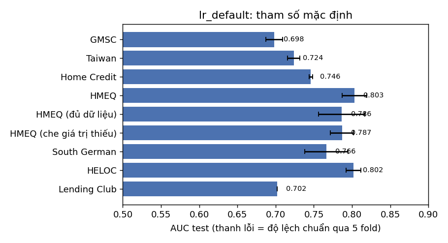

*Hình 4.2. AUC trên test của Logistic Regression theo bộ dữ liệu*

| Bộ dữ liệu | Đánh giá | AUC | Gini | KS | Brier | LogLoss | AP |
|---|---|---|---|---|---|---|---|
| HMEQ | 5-fold CV | **0,8030 ± 0,0161** | 0,6061 ± 0,0322 | 0,4655 ± 0,0394 | 0,1196 ± 0,0071 | 0,3884 ± 0,0184 | 0,5919 ± 0,0182 |
| FICO HELOC | 5-fold CV | **0,8019 ± 0,0098** | 0,6038 ± 0,0196 | 0,4736 ± 0,0194 | 0,1813 ± 0,0044 | 0,5442 ± 0,0101 | 0,7947 ± 0,0043 |
| South German | 5-fold CV | 0,7663 ± 0,0281 | 0,5327 ± 0,0562 | 0,4340 ± 0,0305 | 0,1716 ± 0,0131 | 0,5196 ± 0,0416 | 0,5983 ± 0,0445 |
| Home Credit | 5-fold CV | 0,7461 ± 0,0022 | 0,4922 ± 0,0044 | 0,3678 ± 0,0043 | 0,0687 ± 0,0010 | 0,2500 ± 0,0027 | 0,2225 ± 0,0044 |
| Taiwan | 5-fold CV | 0,7237 ± 0,0082 | 0,4473 ± 0,0165 | 0,3821 ± 0,0173 | 0,1449 ± 0,0038 | 0,4659 ± 0,0102 | 0,5043 ± 0,0094 |
| Lending Club | Fit lại train + val | 0,7018 (KTC 95%: 0,6992–0,7045) | 0,4037 | 0,2955 | 0,1185 | 0,3885 | 0,2800 |
| GMSC | 5-fold CV | **0,6981 ± 0,0110** | 0,3962 ± 0,0220 | 0,3196 ± 0,0221 | 0,0576 ± 0,0019 | 0,2253 ± 0,0065 | 0,2344 ± 0,0088 |

Brier, LogLoss và AP phụ thuộc tỷ lệ xấu nên không so sánh được giữa các bộ: GMSC có Brier thấp nhất nhưng AUC thấp nhất; HELOC có AP cao nhất (0,79) một phần vì tỷ lệ xấu 52%.

**Độ đo theo ngưỡng** (ngưỡng tối đa F1 trên validation):

| Bộ dữ liệu | Precision | Recall | F1 | Accuracy |
|---|---|---|---|---|
| HMEQ | 0,538 ± 0,023 | 0,543 ± 0,045 | 0,539 ± 0,018 | 0,815 ± 0,006 |
| FICO HELOC | 0,694 ± 0,021 | 0,839 ± 0,016 | 0,759 ± 0,006 | 0,723 ± 0,017 |
| South German | 0,551 ± 0,041 | 0,588 ± 0,103 | 0,563 ± 0,034 | 0,729 ± 0,027 |
| Home Credit | 0,223 ± 0,014 | 0,426 ± 0,043 | 0,291 ± 0,002 | 0,833 ± 0,016 |
| Taiwan | 0,547 ± 0,043 | 0,477 ± 0,030 | 0,508 ± 0,008 | 0,795 ± 0,019 |
| Lending Club | 0,239 | 0,662 | 0,352 | 0,637 |
| GMSC | 0,306 ± 0,014 | 0,319 ± 0,013 | 0,312 ± 0,009 | 0,906 ± 0,004 |

Accuracy cao của GMSC (0,906) và Home Credit (0,833) chỉ phản ánh mất cân bằng nhãn: đoán "tốt" cho mọi người đã đạt 93% và 92%.

### 4.3.2. Overfit: gần như không có, trừ South German

| Bộ dữ liệu | AUC train | AUC validation | AUC test | Train − test |
|---|---|---|---|---|
| GMSC | 0,6997 | 0,6945 | 0,6981 | +0,002 |
| Taiwan | 0,7271 | 0,7233 | 0,7237 | +0,003 |
| Home Credit | 0,7495 | 0,7465 | 0,7461 | +0,003 |
| HMEQ | 0,8081 | 0,8054 | 0,8030 | +0,005 |
| **South German** | **0,8365** | 0,8228 | **0,7663** | **+0,070** |
| FICO HELOC | 0,8059 | 0,8006 | 0,8019 | +0,004 |
| Lending Club | 0,6856 | 0,6827 | 0,7018 | −0,016 |

- Với 6 bộ, AUC train gần bằng AUC test: giới hạn hiệu năng của LR đến từ **dạng quan hệ tuyến tính**, không phải từ overfit.
- **South German** là ngoại lệ: 71 đặc trưng (68 cột one-hot) cho 640 dòng train dẫn đến overfit rõ (+0,07) và AUC dao động lớn nhất giữa các fold (0,734 ở fold 1 đến 0,790 ở fold 3). Đây là bộ hưởng lợi nhiều nhất khi tinh chỉnh tham số phạt `C`.
- Lending Club có AUC test **cao hơn** AUC train không phải do lỗi: mô hình cuối được fit trên 2013–2014 (262.992 dòng) thay vì chỉ 2013. Mô hình chỉ fit trên 2013 cho AUC test 0,6936; fit lại trên train + validation tăng AUC thêm **+0,008**.

### 4.3.3. GMSC: AUC thấp do ngoại lai cực đoan

AUC 0,698 của GMSC thấp hơn cả AUC đơn biến của biến mạnh nhất, tỷ lệ sử dụng hạn mức tín dụng `RevolvingUtilizationOfUnsecuredLines` (0,776 ở giai đoạn EDA). Nguyên nhân:

- Biến này lẽ ra nằm trong [0, 1] nhưng có giá trị tới ~50.000. Sau chuẩn hóa, độ lệch chuẩn bị ngoại lai kéo lên ~205, nên gần như mọi người vay dồn về cùng một giá trị (~ −0,02). Hệ số LR của biến này chỉ ≈ −0,015: mô hình tuyến tính **không khai thác được** biến mạnh nhất.
- Hình 4.3 cho thấy biến này phân tách hai lớp rõ: người tốt tập trung gần 0, người xấu tập trung gần 1, dù biểu đồ chỉ vẽ trong khoảng phân vị 0,5%–99,5% của mỗi biến, tức đã bỏ các giá trị cực lớn nói trên.

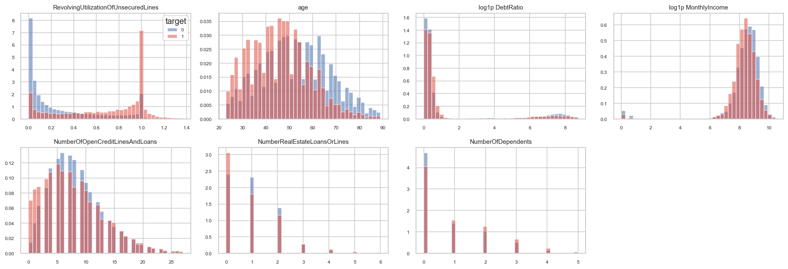

*Hình 4.3. GMSC: phân phối các biến số theo nhãn (0 = tốt, 1 = xấu)*

- Mã 96/98 trong các cột đếm trễ hạn làm ba cột này gần như cộng tuyến trên các dòng đó, dẫn đến hệ số trái dấu. Tuy nhiên, bỏ 49 dòng có mã 96/98 khỏi test không cải thiện AUC (0,683 → 0,678), nên đây không phải nguyên nhân chính.

**Phân tích phụ** (fold 1; *không* thuộc pipeline chính, vì pipeline chính không cắt ngoại lai): cắt mỗi biến số về khoảng phân vị 1%–99% **học trên train**, sau đó chạy lại đúng B.1 và LR mặc định.

| Bộ dữ liệu | AUC test fold 1 (pipeline chuẩn) | AUC sau khi cắt 1%–99% | Chênh lệch |
|---|---|---|---|
| **GMSC** | 0,6825 | **0,8517** | **+0,169** |
| Home Credit | 0,7497 | 0,7499 | +0,000 |
| Lending Club | 0,6937 | 0,6943 | +0,001 |

Với GMSC, gần như toàn bộ khoảng cách là do ngoại lai. Kết quả LR của GMSC theo pipeline chuẩn vì vậy **đánh giá thấp** mô hình tuyến tính; khi so sánh với các mô hình cây (vốn không nhạy với ngoại lai), cần nêu rõ điểm này để không quy toàn bộ chênh lệch cho tính phi tuyến. Home Credit và Lending Club, dù cũng có giá trị chuẩn hóa tới hàng trăm độ lệch chuẩn, không bị ảnh hưởng vì ngoại lai không nằm ở các biến quan trọng.

### 4.3.4. Calibration

Hình 4.4 trình bày đường ROC và đường calibration của LR trên test. Ở đồ thị calibration, các điểm càng gần đường chéo thì xác suất dự đoán càng sát tỷ lệ vỡ nợ thực tế.

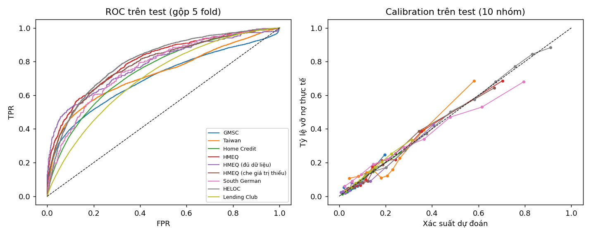

*Hình 4.4. Đường ROC và calibration của Logistic Regression trên test*

| Bộ dữ liệu | Tỷ lệ xấu thực tế (test) | Xác suất dự đoán trung bình |
|---|---:|---:|
| GMSC | 6,68% | 6,70% |
| Taiwan | 22,12% | 22,16% |
| Home Credit | 8,07% | 8,10% |
| HMEQ | 19,95% | 19,90% |
| South German | 30,00% | 30,60% |
| FICO HELOC | 52,03% | 52,10% |
| Lending Club | **14,88%** | **13,51%** |

- Ở 6 bộ CV, xác suất dự đoán trung bình gần như bằng tỷ lệ xấu thực (chênh ≤ 0,6 điểm %), đúng kỳ vọng với LR không cân bằng lớp khi train và test cùng phân phối.
- **Lending Club** dự đoán thấp hơn thực tế 1,4 điểm %: mô hình học trên 2013–2014 (tỷ lệ xấu 13,2%) nhưng năm 2015 có tỷ lệ xấu 14,9%. Đây là trôi dạt theo thời gian — mô hình vẫn xếp hạng tốt nhưng mức rủi ro cần được hiệu chỉnh lại khi áp dụng cho năm sau.
- **South German** quá tự tin ở nhóm rủi ro cao (dự đoán ~0,8 nhưng thực tế ~0,68), là hệ quả của overfit ở mục 4.3.2.
- **Taiwan** lệch ở vùng giữa (dự đoán 0,2–0,25 nhưng thực tế ~0,12): quan hệ phi tuyến của các biến trạng thái thanh toán `PAY_*` (giữ là biến số) mà LR không nắm được.

### 4.3.5. Độ ổn định

- Độ lệch chuẩn AUC giữa các fold tỷ lệ nghịch với kích thước bộ dữ liệu: Home Credit ± 0,002 (307.511 dòng) → HMEQ ± 0,016 → South German ± 0,028 (1.000 dòng).
- Lending Club có khoảng tin cậy bootstrap rất hẹp (± 0,0027) vì tập test lớn (282.787 dòng). Khoảng này chỉ phản ánh biến động do lấy mẫu test, không phản ánh biến động do việc chọn năm.

| Bộ dữ liệu | Fold 1 | Fold 2 | Fold 3 | Fold 4 | Fold 5 |
|---|---|---|---|---|---|
| GMSC | 0,6825 | 0,7057 | 0,6910 | 0,7087 | 0,7026 |
| Taiwan | 0,7315 | 0,7270 | 0,7296 | 0,7183 | 0,7120 |
| Home Credit | 0,7497 | 0,7437 | 0,7458 | 0,7458 | 0,7454 |
| HMEQ | 0,8268 | 0,7956 | 0,8090 | 0,7838 | 0,8000 |
| South German | 0,7336 | 0,7377 | 0,7895 | 0,7841 | 0,7868 |
| FICO HELOC | 0,8009 | 0,7990 | 0,8171 | 0,7899 | 0,8025 |

### 4.3.6. Tóm tắt

| Mức độ khó (theo AUC của LR) | Bộ dữ liệu | Nhận xét |
|---|---|---|
| Dễ (AUC ≈ 0,80) | HMEQ, FICO HELOC | HMEQ hưởng lợi từ việc thiếu dữ liệu mang thông tin (qua nhóm `__missing__`); HELOC có sẵn điểm rủi ro tổng hợp |
| Trung bình (0,72–0,77) | South German, Home Credit, Taiwan | South German bị giới hạn bởi kích thước; Taiwan bởi quan hệ phi tuyến của `PAY_*` |
| Khó (≈ 0,70) | Lending Club, GMSC | Lending Club: tín hiệu yếu thật và có trôi dạt theo thời gian. GMSC: do ngoại lai, không phải do tín hiệu yếu (mục 4.3.3) |

**Giới hạn của kết quả này:**

1. Tham số mặc định, chưa tinh chỉnh — đặc biệt tham số phạt `C` với South German.
2. Pipeline không cắt ngoại lai, nên LR của GMSC bị đánh giá thấp nghiêm trọng (mục 4.3.3).
3. Ngưỡng F1 của Lending Club lấy từ mô hình fit trên 2013 (validation 2014) và áp cho mô hình fit lại trên 2013–2014, vì mô hình fit lại không còn phần validation.
4. Lending Club chỉ có một lần chia; khoảng tin cậy bootstrap không phản ánh biến động do chọn năm.

## 4.4. So sánh các mô hình classic ML

Bốn mô hình dùng cùng các fold, cùng ma trận đặc trưng và cùng cách đánh giá (chương 3), nên chênh lệch chỉ đến từ mô hình. Số liệu gốc: `reports/models/comparison/` (`tables.md`, `auc.csv`, `ranks.csv`, `stats.json`).

Hình 4.5 so sánh AUC test của bốn mô hình trên từng bộ dữ liệu. RF cao nhất ở GMSC, Taiwan, HMEQ và South German, LR cao nhất ở Home Credit, FICO HELOC và Lending Club, còn KNN và NB thường thấp nhất.

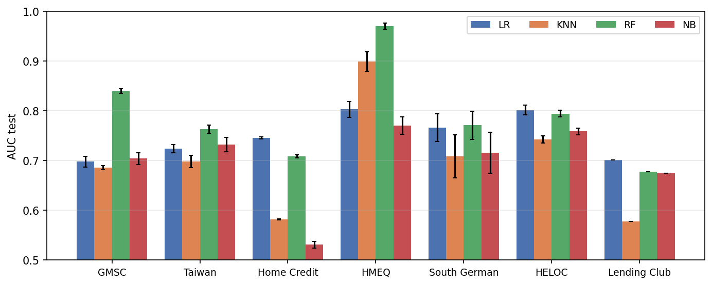

*Hình 4.5. AUC test của bốn mô hình classic ML trên 7 bộ dữ liệu (thanh sai số: độ lệch chuẩn qua 5 fold)*

### AUC trên test

| Bộ dữ liệu | LR | KNN | RF | NB | Tốt nhất |
|---|---|---|---|---|---|
| GMSC | 0,6981 ± 0,0110 | 0,6859 ± 0,0038 | **0,8399 ± 0,0047** | 0,7042 ± 0,0119 | RF |
| Taiwan | 0,7237 ± 0,0082 | 0,6985 ± 0,0126 | **0,7633 ± 0,0081** | 0,7323 ± 0,0142 | RF |
| Home Credit | **0,7461 ± 0,0022** | 0,5819 ± 0,0009 | 0,7084 ± 0,0030 | 0,5310 ± 0,0066 | LR |
| HMEQ | 0,8030 ± 0,0161 | 0,8993 ± 0,0195 | **0,9703 ± 0,0060** | 0,7704 ± 0,0179 | RF |
| South German | 0,7663 ± 0,0281 | 0,7084 ± 0,0431 | **0,7710 ± 0,0284** | 0,7156 ± 0,0414 | RF |
| FICO HELOC | **0,8019 ± 0,0098** | 0,7427 ± 0,0075 | 0,7946 ± 0,0066 | 0,7587 ± 0,0069 | LR |
| Lending Club | **0,7018** | 0,5782 | 0,6777 | 0,6749 | LR |
| **Hạng trung bình** | 2,00 | 3,57 | **1,43** | 3,00 | |

### Hạng trung bình theo từng độ đo (1 = tốt nhất)

| Độ đo | LR | KNN | RF | NB |
|---|---|---|---|---|
| AUC / Gini | 2,00 | 3,57 | **1,43** | 3,00 |
| KS | 2,00 | 3,29 | **1,57** | 3,14 |
| AP | 1,71 | 3,29 | **1,43** | 3,57 |
| F1 | 1,86 | 3,43 | **1,43** | 3,29 |
| Precision | **1,57** | 3,14 | 1,86 | 3,43 |
| Recall | 3,14 | 2,43 | 2,71 | **1,71** |
| Brier | 1,71 | 2,86 | **1,43** | 4,00 |
| LogLoss | **1,43** | 3,29 | 1,57 | 3,71 |

Thứ tự **RF > LR > NB, KNN** giữ nguyên ở hầu hết các độ đo; precision và recall được phân tích riêng ở mục 4.5. Riêng LogLoss, LR xếp nhất vì xác suất của LR được hiệu chỉnh tốt nhất (mục 4.3.4), trong khi RF với cây phát triển hết độ sâu cho xác suất sát 0 hoặc 1 nhiều hơn.

### Kiểm định thống kê

| Kiểm định | Kết quả |
|---|---|
| Friedman (N = 7 bộ, k = 4 mô hình) | χ²_F = 11,74; p = 0,0083 |
| Iman–Davenport | F = 7,61; **p = 0,0017** |

→ Bác bỏ giả thuyết "bốn mô hình có hạng như nhau": có khác biệt có ý nghĩa thống kê giữa các mô hình.

| Cặp (A vs B) | Số bộ A thắng / B thắng | Chênh AUC trung bình (A − B) | p | p (Holm) |
|---|---|---|---|---|
| RF vs KNN | 7 / 0 | +0,0900 | 0,0156 | 0,0938 |
| RF vs NB | 7 / 0 | +0,0912 | 0,0156 | 0,0938 |
| LR vs NB | 5 / 2 | +0,0506 | 0,0781 | 0,3125 |
| LR vs KNN | 6 / 1 | +0,0494 | 0,1562 | 0,4688 |
| RF vs LR | 4 / 3 | +0,0406 | 0,4688 | 0,9375 |
| NB vs KNN | 5 / 2 | −0,0011 | 0,8125 | 0,9375 |

- RF thắng KNN và NB ở **cả 7 bộ**, nhưng sau hiệu chỉnh Holm p = 0,094, chưa đạt mức 0,05. Đây là giới hạn của số bộ dữ liệu: với N = 7, p nhỏ nhất có thể có của Wilcoxon là 0,0156, và nhân với 6 cặp theo Holm thì không cặp nào có thể xuống dưới 0,05. Kết luận "RF tốt hơn KNN và NB" là nhất quán nhưng chưa được khẳng định thống kê ở mức từng cặp.
- **RF và LR không khác biệt có ý nghĩa** (4 thắng / 3 thua, p = 0,47): mỗi mô hình mạnh trên một nhóm bộ dữ liệu khác nhau (xem dưới).

### Ở mức từng bộ dữ liệu

Số fold (trên 5) mô hình thắng LR về AUC test:

| Bộ dữ liệu | KNN | RF | NB |
|---|---|---|---|
| GMSC | 1/5 | **5/5** | 4/5 |
| Taiwan | 0/5 | **5/5** | **5/5** |
| Home Credit | 0/5 | 0/5 | 0/5 |
| HMEQ | **5/5** | **5/5** | 0/5 |
| South German | 0/5 | 3/5 | 0/5 |
| FICO HELOC | 0/5 | 1/5 | 0/5 |

Lending Club — chênh lệch AUC so với LR trên cùng 282.787 dòng test (bootstrap ghép cặp, 1.000 lần):

| Mô hình | Chênh AUC | KTC 95% |
|---|---|---|
| KNN − LR | −0,1237 | −0,1268 đến −0,1207 |
| RF − LR | −0,0241 | −0,0261 đến −0,0221 |
| NB − LR | −0,0270 | −0,0285 đến −0,0253 |

Trên Lending Club, LR tốt hơn cả ba mô hình còn lại một cách rõ ràng (mọi khoảng tin cậy đều nằm hoàn toàn dưới 0).

### Nhận xét theo mô hình

**Random Forest — tốt nhất nói chung, mạnh ở dữ liệu nhỏ và vừa có quan hệ phi tuyến.**

- Thắng rõ trên **GMSC** (0,840 so với 0,698 của LR): RF chia theo ngưỡng nên không bị ngoại lai ảnh hưởng, khai thác được biến tỷ lệ sử dụng hạn mức mà LR bỏ qua (mục 4.3.3). Kết quả này gần với mức LR đạt được khi cắt ngoại lai ở phân tích phụ (0,852), củng cố nhận định rằng khoảng cách của LR trên GMSC chủ yếu do ngoại lai.
- Thắng rất lớn trên **HMEQ** (0,970 so với 0,803). Mức tăng này không đến từ mẫu giá trị thiếu: trên các dòng test không thiếu giá trị nào, RF vẫn đạt 0,972 so với 0,798 của LR, và RF chỉ huấn luyện trên các dòng đầy đủ vẫn đạt 0,957. Biến quan trọng nhất là tỷ lệ nợ/thu nhập `DEBTINC` (22% độ quan trọng), có quan hệ phi tuyến với nhãn.
- Thắng trên **Taiwan** (0,763): nắm được quan hệ phi tuyến của các biến trạng thái thanh toán `PAY_*`.
- **Thua LR** trên Home Credit, HELOC và Lending Club — các bộ có nhiều đặc trưng (HELOC 37, Lending Club 184, Home Credit 250), tín hiệu phân tán, gần tuyến tính. Với tham số mặc định, mỗi cây phát triển hết độ sâu nên **AUC train = 1,000 ở mọi bộ** (học thuộc dữ liệu train); trên các bộ tín hiệu yếu và nhiễu, việc học thuộc này làm giảm khả năng tổng quát. Đây là mô hình hưởng lợi nhiều nhất khi tinh chỉnh (độ sâu, số dòng tối thiểu ở lá).

**Logistic Regression — ổn định và được hiệu chỉnh tốt nhất.**

- Tốt nhất trên 3 bộ lớn/rộng (Home Credit, HELOC, Lending Club) và thắng khẳng định trên Lending Club.
- Xác suất dự đoán trung bình khớp tỷ lệ xấu thực trong khoảng 0,6 điểm % ở mọi bộ CV; xếp nhất về LogLoss.
- Điểm yếu: không nắm được quan hệ phi tuyến (HMEQ, Taiwan) và nhạy với ngoại lai (GMSC).

**K-Nearest Neighbors — tệ nhất, sụp đổ khi số chiều lớn.**

- Trên Home Credit (250 đặc trưng) và Lending Club (184 đặc trưng), AUC chỉ còn 0,58: với số chiều lớn, khoảng cách Euclid giữa các điểm gần như bằng nhau ("lời nguyền số chiều"), lại bị chi phối bởi các biến có ngoại lai lớn sau chuẩn hóa.
- Ngược lại, KNN tốt thứ hai trên HMEQ (0,899, hơn LR 0,10): HMEQ có ít chiều (20) và cấu trúc cục bộ rõ, cùng hướng với kết quả của RF. Mức tăng lớn của cả hai mô hình dựa trên láng giềng/phân vùng trên HMEQ có thể một phần do các hồ sơ gần giống nhau trong dữ liệu; điều này chưa được kiểm tra (việc nhóm dòng trùng chỉ xử lý các dòng **giống hệt** nhau).
- Chậm nhất khi dự đoán (chiếm khoảng 80% tổng thời gian chạy, mục 4.2.3).

**Naive Bayes — xếp hạng kém và xác suất sai lệch nghiêm trọng.**

- Thất bại trên **Home Credit** (AUC 0,531, gần ngẫu nhiên). Nguyên nhân: giả định các đặc trưng độc lập bị vi phạm nặng — Home Credit có nhiều nhóm cột gần trùng nhau (các biến nhà ở dạng `*_AVG`/`*_MODE`/`*_MEDI`), nên tích các xác suất có điều kiện bị bão hòa: 98,5% dự đoán rơi sát 0 hoặc 1, thứ tự xếp hạng bị phá vỡ. Cắt ngoại lai không khắc phục được (0,547).
- Xác suất sai lệch rất lớn: trung bình xác suất dự đoán cao hơn tỷ lệ xấu thực **69 điểm %** trên Taiwan và **85 điểm %** trên Home Credit, nên NB xếp cuối về Brier ở mọi bộ; F1 trên Home Credit chỉ 0,157.
- Vẫn khá trên các bộ ít biến và ít tương quan (Taiwan 0,732, hơn LR).

### Kết luận so sánh

| Nhóm bộ dữ liệu | Mô hình tốt nhất | Lý do |
|---|---|---|
| Nhỏ và vừa, ít đặc trưng, quan hệ phi tuyến hoặc có ngoại lai (GMSC, Taiwan, HMEQ, South German) | **RF** | Chia theo ngưỡng: không nhạy với ngoại lai, nắm được phi tuyến và tương tác |
| Lớn hoặc rộng, tín hiệu phân tán, có trôi dạt theo thời gian (Home Credit, HELOC, Lending Club) | **LR** | Mô hình đơn giản, ổn định, ít học thuộc nhiễu; xác suất được hiệu chỉnh tốt |
| — | KNN, NB | Không phù hợp làm mô hình chính: KNN hỏng khi số chiều lớn; NB vi phạm giả định độc lập và cho xác suất sai lệch |

Với tham số mặc định, **RF có hạng trung bình tốt nhất (1,43)** và khác biệt giữa các mô hình là có ý nghĩa thống kê theo Friedman (p = 0,0017); nhưng RF **không vượt trội LR một cách nhất quán** (4 thắng / 3 thua). Hai hướng tiếp theo có khả năng thay đổi thứ tự: tinh chỉnh tham số (đặc biệt độ sâu cây của RF và tham số phạt `C` của LR) và các mô hình GBDT.

**Giới hạn của so sánh:** tất cả là tham số mặc định, chưa tinh chỉnh; mới có 7 bộ dữ liệu nên năng lực của kiểm định từng cặp thấp; chưa có SVM (mục 3.6); ma trận đặc trưng one-hot và chuẩn hóa là lựa chọn chung cho nhóm classic, không nhất thiết tối ưu cho từng mô hình (ví dụ NB và RF không cần chuẩn hóa).

## 4.5. Precision, recall và F1

Các độ đo này được tính tại **ngưỡng tối đa F1 chọn trên validation** của từng fold, rồi áp nguyên sang test. Khác với AUC (đánh giá toàn bộ thứ tự xếp hạng), chúng phản ánh một quyết định cụ thể "từ chối / chấp nhận": precision là tỷ lệ người bị gắn nhãn xấu thực sự xấu; recall là tỷ lệ người xấu bị phát hiện.

Hình 4.6 trình bày F1, precision và recall trên test. Hình gồm cả ba mô hình GBDT để tiện đối chiếu; mục này chỉ phân tích bốn mô hình classic ML, các mô hình GBDT được phân tích ở mục 4.7.

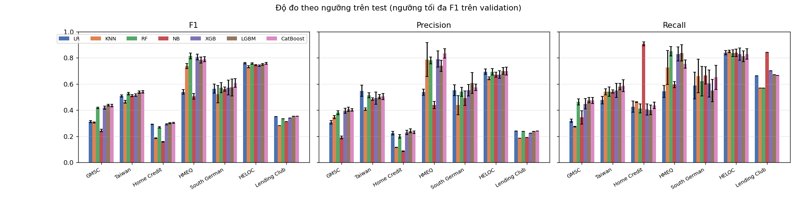

*Hình 4.6. F1, precision và recall trên test tại ngưỡng tối đa F1 chọn trên validation*

### F1

| Bộ dữ liệu | LR | KNN | RF | NB | Tốt nhất |
|---|---|---|---|---|---|
| GMSC | 0,312 ± 0,009 | 0,306 ± 0,004 | **0,417 ± 0,006** | 0,244 ± 0,009 | RF |
| Taiwan | 0,508 ± 0,008 | 0,464 ± 0,012 | **0,526 ± 0,009** | 0,511 ± 0,008 | RF |
| Home Credit | **0,291 ± 0,002** | 0,185 ± 0,003 | 0,268 ± 0,005 | 0,157 ± 0,003 | LR |
| HMEQ | 0,539 ± 0,018 | 0,737 ± 0,019 | **0,813 ± 0,022** | 0,506 ± 0,022 | RF |
| South German | 0,563 ± 0,034 | 0,521 ± 0,067 | **0,571 ± 0,039** | 0,562 ± 0,017 | RF |
| FICO HELOC | **0,759 ± 0,006** | 0,732 ± 0,009 | 0,757 ± 0,005 | 0,744 ± 0,004 | LR |
| Lending Club | **0,352** | 0,281 | 0,335 | 0,312 | LR |
| **Hạng trung bình** | 1,86 | 3,43 | **1,43** | 3,29 | |

### Precision

| Bộ dữ liệu | LR | KNN | RF | NB | Tốt nhất |
|---|---|---|---|---|---|
| GMSC | 0,306 ± 0,014 | 0,347 ± 0,012 | **0,381 ± 0,016** | 0,191 ± 0,012 | RF |
| Taiwan | **0,548 ± 0,043** | 0,407 ± 0,011 | 0,514 ± 0,020 | 0,484 ± 0,011 | LR |
| Home Credit | **0,223 ± 0,014** | 0,116 ± 0,002 | 0,200 ± 0,014 | 0,086 ± 0,002 | LR |
| HMEQ | 0,538 ± 0,023 | **0,786 ± 0,129** | 0,780 ± 0,027 | 0,440 ± 0,028 | KNN |
| South German | **0,551 ± 0,041** | 0,438 ± 0,073 | 0,540 ± 0,035 | 0,492 ± 0,055 | LR |
| FICO HELOC | **0,694 ± 0,021** | 0,643 ± 0,010 | 0,693 ± 0,026 | 0,671 ± 0,020 | LR |
| Lending Club | **0,239** | 0,187 | 0,238 | 0,192 | LR |
| **Hạng trung bình** | **1,57** | 3,14 | 1,86 | 3,43 | |

### Recall

| Bộ dữ liệu | LR | KNN | RF | NB | Tốt nhất |
|---|---|---|---|---|---|
| GMSC | 0,319 ± 0,013 | 0,274 ± 0,003 | **0,463 ± 0,025** | 0,344 ± 0,052 | RF |
| Taiwan | 0,477 ± 0,030 | 0,540 ± 0,023 | 0,541 ± 0,036 | **0,542 ± 0,013** | NB |
| Home Credit | 0,426 ± 0,043 | 0,462 ± 0,003 | 0,412 ± 0,035 | **0,906 ± 0,015** | NB |
| HMEQ | 0,543 ± 0,045 | 0,726 ± 0,130 | **0,849 ± 0,036** | 0,595 ± 0,023 | RF |
| South German | 0,588 ± 0,103 | 0,661 ± 0,129 | 0,622 ± 0,113 | **0,666 ± 0,066** | NB |
| FICO HELOC | 0,839 ± 0,016 | **0,849 ± 0,010** | 0,835 ± 0,027 | 0,838 ± 0,029 | KNN |
| Lending Club | 0,662 | 0,569 | 0,568 | **0,842** | NB |
| **Hạng trung bình** | 3,14 | 2,43 | 2,71 | **1,71** | |

### Ngưỡng quyết định

| Bộ dữ liệu | LR | KNN | RF | NB | Tỷ lệ xấu |
|---|---|---|---|---|---|
| GMSC | 0,125 | 0,400 | 0,260 | 0,016 | 0,067 |
| Taiwan | 0,296 | 0,400 | 0,325 | **1,000** | 0,221 |
| Home Credit | 0,140 | 0,200 | 0,152 | **1,000** | 0,081 |
| HMEQ | 0,283 | 0,320 | 0,314 | 0,061 | 0,199 |
| South German | 0,407 | 0,360 | 0,386 | 0,704 | 0,300 |
| FICO HELOC | 0,396 | 0,400 | 0,432 | 0,002 | 0,520 |
| Lending Club | 0,139 | 0,200 | 0,180 | 0,012 | 0,149 |

(Trung bình qua các fold; KNN với k = 5 chỉ có 6 mức xác suất nên ngưỡng rơi vào 0,2 / 0,4.)

### Nhận xét

- **F1 cho cùng kết luận với AUC**: RF tốt nhất (hạng 1,43), mạnh nhất ở GMSC (+0,105 so với LR) và HMEQ (+0,274); LR tốt nhất ở Home Credit, HELOC, Lending Club.
- **LR có precision tốt nhất** (hạng 1,57, nhất ở 5/7 bộ): khi LR gắn nhãn xấu, khả năng đúng cao nhất. Đây là ưu thế quan trọng trong tín dụng, vì mỗi dự báo "xấu" sai là một khách hàng tốt bị từ chối.
- **Recall "tốt nhất" của NB là ảo** (hạng 1,71): NB đạt recall cao vì gắn nhãn xấu cho phần lớn người vay, không phải vì phân biệt tốt. Trên Lending Club, ngưỡng chỉ 0,012, recall 0,84 nhưng precision 0,19 — gần bằng tỷ lệ xấu 0,15. Trên Home Credit, recall 0,91 nhưng precision chỉ 0,086 — gần như bằng tỷ lệ xấu 0,081, tức không tốt hơn gắn nhãn ngẫu nhiên. Hạng recall vì vậy không nên đọc riêng lẻ mà phải đi cùng precision; F1 và đường precision–recall cho bức tranh đúng hơn.
- **NB cho thấy rõ hiện tượng bão hòa xác suất**: trên Home Credit, khoảng 87% dự đoán test bằng **đúng 1** và khoảng 5% gần bằng 0, nên ngưỡng tối ưu trên validation bằng đúng 1,000 và mọi dự đoán bằng 1 đều bị gắn nhãn xấu (khoảng 52 nghìn trên 61,5 nghìn dòng test mỗi fold). Đường precision–recall của NB trên Home Credit vì vậy gần như một đoạn thẳng. Taiwan có hiện tượng tương tự (ngưỡng ≈ 1,000).
- **Mọi mô hình đều khó trên các bộ mất cân bằng nặng**: F1 tốt nhất chỉ 0,29 (Home Credit), 0,35 (Lending Club), 0,42 (GMSC). Precision ở các bộ này chỉ 0,2–0,4: cứ 3–5 người bị gắn nhãn xấu thì chỉ khoảng 1 người thực sự xấu.

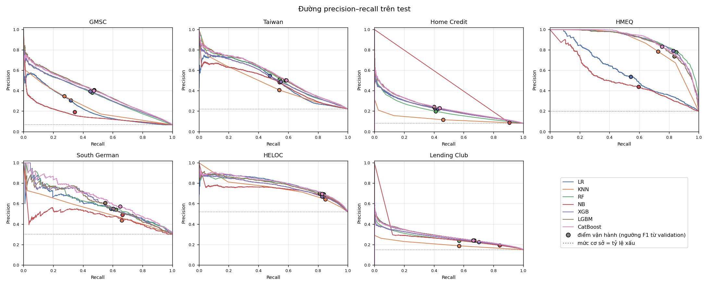

*Hình 4.7. Đường precision–recall trên test (chấm tròn: điểm vận hành tại ngưỡng F1 từ validation; nét chấm: mức cơ sở bằng tỷ lệ xấu; gồm cả ba mô hình GBDT)*

Đường precision–recall ở Hình 4.7 xác nhận thứ tự theo AUC: đường của RF nằm trên các mô hình khác ở GMSC, HMEQ và Taiwan; đường của LR nằm trên ở Home Credit và Lending Club. Ở HMEQ, RF duy trì precision gần 1 tới recall khoảng 0,5.

## 4.6. Learning curves

Hình 4.8 trình bày learning curves của bốn mô hình classic ML trên 7 bộ dữ liệu. Đường validation còn đi lên nghĩa là mô hình còn hưởng lợi khi thêm dữ liệu; khoảng cách giữa đường train và đường validation cho biết mức overfit.

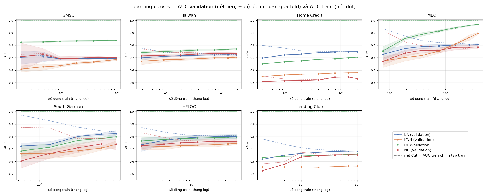

*Hình 4.8. Learning curves: AUC validation (nét liền, vùng mờ = ± độ lệch chuẩn qua fold) và AUC train (nét đứt) theo số dòng train (thang log)*

### AUC validation theo tỷ lệ dữ liệu train

| Bộ dữ liệu | Mô hình | 5% | 20% | 100% | Tăng 20% → 100% |
|---|---|---|---|---|---|
| GMSC | LR | 0,708 | 0,694 | 0,695 | +0,001 |
| | RF | 0,827 | 0,836 | 0,840 | +0,005 |
| | KNN | 0,627 | 0,658 | 0,685 | +0,028 |
| Taiwan | LR | 0,711 | 0,720 | 0,723 | +0,004 |
| | RF | 0,750 | 0,762 | 0,770 | +0,008 |
| Home Credit | LR | 0,723 | 0,741 | 0,748 | +0,007 |
| | RF | 0,668 | 0,687 | 0,704 | +0,018 |
| | KNN | 0,561 | 0,571 | 0,581 | +0,010 |
| HMEQ | LR | 0,774 | 0,794 | 0,805 | +0,011 |
| | RF | 0,855 | 0,914 | 0,969 | **+0,055** |
| | KNN | 0,702 | 0,754 | 0,896 | **+0,143** |
| South German | LR | — | 0,735 | 0,823 | **+0,088** |
| | RF | — | 0,713 | 0,797 | **+0,084** |
| FICO HELOC | LR | 0,768 | 0,794 | 0,801 | +0,007 |
| | RF | 0,776 | 0,787 | 0,795 | +0,008 |
| Lending Club | LR | 0,651 | 0,674 | 0,683 | +0,009 |
| | RF | 0,643 | 0,648 | 0,659 | +0,010 |
| | KNN | 0,555 | 0,554 | 0,563 | +0,009 |

(Bảng đầy đủ cho cả 4 mô hình và 7 mức tỷ lệ: `reports/models/learning_curves/tables.md`. South German không có mức 5% vì dưới 50 dòng.)

### Khoảng cách AUC train − validation ở 100% dữ liệu train

| Bộ dữ liệu | LR | RF | NB |
|---|---|---|---|
| GMSC | +0,005 | +0,160 | +0,003 |
| Taiwan | +0,004 | +0,231 | +0,001 |
| Home Credit | −0,000 | +0,296 | +0,001 |
| HMEQ | +0,003 | +0,031 | −0,014 |
| South German | +0,014 | +0,203 | +0,038 |
| FICO HELOC | +0,005 | +0,205 | +0,000 |
| Lending Club | +0,003 | +0,341 | +0,002 |

### Nhận xét

**1. Bộ dữ liệu nào còn thiếu dữ liệu?**

- **South German** là bộ duy nhất mà mọi mô hình vẫn tăng mạnh tới 100% dữ liệu (LR +0,088 từ 20% lên 100%). Với 640 dòng train, hiệu năng bị giới hạn bởi **lượng dữ liệu**; độ dao động lớn giữa các fold (mục 4.3.5) cũng xuất phát từ đây.
- **HMEQ** với RF và KNN vẫn tăng rõ (+0,055 và +0,143) và chưa nằm ngang: các mô hình dựa trên phân vùng/láng giềng hưởng lợi khi mật độ dữ liệu tăng. Đường của KNN tăng rất dốc ở phần cuối, phù hợp với giả thuyết ở mục 4.4 rằng HMEQ có các hồ sơ gần giống nhau (càng nhiều dòng, láng giềng gần nhất càng có khả năng là một hồ sơ gần như trùng) — giả thuyết này vẫn cần kiểm tra trực tiếp.
- Các bộ còn lại gần như **đã bão hòa** với LR: tăng dưới 0,01 AUC từ 20% lên 100%. Thêm dữ liệu cùng loại không cải thiện đáng kể; muốn cải thiện cần mô hình hoặc đặc trưng tốt hơn.

**2. LR bị giới hạn bởi dạng mô hình, không phải bởi dữ liệu.**

- Đường validation của LR nằm ngang sớm, và AUC train ≈ AUC validation ở mọi bộ (khoảng cách ≤ 0,014): LR **không overfit**, giới hạn nằm ở **độ lệch (bias)** của mô hình tuyến tính.
- Rõ nhất ở **GMSC**: LR nằm ngang ở ~0,69 ngay từ 2% dữ liệu, trong khi RF đạt 0,83 cũng chỉ với 2% (khoảng 1.900 dòng). Nguyên nhân là ngoại lai (mục 4.3.3), không phải thiếu dữ liệu — thêm dữ liệu không giúp được LR.

**3. RF học thuộc tập train nhưng vẫn tổng quát tốt ở nhiều bộ.**

- AUC train của RF luôn bằng 1,000 ở mọi mức dữ liệu (đường nét đứt nằm trên cùng): cây phát triển hết độ sâu học thuộc từng dòng train. Khoảng cách train − validation lên tới 0,16–0,34, ngoại trừ HMEQ (0,03).
- Dù vậy, AUC validation của RF vẫn tăng đều theo dữ liệu, nên việc học thuộc không làm hỏng mô hình mà chủ yếu làm lãng phí dung lượng. Đây là dấu hiệu RF sẽ hưởng lợi khi tinh chỉnh các tham số hạn chế độ phức tạp (độ sâu tối đa, số dòng tối thiểu ở lá).

**4. Mô hình tốt nhất phụ thuộc lượng dữ liệu.**

- **HELOC**: RF tốt hơn LR khi có ít dữ liệu (2%: 0,765 so với 0,735), LR vượt lên từ khoảng 10% (≈ 630 dòng) và giữ ưu thế.
- **Lending Club**: RF tốt hơn ở 2% (0,631 so với 0,617), LR vượt từ 5% trở đi và bỏ xa dần (100%: 0,683 so với 0,659).
- **Home Credit**: LR tốt hơn RF ở mọi mức, nhưng RF tăng nhanh hơn (+0,018 so với +0,007 từ 20% lên 100%), nên khoảng cách thu hẹp dần khi có thêm dữ liệu.

**5. KNN và NB.**

- KNN trên Home Credit và Lending Club gần như **không tăng** theo dữ liệu (0,55–0,58): với 184–250 chiều, thêm điểm không làm khoảng cách Euclid có ý nghĩa hơn. Đây là giới hạn cấu trúc, không phải do thiếu dữ liệu.
- NB có AUC train ≈ AUC validation (không overfit) và nằm ngang sớm: mô hình rất đơn giản, giới hạn bởi giả định độc lập. Trên Home Credit, đường của NB dao động và giảm ở 100% (0,546 → 0,532), phù hợp với hiện tượng bão hòa xác suất.

### Tóm tắt mục 4.5–4.6

| Câu hỏi | Trả lời |
|---|---|
| Xét theo F1, mô hình nào tốt nhất? | RF (hạng 1,43), cùng kết luận với AUC |
| Mô hình nào gắn nhãn xấu chính xác nhất? | LR (precision hạng 1,57) |
| Recall cao của NB có đáng tin? | Không — do ngưỡng rất thấp, precision gần mức cơ sở |
| Bộ nào cần thêm dữ liệu? | South German (mọi mô hình), HMEQ (RF, KNN) |
| Vì sao LR yếu trên GMSC? | Giới hạn của mô hình tuyến tính trước ngoại lai; thêm dữ liệu không giúp |
| RF có overfit? | Có học thuộc train (AUC train = 1), nhưng AUC validation vẫn tăng theo dữ liệu; cần tinh chỉnh độ phức tạp |

## 4.7. Gradient boosting so với classic ML

Ba mô hình GBDT (XGBoost, LightGBM, CatBoost) được huấn luyện trên **đúng các fold** của classic ML, với tham số mặc định của từng thư viện và nhánh tiền xử lý mã số nguyên (mục 3.5–3.6). Số liệu gốc: `reports/models/{xgb,lgbm,cat}_default/` và `reports/models/comparison/`.

Hình 4.9 bổ sung ba mô hình GBDT vào so sánh ở Hình 4.5. Ba mô hình GBDT nằm trong nhóm cao nhất ở hầu hết các bộ, rõ nhất ở GMSC và Taiwan; ở Home Credit, FICO HELOC và Lending Club, chúng chỉ ngang LR.

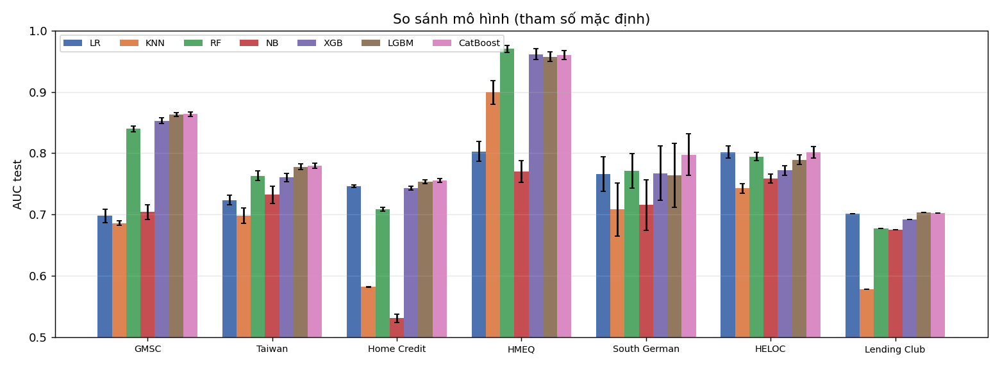

*Hình 4.9. AUC test của 7 mô hình trên 7 bộ dữ liệu (thanh sai số: độ lệch chuẩn qua 5 fold)*

### AUC trên test

| Bộ dữ liệu | LR | KNN | RF | NB | XGB | LGBM | CatBoost | Tốt nhất |
|---|---|---|---|---|---|---|---|---|
| GMSC | 0,6981 | 0,6859 | 0,8399 | 0,7042 | 0,8530 | 0,8631 | **0,8637** | CatBoost |
| Taiwan | 0,7237 | 0,6985 | 0,7633 | 0,7323 | 0,7606 | 0,7780 | **0,7794** | CatBoost |
| Home Credit | 0,7461 | 0,5819 | 0,7084 | 0,5310 | 0,7430 | 0,7537 | **0,7560** | CatBoost |
| HMEQ | 0,8030 | 0,8993 | **0,9703** | 0,7704 | 0,9615 | 0,9573 | 0,9602 | RF |
| South German | 0,7663 | 0,7084 | 0,7710 | 0,7156 | 0,7674 | 0,7639 | **0,7978** | CatBoost |
| FICO HELOC | **0,8019** | 0,7427 | 0,7946 | 0,7587 | 0,7718 | 0,7893 | 0,8016 | LR |
| Lending Club | 0,7018 | 0,5782 | 0,6777 | 0,6749 | 0,6921 | **0,7037** | 0,7024 | LGBM |
| **Hạng trung bình** | 4,14 | 6,57 | 3,29 | 6,00 | 3,57 | 2,86 | **1,57** | |

(Độ lệch chuẩn qua 5 fold: `reports/models/comparison/tables.md`, bảng 1.)

### Hạng trung bình theo từng độ đo (1 = tốt nhất, 7 mô hình)

| Độ đo | LR | KNN | RF | NB | XGB | LGBM | CatBoost |
|---|---|---|---|---|---|---|---|
| AUC / Gini | 4,14 | 6,57 | 3,29 | 6,00 | 3,57 | 2,86 | **1,57** |
| KS | 4,29 | 6,29 | 3,57 | 6,14 | 3,71 | 2,43 | **1,57** |
| AP | 4,14 | 6,29 | 3,71 | 6,57 | 3,43 | 2,29 | **1,57** |
| F1 | 4,14 | 6,43 | 3,43 | 6,14 | 3,71 | 2,29 | **1,86** |
| Precision | 3,71 | 6,00 | 4,00 | 6,43 | 3,71 | 2,29 | **1,86** |
| Recall | 5,29 | 4,14 | 4,14 | **3,00** | 4,14 | 4,14 | 3,14 |
| Brier | 3,57 | 5,86 | 3,57 | 7,00 | 3,86 | 2,57 | **1,57** |
| LogLoss | 3,43 | 6,29 | 3,57 | 6,71 | 4,14 | 2,43 | **1,43** |

CatBoost đứng đầu ở mọi độ đo trừ recall (recall cao của NB là ảo, mục 4.5); LightGBM đứng thứ hai ở mọi độ đo trừ recall. Hình 4.10 biểu diễn hạng trung bình theo AUC trên một trục: các mô hình chia thành ba nhóm, gồm CatBoost tách biệt ở đầu, nhóm giữa gồm LightGBM, RF, XGBoost và LR, và nhóm cuối gồm NB và KNN.

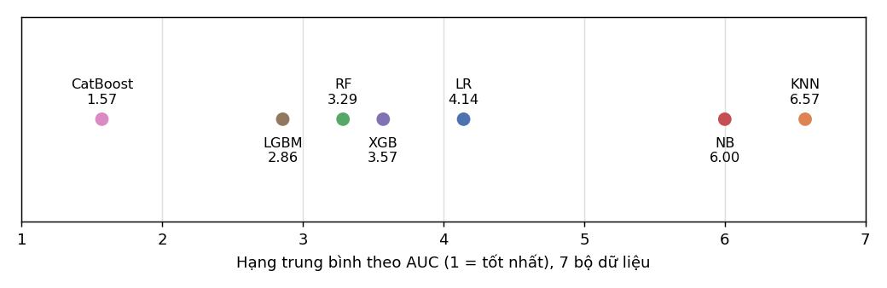

*Hình 4.10. Hạng trung bình theo AUC của 7 mô hình trên 7 bộ dữ liệu (1 = tốt nhất)*

### Kiểm định thống kê

| Kiểm định | Kết quả |
|---|---|
| Friedman (N = 7 bộ, k = 7 mô hình) | χ²_F = 27,80; p = 0,0001 |
| Iman–Davenport | F = 11,74; **p < 0,0001** |

So sánh từng mô hình với mô hình hạng tốt nhất (CatBoost), kiểm định z trên hạng, hiệu chỉnh Holm:

| Mô hình | Chênh hạng so với CatBoost | z | p | p (Holm) | Khác biệt có ý nghĩa |
|---|---|---|---|---|---|
| KNN | +5,00 | 4,33 | < 0,0001 | 0,0001 | **có** |
| NB | +4,43 | 3,84 | 0,0001 | 0,0006 | **có** |
| LR | +2,57 | 2,23 | 0,0260 | 0,1038 | không |
| XGB | +2,00 | 1,73 | 0,0833 | 0,2498 | không |
| RF | +1,71 | 1,48 | 0,1376 | 0,2753 | không |
| LGBM | +1,29 | 1,11 | 0,2655 | 0,2753 | không |

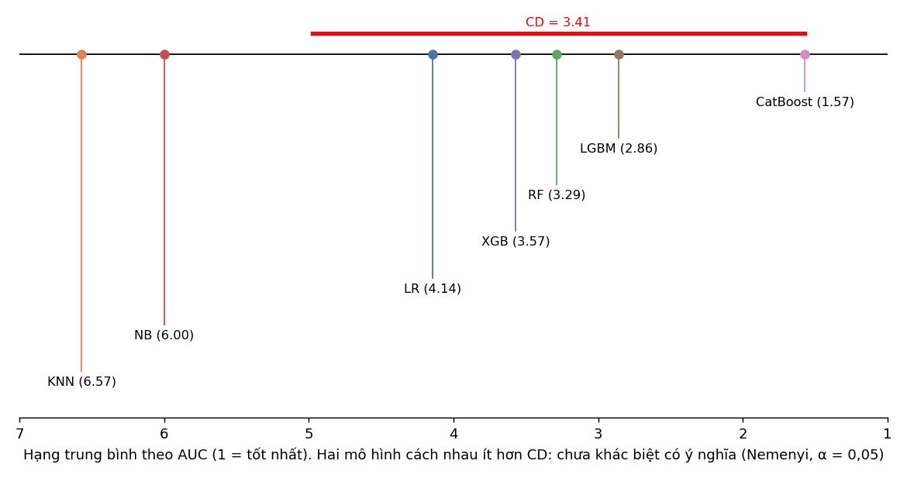

*Hình 4.11. Biểu đồ critical difference (Nemenyi, α = 0,05)*

Hình 4.11 đặt hạng trung bình lên cùng trục với độ dài CD. Với Nemenyi, CD = 3,41: CatBoost tốt hơn có ý nghĩa so với KNN và NB; LightGBM tốt hơn KNN. LR, RF, XGBoost, LightGBM và CatBoost **chưa phân biệt được về mặt thống kê** với 7 bộ dữ liệu. Wilcoxon từng cặp (21 cặp, hiệu chỉnh Holm) không cho cặp nào có ý nghĩa, đúng như dự báo ở mục 4.1.2.

### Ở mức từng bộ dữ liệu

**Mô hình classic tốt nhất so với mô hình GBDT tốt nhất (AUC test):**

| Bộ dữ liệu | Classic tốt nhất | GBDT tốt nhất | Chênh lệch | GBDT tốt nhất − LR |
|---|---|---|---|---|
| GMSC | RF 0,8399 | CatBoost 0,8637 | **+0,024** | +0,166 |
| Taiwan | RF 0,7633 | CatBoost 0,7794 | **+0,016** | +0,056 |
| Home Credit | LR 0,7461 | CatBoost 0,7560 | **+0,010** | +0,010 |
| HMEQ | RF 0,9703 | XGB 0,9615 | −0,009 | +0,159 |
| South German | RF 0,7710 | CatBoost 0,7978 | **+0,027** | +0,031 |
| FICO HELOC | LR 0,8019 | CatBoost 0,8016 | −0,000 | −0,000 |
| Lending Club | LR 0,7018 | LGBM 0,7037 | +0,002 | +0,002 |

**Số fold (trên 5) CatBoost thắng LR:** GMSC, Taiwan, Home Credit, HMEQ, South German đều 5/5; HELOC 3/5.

**Lending Club** — chênh AUC so với LR trên cùng 282.787 dòng test (bootstrap ghép cặp, 1.000 lần):

| Mô hình | Chênh AUC | KTC 95% | p |
|---|---|---|---|
| XGB − LR | −0,0097 | −0,0113 đến −0,0082 | < 0,001 |
| LGBM − LR | **+0,0019** | +0,0008 đến +0,0029 | 0,004 |
| CatBoost − LR | +0,0006 | −0,0009 đến +0,0019 | 0,48 |

LightGBM là mô hình duy nhất vượt LR trên Lending Club có ý nghĩa thống kê, nhưng mức chênh chỉ 0,002 AUC; CatBoost ngang LR.

### F1, precision, recall

| Bộ dữ liệu | F1 tốt nhất (classic) | F1 tốt nhất (GBDT) |
|---|---|---|
| GMSC | RF 0,417 | **LGBM 0,438** |
| Taiwan | RF 0,526 | **CatBoost 0,540** |
| Home Credit | LR 0,291 | **CatBoost 0,302** |
| HMEQ | **RF 0,813** | XGB 0,806 |
| South German | RF 0,571 | **CatBoost 0,607** |
| FICO HELOC | **LR 0,759** | CatBoost 0,756 |
| Lending Club | LR 0,352 | **LGBM 0,353** |

- Về F1, GBDT tốt nhất thắng classic tốt nhất ở 5/7 bộ; mức tăng lớn nhất ở South German (+0,035) và GMSC (+0,021).
- **Ưu thế precision của LR biến mất** khi có GBDT: LR từ hạng 1,57 (trong 4 mô hình classic) xuống 3,71 (trong 7 mô hình); LightGBM và CatBoost có precision cao nhất (hạng 2,29 và 1,86). Riêng Taiwan, LR vẫn có precision cao nhất (0,548).

### Overfit và calibration

Khoảng cách AUC train − AUC test:

| Bộ dữ liệu | RF | XGB | LGBM | CatBoost | LR |
|---|---|---|---|---|---|
| GMSC | +0,160 | +0,070 | +0,036 | **+0,035** | +0,002 |
| Taiwan | +0,237 | +0,195 | +0,115 | **+0,114** | +0,003 |
| Home Credit | +0,292 | +0,126 | **+0,054** | +0,084 | +0,003 |
| HMEQ | +0,030 | +0,038 | +0,043 | **+0,034** | +0,005 |
| South German | +0,229 | +0,233 | +0,236 | **+0,200** | +0,070 |
| FICO HELOC | +0,205 | +0,223 | +0,160 | **+0,120** | +0,004 |
| Lending Club | +0,322 | +0,189 | **+0,078** | +0,125 | −0,016 |

(Với Lending Club, AUC train lấy từ mô hình chỉ fit trên 2013; AUC test từ mô hình fit lại trên 2013–2014.)

- Cả ba GBDT overfit **ít hơn RF** ở hầu hết các bộ: RF mặc định để cây phát triển hết độ sâu (AUC train = 1), còn GBDT dùng cây nông (độ sâu 6 hoặc 31 lá). Trong nhóm GBDT, XGBoost overfit nhiều nhất ở 5/7 bộ (learning rate mặc định 0,3 cao hơn hẳn 0,1 của LightGBM và mức tự chọn của CatBoost).
- **Calibration**: trên 4 bộ GMSC, Taiwan, Home Credit, HELOC, xác suất dự đoán trung bình của ba GBDT lệch tỷ lệ xấu thực dưới 0,7 điểm %. Lệch lớn hơn ở các bộ nhỏ (HMEQ, South German: dự đoán thấp hơn thực tế 1,3–2,9 điểm %). Trên Lending Club, cả ba đều dự đoán thấp hơn thực tế 1,3–1,7 điểm %, giống LR (1,4 điểm %): trôi dạt theo thời gian ảnh hưởng mọi mô hình như nhau.
- CatBoost có xác suất tốt nhất (hạng 1,57 về Brier, 1,43 về LogLoss), có thể nhờ 1.000 cây với learning rate nhỏ, cây đối xứng và điều chuẩn L2 (cấu hình mặc định không dùng ordered boosting, mục 2.4.6). Hình 4.12 cho thấy các đường calibration của CatBoost bám sát đường chéo ở hầu hết các bộ, tương tự LR ở Hình 4.4, dù CatBoost là mô hình cây.

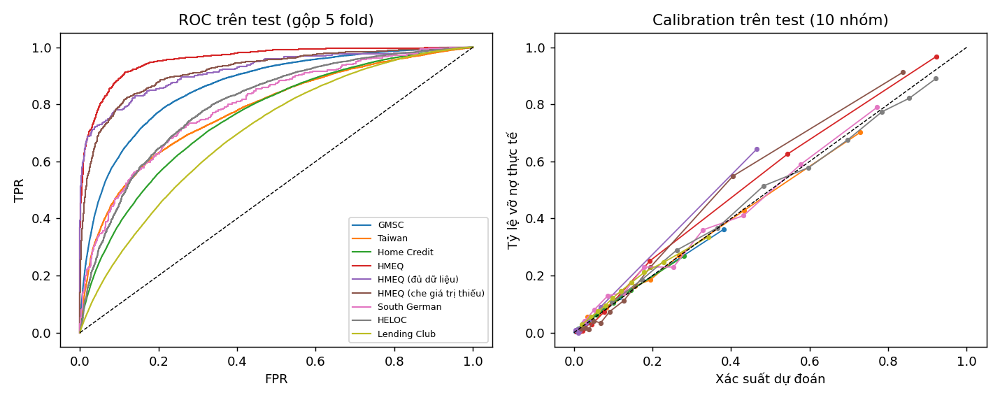

*Hình 4.12. Đường ROC và calibration của CatBoost trên test*

### Thời gian chạy

XGBoost là mô hình cây nhanh nhất (8 giây cho cả 7 bộ), LightGBM 20 giây, CatBoost 124 giây (1.000 cây mặc định). Cả ba nhanh hơn KNN (340 giây); XGBoost và LightGBM nhanh hơn RF (68 giây). Chi tiết ở mục 4.2.3.

### Điểm nổi bật

1. **CatBoost là mô hình tốt nhất tổng thể** với tham số mặc định: hạng 1,57 về AUC, đứng đầu ở 5/7 bộ, và đứng đầu ở mọi độ đo trừ recall. LightGBM đứng thứ hai (hạng 2,86).
2. **Bước nhảy lớn nhất là từ mô hình tuyến tính sang mô hình cây, không phải từ RF sang boosting.** So với LR, GBDT tốt nhất tăng tới +0,166 AUC (GMSC) và +0,159 (HMEQ); nhưng so với mô hình classic tốt nhất (thường là RF), mức tăng chỉ từ −0,009 đến +0,027.
3. **Khác biệt giữa các mô hình cây và LR chưa được khẳng định thống kê với 7 bộ dữ liệu.** Chỉ KNN và NB kém CatBoost có ý nghĩa; LR, RF, XGBoost, LightGBM, CatBoost nằm trong cùng một khoảng CD.
4. **LR vẫn ngang GBDT ở các bộ tín hiệu gần tuyến tính hoặc có trôi dạt theo thời gian**: HELOC (LR 0,8019 so với CatBoost 0,8016) và Lending Club (LightGBM chỉ hơn LR 0,002 AUC). Với các bộ này, LR đơn giản, dễ diễn giải và nhanh vẫn là lựa chọn hợp lý.
5. **Lợi ích của GBDT rõ nhất ở các bộ có quan hệ phi tuyến hoặc ngoại lai** (GMSC, Taiwan, South German). Trên GMSC, boosting giải quyết được vấn đề ngoại lai mà LR gặp phải (mục 4.3.3), đạt 0,864 — cao hơn cả LR sau khi cắt ngoại lai (0,852).
6. **RF vẫn tốt nhất trên HMEQ** (0,970), vượt cả ba GBDT; đây là bộ duy nhất mà GBDT không cải thiện so với classic tốt nhất.
7. **CatBoost ổn định nhất trên dữ liệu nhỏ**: trên South German (640 dòng train), CatBoost đạt 0,798 — hơn mọi mô hình khác ít nhất 0,027 — với độ lệch chuẩn giữa các fold thấp nhất trong nhóm cây (0,034 so với 0,044–0,052 của XGBoost và LightGBM).
8. **XGBoost mặc định kém hơn LightGBM và CatBoost** (hạng 3,57, sau cả RF): learning rate 0,3 khiến mô hình overfit nhiều hơn. XGBoost là mô hình hưởng lợi nhiều nhất khi tinh chỉnh.

**Giới hạn:** tất cả là tham số mặc định, không dừng sớm; mã số nguyên của biến phân loại được dùng như biến số thay vì cơ chế xử lý biến phân loại riêng của CatBoost và LightGBM; chỉ có 7 bộ dữ liệu nên năng lực kiểm định thấp. Bước tiếp theo là tinh chỉnh tham số bằng Optuna (20 lần thử mỗi fold) và tạo đặc trưng cho nhánh GBDT.

## 4.8. Kiểm tra rò rỉ dữ liệu và overfit

Các kiểm tra được mô tả ở mục 3.8; số liệu gốc trong `reports/models/validity/`.

### Rò rỉ dữ liệu

| Bộ dữ liệu | KC láng giềng test → train | KC train → train | Đặc trưng đơn mạnh nhất (AUC) | AUC chỉ dùng mẫu thiếu | Nhận ra dòng thiếu sau B.1 |
|---|---|---|---|---|---|
| GMSC | 0,071 | 0,070 | `RevolvingUtilization…` (0,782) | 0,518 | 1,000 |
| Taiwan | 0,844 | 0,836 | `PAY_0` (0,719) | — | — |
| Home Credit | 6,347 | 6,423 | `EXT_SOURCE_3` (0,661) | 0,591 | 1,000 |
| **HMEQ** | 0,331 | 0,330 | `DEBTINC` (0,854) | **0,836** | **0,995** |
| HMEQ (che giá trị thiếu) | 0,391 | 0,400 | `DEBTINC` (0,854) | 0,836 (dữ liệu gốc) | 0,907 |
| HMEQ (đủ dữ liệu) | 0,302 | 0,303 | `DEBTINC` (0,728) | — | — |
| South German | 2,629 | 2,683 | `status` (0,676) | — | — |
| FICO HELOC | 2,130 | 2,193 | `ExternalRiskEstimate` (0,763) | 0,624 | 0,966 |
| Lending Club | 5,889 | 5,283 | `sub_grade` (0,677) | 0,542 | 0,999 |

("—": bộ dữ liệu không có giá trị thiếu.)

**Không có rò rỉ do pipeline hay do cách chia:**

- Ở mọi bộ, khoảng cách từ dòng test tới dòng train gần nhất bằng khoảng cách giữa các dòng train với nhau: dòng test **không** phải bản sao gần đúng của dòng train. Lending Club có khoảng cách test lớn hơn một chút (5,89 so với 5,28), đúng với việc test thuộc một năm khác.
- Không cột đơn lẻ nào gần như tiết lộ nhãn: AUC cao nhất là 0,854 (`DEBTINC` của HMEQ), các bộ còn lại 0,66–0,78.
- Các kiểm soát theo thiết kế (tiền xử lý chỉ học trên train, chia theo nhóm dòng trùng, chia theo thời gian và bỏ cột sau giải ngân ở Lending Club, chọn ngưỡng trên validation) đều được giữ.

**Rò rỉ trong dữ liệu: HMEQ.** Mô hình chỉ dùng mẫu thiếu đạt 0,836 — cao hơn LR dùng toàn bộ dữ liệu (0,803) — và sau tiền xử lý B.1, dòng nào từng bị thiếu bị nhận ra gần như chắc chắn (0,995). Đây là kênh rò rỉ đã phân tích ở mục 3.2.6. Ở các bộ khác, dòng thiếu cũng nhận ra được sau B.1 (0,97–1,00), nhưng mẫu thiếu gần như không mang thông tin về nhãn (AUC 0,52–0,62), nên không gây rò rỉ. Với HELOC, mẫu thiếu (0,624) đến từ các mã −7/−8 có nghĩa định sẵn (ví dụ "chưa từng quá hạn"), là thông tin hợp lệ.

**Đặc trưng mạnh nhưng hợp lệ:** `sub_grade`, `int_rate` của Lending Club là xếp hạng và lãi suất do chính Lending Club định giá lúc duyệt khoản vay — có sẵn tại thời điểm quyết định, nhưng khiến mô hình học lại một phần mô hình rủi ro của Lending Club. `PAY_0` của Taiwan là trạng thái thanh toán tháng gần nhất — hợp lệ nếu dự báo được đưa ra sau khi tháng đó khép lại.

### Kết quả sau khi ngăn rò rỉ ở HMEQ

Hình 4.13 so sánh AUC của từng mô hình trên HMEQ gốc và hai phiên bản đã ngăn rò rỉ.

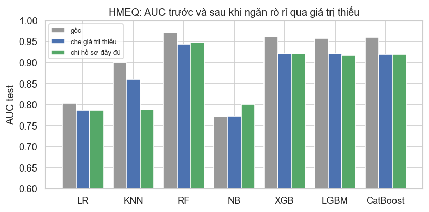

*Hình 4.13. AUC của HMEQ trước và sau khi ngăn rò rỉ*

| Mô hình | HMEQ gốc | Che giá trị thiếu | Chỉ hồ sơ đủ dữ liệu | Che − gốc |
|---|---|---|---|---|
| LR | 0,8030 | 0,7868 | 0,7864 | −0,016 |
| KNN | 0,8993 | 0,8598 | 0,7883 | −0,039 |
| RF | **0,9703** | **0,9436** | **0,9481** | −0,027 |
| NB | 0,7704 | 0,7716 | 0,8010 | +0,001 |
| XGB | 0,9615 | 0,9214 | 0,9213 | −0,040 |
| LGBM | 0,9573 | 0,9214 | 0,9177 | −0,036 |
| CatBoost | 0,9602 | 0,9196 | 0,9203 | −0,041 |

- **Rò rỉ làm AUC tuyệt đối của HMEQ cao hơn thực tế** khoảng 0,02 (LR) đến 0,04 (GBDT).
- Bản che giá trị thiếu chưa xóa hết dấu vết (dòng thiếu vẫn nhận ra được với AUC 0,907, vì giá trị rút ngẫu nhiên không khớp với các cột còn lại), nhưng dấu vết đó gần như không còn thông tin về nhãn: AUC của bản che và bản chỉ hồ sơ đủ dữ liệu — sạch tuyệt đối — gần như trùng nhau ở LR và cả bốn mô hình cây (chênh ≤ 0,005).
- **Lợi thế của mô hình cây trên HMEQ là thật**: sau khi ngăn rò rỉ, RF và GBDT vẫn hơn LR khoảng 0,13–0,16 AUC. Điều này khớp với phân tích ở mục 4.4: trên các hồ sơ đủ dữ liệu, RF đạt 0,972 so với 0,798 của LR.
- **Kết luận so sánh không đổi** khi thay HMEQ gốc bằng bản đã ngăn rò rỉ:

| Bộ dữ liệu dùng cho HMEQ | LR | KNN | RF | NB | XGB | LGBM | CatBoost | Iman–Davenport |
|---|---|---|---|---|---|---|---|---|
| Gốc | 4,14 | 6,57 | 3,29 | 6,00 | 3,57 | 2,86 | **1,57** | F = 11,74; p < 0,0001 |
| Che giá trị thiếu | 4,14 | 6,57 | 3,29 | 6,00 | 3,71 | 2,57 | **1,71** | F = 11,67; p < 0,0001 |
| Chỉ hồ sơ đủ dữ liệu | 4,29 | 6,71 | 3,29 | 5,71 | 3,57 | 2,86 | **1,57** | F = 11,29; p < 0,0001 |

(Hạng trung bình theo AUC trên 7 bộ dữ liệu; bảng đầy đủ: `reports/models/comparison_hmeq_blind/`, `reports/models/comparison_hmeq_complete/`.)

Hình 4.14 là biểu đồ critical difference khi dùng bản che giá trị thiếu của HMEQ. Thứ tự các mô hình giống hệt Hình 4.11: CatBoost, LightGBM, RF, XGBoost, LR, NB, KNN.

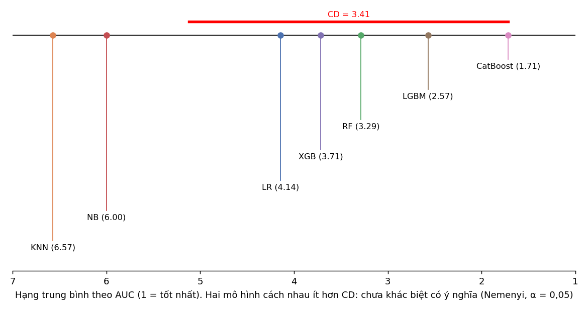

*Hình 4.14. Biểu đồ critical difference khi HMEQ dùng bản che giá trị thiếu (Nemenyi, α = 0,05)*

### Overfit

**Khoảng cách AUC train − test** được trình bày ở Hình 4.15. Ô càng đậm thì mô hình càng overfit: hàng của RF đậm ở hầu hết các bộ, cột South German đậm ở mọi mô hình, còn hàng của LR và NB gần như trắng.

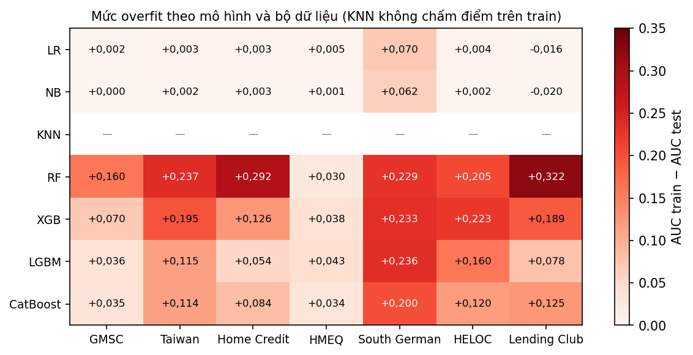

*Hình 4.15. Khoảng cách AUC train − AUC test theo mô hình và bộ dữ liệu*

(KNN không có AUC train; với Lending Club, AUC train lấy từ mô hình chỉ fit trên 2013.)

**Khoảng cách AUC validation − test:** |chênh| ≤ 0,007 ở mọi mô hình trên 5 bộ GMSC, Taiwan, Home Credit, HMEQ, HELOC (trừ NB trên HMEQ: 0,015); **South German +0,024 đến +0,056** ở mọi mô hình; Lending Club −0,015 đến −0,031.

**Khi nào và vì sao:**

1. **RF học thuộc mọi bộ** (AUC train = 1,000): cây mặc định phát triển hết độ sâu. Không gây hại ở GMSC, Taiwan, HMEQ (RF vẫn thuộc nhóm tốt nhất trên test), nhưng **gây hại** ở Home Credit, HELOC, Lending Club — các bộ nhiều đặc trưng, tín hiệu yếu và gần tuyến tính — nơi RF thua LR trên test.
2. **XGBoost là GBDT overfit nhiều nhất** (learning rate mặc định 0,3), giải thích vì sao XGBoost xếp sau cả RF.
3. **South German là bộ dễ overfit nhất**: mọi mô hình overfit, kể cả LR (+0,07 với 71 đặc trưng cho 640 dòng train); validation cao hơn test một cách hệ thống (160 dòng validation quá ít), nên mọi lựa chọn dựa trên validation — ngưỡng, và sau này là tham số — sẽ lạc quan; learning curve vẫn đi lên, tức bộ này thiếu dữ liệu.
4. **LR và NB không overfit** (khoảng cách ≤ 0,005) ngoài South German; giới hạn của chúng là độ đơn giản của mô hình.
5. **Lending Club**: test cao hơn validation khoảng 0,02 là do mô hình cuối được fit lại trên 2013–2014 (thêm dữ liệu), không phải overfit; rủi ro thực của bộ này là trôi dạt theo thời gian (mọi mô hình dự đoán thấp hơn tỷ lệ xấu 2015 khoảng 1,3–1,7 điểm %).

Chương này đã đánh giá bảy mô hình với tham số mặc định trên bảy bộ dữ liệu. CatBoost có hạng trung bình tốt nhất theo AUC, tiếp theo là LightGBM và Random Forest; bước cải thiện lớn nhất là từ mô hình tuyến tính sang mô hình cây, còn mức tăng từ Random Forest sang gradient boosting nhỏ hơn nhiều. Khác biệt giữa các mô hình có ý nghĩa theo kiểm định Friedman, nhưng với bảy bộ dữ liệu chỉ khẳng định được KNN và Naive Bayes kém CatBoost; Logistic Regression vẫn cạnh tranh ở các bộ có tín hiệu gần tuyến tính hoặc trôi dạt theo thời gian. Các kiểm tra cho thấy không có rò rỉ do pipeline hay do cách chia; rò rỉ qua giá trị thiếu ở HMEQ làm phóng đại mức AUC tuyệt đối nhưng không thay đổi thứ tự các mô hình. Chương 5 tổng kết các kết quả này, nêu giới hạn của đồ án và hướng phát triển.
