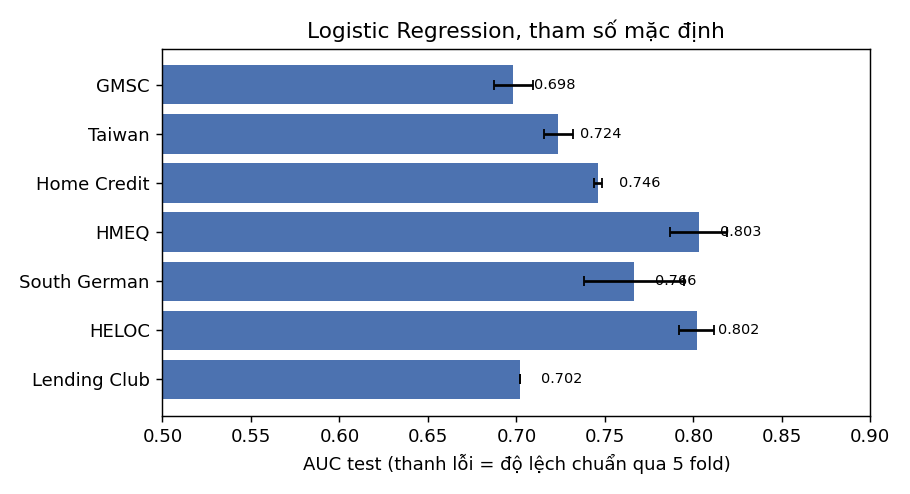
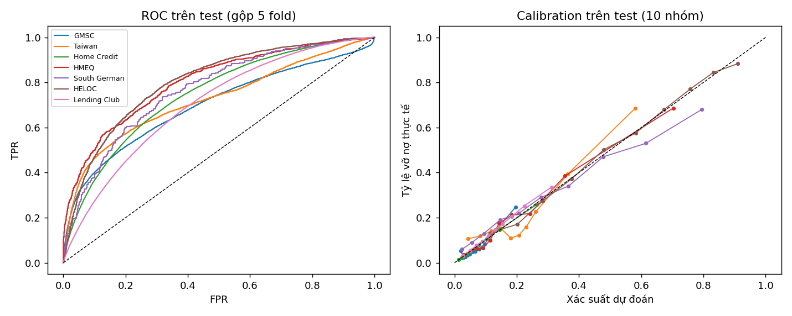

# Báo cáo — Logistic Regression, tham số mặc định

Mô hình cơ sở (baseline) đầu tiên theo giao thức Baesens et al. (2026), áp dụng cho 7 bộ dữ liệu.
Bảng số liệu đầy đủ: [`tables.md`](tables.md); số liệu gốc: `summary.csv`, `fold_metrics.csv`, `run.json`;
dự đoán từng dòng: `predictions/*.parquet`.

---

## 1. Cấu hình

| Mục | Giá trị |
|---|---|
| Mô hình | `LogisticRegression(max_iter=2000, random_state=42)` — mọi tham số khác để mặc định của scikit-learn 1.7: `C=1.0`, phạt L2, solver `lbfgs`, không `class_weight` |
| `max_iter` | Lấy theo khung code B.3 của `configs/preprocessing_v1.md`. Thực tế mọi lần fit hội tụ sau **≤ 89 vòng lặp** (< 100 là mặc định của scikit-learn), nên kết quả **trùng với `LogisticRegression()` mặc định hoàn toàn** |
| Tiền xử lý | Tầng A → chia dữ liệu → B.0 → B.1 nhánh *classic*: median + chuẩn hóa cho biến số; chuỗi → nhóm `__missing__` → one-hot cho biến phân loại. Mọi tham số fit trên train của từng fold |
| Không làm (đúng Baesens) | Không cắt ngoại lai, không cân bằng lớp, không FE, không cột đánh dấu thiếu |
| Tinh chỉnh | **Không** — đây là baseline tham số mặc định (bước Optuna 20 lần thử làm sau) |
| Ngưỡng cho độ đo theo ngưỡng | Ngưỡng tối đa F1 trên validation của từng fold, áp nguyên sang test |
| Đánh giá | 6 bộ: trung bình ± độ lệch chuẩn trên 5 fold test. Lending Club: fit lại trên train + validation (2013–2014), đánh giá trên test 2015, khoảng tin cậy bằng bootstrap 1.000 lần |

**Pipeline:** `python run_pipeline.py` (các bước `interim → splits → preprocess → train → report`);
chỉ huấn luyện và báo cáo: `python run_pipeline.py --only train report` (~1 phút).

---

## 2. Kết quả chính

| Dataset | Đánh giá | AUC | Gini | KS | Brier | LogLoss | AP |
|---|---|---|---|---|---|---|---|
| HMEQ | 5-fold CV | **0.8030 ± 0.0161** | 0.6061 ± 0.0322 | 0.4655 ± 0.0394 | 0.1196 ± 0.0071 | 0.3884 ± 0.0184 | 0.5919 ± 0.0182 |
| HELOC | 5-fold CV | **0.8019 ± 0.0098** | 0.6038 ± 0.0196 | 0.4736 ± 0.0194 | 0.1813 ± 0.0044 | 0.5442 ± 0.0101 | 0.7947 ± 0.0043 |
| South German | 5-fold CV | 0.7663 ± 0.0281 | 0.5327 ± 0.0562 | 0.4340 ± 0.0305 | 0.1716 ± 0.0131 | 0.5196 ± 0.0416 | 0.5983 ± 0.0445 |
| Home Credit | 5-fold CV | 0.7461 ± 0.0022 | 0.4922 ± 0.0044 | 0.3678 ± 0.0043 | 0.0687 ± 0.0010 | 0.2500 ± 0.0027 | 0.2225 ± 0.0044 |
| Taiwan | 5-fold CV | 0.7237 ± 0.0082 | 0.4473 ± 0.0165 | 0.3821 ± 0.0173 | 0.1449 ± 0.0038 | 0.4659 ± 0.0102 | 0.5043 ± 0.0094 |
| Lending Club | fit lại train+val | 0.7018 (95% CI 0.6992–0.7045) | 0.4037 | 0.2955 | 0.1185 | 0.3885 | 0.2800 |
| GMSC | 5-fold CV | **0.6981 ± 0.0110** | 0.3962 ± 0.0220 | 0.3196 ± 0.0221 | 0.0576 ± 0.0019 | 0.2253 ± 0.0065 | 0.2344 ± 0.0088 |

Brier và LogLoss **không so sánh được giữa các bộ** vì phụ thuộc tỷ lệ vỡ nợ (GMSC 6,7% có Brier thấp nhất nhưng AUC thấp nhất). AP cũng tăng theo tỷ lệ vỡ nợ (HELOC 52% → AP 0,79).

**Độ đo theo ngưỡng** (ngưỡng tối đa F1 trên validation):

| Dataset | Precision | Recall | F1 | Accuracy |
|---|---|---|---|---|
| HMEQ | 0.538 ± 0.023 | 0.543 ± 0.045 | 0.539 ± 0.018 | 0.815 ± 0.006 |
| HELOC | 0.694 ± 0.021 | 0.839 ± 0.016 | 0.759 ± 0.006 | 0.723 ± 0.017 |
| South German | 0.551 ± 0.041 | 0.588 ± 0.103 | 0.563 ± 0.034 | 0.729 ± 0.027 |
| Home Credit | 0.223 ± 0.014 | 0.426 ± 0.043 | 0.291 ± 0.002 | 0.833 ± 0.016 |
| Taiwan | 0.547 ± 0.043 | 0.477 ± 0.030 | 0.508 ± 0.008 | 0.795 ± 0.019 |
| Lending Club | 0.239 | 0.662 | 0.352 | 0.637 |
| GMSC | 0.306 ± 0.014 | 0.319 ± 0.013 | 0.312 ± 0.009 | 0.906 ± 0.004 |

Accuracy cao ở GMSC (0,906) và Home Credit (0,833) chỉ phản ánh mất cân bằng nhãn — đoán "tốt" cho mọi người đã được 93% và 92%.

---

## 3. Nhận xét

### 3.1 Khớp tốt, gần như không overfit — trừ South German

| Dataset | AUC train | AUC val | AUC test | Train − test |
|---|---|---|---|---|
| GMSC | 0.6997 | 0.6945 | 0.6981 | +0.002 |
| Taiwan | 0.7271 | 0.7233 | 0.7237 | +0.003 |
| Home Credit | 0.7495 | 0.7465 | 0.7461 | +0.003 |
| HMEQ | 0.8081 | 0.8054 | 0.8030 | +0.005 |
| **South German** | **0.8365** | 0.8228 | **0.7663** | **+0.070** |
| HELOC | 0.8059 | 0.8006 | 0.8019 | +0.004 |
| Lending Club | 0.6856 | 0.6827 | 0.7018 | −0.016 |

- LR là mô hình đơn giản nên với 6 bộ, train ≈ test: giới hạn hiệu năng đến từ **dạng quan hệ tuyến tính**, không phải overfit.
- **South German** là ngoại lệ: 71 feature (68 cột one-hot) cho 640 dòng train → overfit rõ (+0,07) và dao động giữa các fold lớn nhất (± 0,028; fold 1 là 0,734, fold 3 là 0,790). Đây là bộ hưởng lợi nhiều nhất khi tinh chỉnh `C` (phạt mạnh hơn).
- Lending Club có AUC test **cao hơn** train: không phải lỗi — mô hình cuối được fit trên 2013–2014 (262.992 dòng) thay vì chỉ 2013; bản chỉ fit trên 2013 cho AUC test 0,6936. Fit lại theo quy tắc 3 tăng AUC thêm **+0,008**.

### 3.2 GMSC thấp bất thường — do ngoại lai cực đoan, không phải do dữ liệu yếu

AUC 0,698 của GMSC **thấp hơn cả AUC đơn biến** của biến mạnh nhất (`RevolvingUtilizationOfUnsecuredLines`, 0,776 trong EDA). Nguyên nhân:

- Biến này lẽ ra nằm trong [0, 1] nhưng có giá trị tới ~50.000. Sau chuẩn hóa, độ lệch chuẩn bị ngoại lai kéo lên ~205, nên gần như mọi người vay dồn về một giá trị (~ −0,02). Hệ số LR của biến này ≈ **−0,015**: mô hình tuyến tính **không dùng được** biến mạnh nhất.
- Các cột đếm trễ hạn có mã 96/98 (giữ nguyên theo Baesens) làm ba cột này gần như cộng tuyến trên các dòng đó → hệ số trái dấu (−3,9 cho cột 60–89 ngày). Tuy nhiên bỏ 49 dòng có mã 96/98 khỏi test không cải thiện AUC (0,683 → 0,678), nên đây không phải nguyên nhân chính.

**Phân tích phụ** (fold 1, chạy thủ công, *không* thuộc pipeline chính vì Baesens không cắt ngoại lai): cắt mỗi biến số về phân vị 1%–99% **học trên train**, rồi chạy lại đúng pipeline B.1 + LR mặc định:

| Dataset | AUC test fold 1 (pipeline chuẩn) | AUC sau khi cắt 1%–99% | Chênh |
|---|---|---|---|
| **GMSC** | 0.6825 | **0.8517** | **+0.169** |
| Home Credit | 0.7497 | 0.7499 | +0.000 |
| Lending Club | 0.6937 | 0.6943 | +0.001 |

→ Với GMSC, gần như toàn bộ khoảng cách là do ngoại lai. Kết quả LR mặc định của GMSC vì vậy **đánh giá thấp** mô hình tuyến tính một cách nghiêm trọng; khi so với GBDT (vốn không nhạy với ngoại lai), cần nêu rõ điểm này để không kết luận sai rằng "GBDT tốt hơn LR 0,15 AUC nhờ phi tuyến". Home Credit và Lending Club, dù cũng có giá trị chuẩn hóa tới hàng trăm độ lệch chuẩn, không bị ảnh hưởng vì ngoại lai không nằm ở biến quan trọng.

### 3.3 Calibration

- **5 bộ CV** có xác suất dự đoán trung bình gần như bằng tỷ lệ vỡ nợ thực (chênh ≤ 0,6 điểm %), đúng kỳ vọng với LR không cân bằng lớp khi train và test cùng phân phối.
- **Lending Club** dự đoán thấp hơn thực tế: xác suất trung bình 13,5% so với tỷ lệ vỡ nợ 2015 là **14,9%** (mô hình fit trên 2013–2014 có tỷ lệ 13,1%). Đây là **trôi dạt theo thời gian** đã dự báo trong `preprocessing_v1.md` — mô hình tách hạng ổn nhưng cần hiệu chỉnh lại mức rủi ro khi áp dụng cho năm sau.
- **South German** quá tự tin ở nhóm rủi ro cao (dự đoán ~0,8 nhưng thực tế ~0,68) — hệ quả của overfit ở mục 3.1.
- **Taiwan** lệch ở vùng giữa (dự đoán 0,2–0,25 nhưng thực tế ~0,12): quan hệ không tuyến tính của các biến trạng thái thanh toán `PAY_*` (được giữ là biến số theo đặc tả) mà LR không nắm được.

### 3.4 Độ ổn định

- Độ lệch chuẩn AUC qua fold tỷ lệ nghịch với kích thước bộ: Home Credit ± 0,002 (307 nghìn dòng) → HMEQ ± 0,016 → South German ± 0,028 (1.000 dòng).
- Lending Club: khoảng tin cậy 95% bootstrap rất hẹp (± 0,0027) vì test lớn (282.787 dòng); độ bất định thật do chọn năm lớn hơn nhiều so với con số này.

---

## 4. Xếp hạng độ khó (theo AUC của LR mặc định)

| Mức | Bộ dữ liệu | Ghi chú |
|---|---|---|
| Dễ (AUC ≈ 0,80) | HMEQ, HELOC | HMEQ hưởng lợi từ việc thiếu dữ liệu mang thông tin (nhóm `__missing__` của `JOB`/`REASON`); HELOC có điểm rủi ro tổng hợp sẵn |
| Trung bình (0,72–0,77) | South German, Home Credit, Taiwan | South German bị giới hạn bởi kích thước; Taiwan bởi quan hệ phi tuyến của `PAY_*` |
| Khó (≈ 0,70) | Lending Club, GMSC | Lending Club: tín hiệu yếu thật (AUC đơn biến cao nhất ~0,68). GMSC: do ngoại lai, không phải tín hiệu yếu (mục 3.2) |

---

## 5. Giới hạn

1. Tham số mặc định, chưa tinh chỉnh — đặc biệt `C` với South German.
2. Không cắt ngoại lai theo đúng Baesens → LR của GMSC bị đánh giá thấp nghiêm trọng (mục 3.2).
3. Ngưỡng F1 của Lending Club lấy từ mô hình fit trên 2013 (validation 2014), áp cho mô hình fit lại trên 2013–2014, vì mô hình fit lại không còn validation.
4. Lending Club chỉ có một lần chia; khoảng tin cậy bootstrap chỉ phản ánh biến động mẫu test, không phản ánh biến động do chọn năm.
5. Kết quả áp dụng giao thức Baesens, không phải tái lập con số của paper (paper chỉ công bố AUC trung bình trên 14 bộ).

## 6. Bước tiếp theo

1. Tinh chỉnh LR bằng Optuna (20 lần thử/fold, tối đa AUC validation): `C`, loại phạt.
2. Các mô hình classic còn lại trên cùng ma trận `data/processed/classic`: RF, KNN, NB (và SVM nếu đủ thời gian).
3. Nhánh GBDT (`--family gbdt`, mã số nguyên) cho bước 2.
4. Kiểm định Friedman / Wilcoxon – Holm khi đã có nhiều mô hình; file `predictions/` đã sẵn cho việc này.
